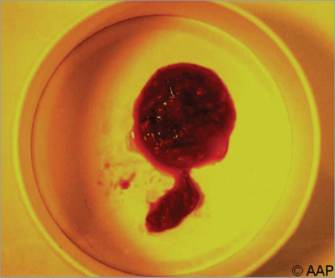
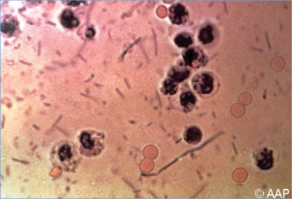
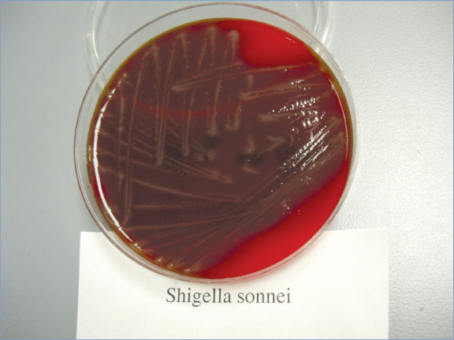
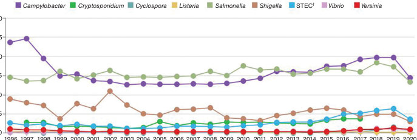

# 131. Shigella Infections
> Reference: [source credits](../../SOURCE_CREDITS.md). Printed pp. 805-809; PDF pp. 819-823.
> Editorial study pathway: Bacterial infections (not a part division in the source).
[Flashcards](../flashcards/131_flashcards.md) · [Quiz](../mcqs/131_mcqs.md) · [Full extraction](../../raw/chapters/131.md)

## Five study pillars

### Etiology and transmission
Shigella species are facultative anaerobic, gram-negative bacilli in the order Enterobacterales. Four species (with more than 40 serotypes) have been identified, with Shigella sonnei being the most common in the United States.
*Printed p. 805 / PDF p. 819*

### Clinical recognition
Shigella species primarily infect the large intestine, resulting in clinical manifestations that range from watery or loose stools with minimal or no constitutional symptoms to more severe symptoms, including high fever or hypothermia, abdominal cramps or tenderness, tenesmus, lethargy, and mucoid stools with or without blood. Infection with Shigella dysenteriae serotype 1 often results in a more severe illness than infection with other Shigella species, with a higher risk of complications, including septicemia, pseudomembranous colitis, toxic megacolon, intestinal perforation, hemolysis, and hemolytic uremic syndrome (HUS).
*Printed p. 805 / PDF p. 819*

### Diagnostic workup
Isolation of Shigella organisms from feces or rectal swab specimens containing feces is diagnostic; sensitivity is improved by testing stool as soon as possible after it is passed, along with the use of enrichment broth media and selective agar plate media. If specimens cannot be transported to the testing laboratory within 2 hours, they should be transferred to appropriate transport media (eg, Cary-Blair or similar media) and kept and transported at 4°C.
*Printed p. 806 / PDF p. 820*

### Treatment in the atlas
• Although severe dehydration is rare with shigellosis, correction of fluid and electrolyte losses, preferably by oral rehydration solutions, is the mainstay of treatment.
*Printed p. 806 / PDF p. 820*

### Prevention and infection control
In addition to standard precautions, contact precautions are indicated for the duration of illness.
*Printed p. 807 / PDF p. 821*

## Clinical search tags
Fever, Dysentery, Encephalitis / seizures, Arthritis / bone pain, Sepsis / shock, Anemia / hemolysis, Congenital / neonatal, Immunocompromised host, Travel / endemic setting

## Full text, original tables, and images

# 131. Shigella Infections
> Private study reference ([source credits](../../SOURCE_CREDITS.md)). PDF pages 819-823; printed pages 805-809.

## PDF page 819 | printed page 805

### CLINICAL MANIFESTATIONS

Shigella species primarily infect the large intestine, resulting in clinical manifestations that range from watery or loose stools with minimal or no constitutional symptoms to more severe symptoms, including high fever or hypothermia, abdominal cramps or tenderness, tenesmus, lethargy, and mucoid stools with or without blood. Infection with Shigella dysenteriae serotype 1 often results in a more severe illness than infection with other Shigella species, with a higher risk of complications, including septicemia, pseudomembranous colitis, toxic megacolon, intestinal perforation, hemolysis, and hemolytic uremic syndrome (HUS). Infections attributable to S dysenteriae serotype 1 have become less common but continue to be an important etiology of illness in lowresource settings. Generalized seizures have been reported among young children with shigellosis attributable to any serotype, although the pathophysiology and incidence are poorly understood. Seizures associated with shigellosis are self-limited and usually are associated with high fever or electrolyte abnormalities. Septicemia is rare during illness and is caused either by Shigella organisms or by translocation of gastrointestinal flora into the bloodstream through compromised intestinal mucosa. Septicemia occurs most often in neonates, malnourished children, and immunocompromised people with S dysenteriae serotype 1 infection but may occur in healthy children with non-S dysenteriae shigellosis. Septicemia presents a higher risk of death in those ill with shigellosis. Reactive arthritis with extra-articular manifestations is a rare complication that can develop weeks to months after shigellosis, especially in people expressing HLA-B27. Postinfectious irritable bowel syndrome can occur and may last for weeks to months.

### ETIOLOGY

Shigella species are facultative anaerobic, gram-negative bacilli in the order Enterobacterales. Four species (with more than 40 serotypes) have been identified, with Shigella sonnei being the most common in the United States. The other species are Shigella flexneri, S dysenteriae, and Shigella

boydii. In resource-limited settings, especially in Africa and Asia, S flexneri predominates, and S dysenteriae serotype 1 is associated with outbreaks. Shiga toxin, a potent cytotoxin produced by S dysenteriae serotype 1, enhances the virulence of this serotype at the colonic mucosa resulting in small blood vessel and renal damage, leading to HUS in some individuals. The Shiga toxin genes are phage encoded and have been found in a small number of strains belonging to other Shigella species and serotypes, including S flexneri serotype 2a, S dysenteriae serotype 4, and S sonnei. HUS has been associated with an infection attributable to S sonnei in an adult, although the non-S dysenteriae species are not commonly associated with HUS.

### EPIDEMIOLOGY

Humans are the primary reservoir of Shigella species, although nonhuman primates are also able to be infected. The primary mode of transmission is the fecal-oral route, and transmission can occur via contact with a contaminated inanimate object, ingestion of contaminated food or water, or sexual contact. Houseflies and cockroaches also may be vectors facilitating physical transport of feces with Shigella. It is very easy to transmit Shigella infection, because ingestion of very few organisms is sufficient for infection to occur. Prolonged organism survival in water (up to 6 months) and food (up to 30 days) can occur. Children 5 years or younger attending child care settings and their caregivers, as well as people living in crowded conditions, are at increased risk of infection. Men who have sex with men are also at increased risk of shigellosis and are particularly at risk for multidrug-resistant strains. Infections attributable to S flexneri, S boydii, and S dysenteriae are slightly more common among adults than among children. Travel to resource-limited settings with inadequate sanitation can place travelers at risk of infection. Even without antimicrobial therapy, the carrier state usually ceases within 1 to 4 weeks after onset of illness; long-term carriage is uncommon and does not correlate with underlying intestinal dysfunction.

Antibiotic resistance is increasing among Shigella isolates, especially among international travelers, men who have sex with men, people who lack housing, and people who are immunocompromised.

## PDF page 820 | printed page 806

During 2020, a year impacted by the COVID-19 pandemic, preliminary data suggest that 38% of Shigella isolates tested in the United States were resistant to ampicillin, 63% were resistant to trimethoprim-sulfamethoxazole, 13% were resistant to azithromycin, 50% were resistant to ciprofloxacin, and 13% were resistant to ceftriaxone.1 The Centers for Disease Control and Prevention (CDC) has been monitoring Shigella isolates that harbor 1 or more quinolone resistance mechanisms (ie, those with a minimum inhibitory concentration [MIC] of ≥0.12 mg/mL for ciprofloxacin) but that have in vitro susceptibility to fluoroquinolones (https://emergency.cdc.gov/han/han00411. asp). Additional data are needed to determine whether fluoroquinolone treatment outcomes and risk of illness transmission are impacted in patients with such isolates. Data from the National Antimicrobial Resistance Monitoring System indicate that many Shigella isolates with a quinolone resistance mechanism are nonsusceptible or resistant to many other commonly used first-line treatment agents. Since 2015, an increase in extensively drug-resistant (XDR) Shigella infections, defined as isolates resistant to azithromycin, ciprofloxacin, ceftriaxone, trimethoprim-sulfamethoxazole, and ampicillin, has been reported through national surveillance systems. In 2022, about 5% of Shigella infections reported to the CDC were caused by XDR strains, compared with 0% in 2015 (https://emergency. cdc.gov/han/2023/han00486.asp).

The incubation period varies from 1 to 7 days but typically is 1 to 3 days.

### DIAGNOSTIC TESTS

Isolation of Shigella organisms from feces or rectal swab specimens containing feces is diagnostic; sensitivity is improved by testing stool as soon as possible after it is passed, along with the use of enrichment broth media and selective agar plate media. If specimens cannot be transported to the testing laboratory within 2 hours, they should be transferred to appropriate transport media (eg, Cary-Blair or similar media) and kept and transported at 4°C. Definitive identification of the organism requires both biochemical profiling and serogrouping to differentiate Shigella from Escherichia. Identification by mass spectrometry of cellular components should not be used, because this method cannot distinguish between

the 2 genera. The presence of fecal lactoferrin demonstrated on a methylene blue-stained stool smear is sensitive for the diagnosis of colitis but is not specific for shigellosis. Although bacteremia is rare, children who are severely ill, immunocompromised, or malnourished should have a blood culture obtained. Multiplex polymerase chain reaction (PCR) platforms for detection of multiple bacterial (including Shigella), viral, and parasitic pathogens have high sensitivity but will not distinguish between viable and nonviable organisms or provide antimicrobial susceptibility results. To guide treatment, if needed, and to enable surveillance and outbreak detection, stool cultures are recommended if shigellosis is diagnosed using multiplex PCR platforms or other nonculturebased diagnostic tests. Other tests for bacterial detection, including qualitative and quantitative PCR assays, are available in research laboratories and some clinical laboratories. Isolates of Shigella species (or clinical specimens from positive nonculture diagnostic tests if reflex culturing is not possible) should be submitted as required to local or state public health laboratories.

### TREATMENT

• Although severe dehydration is rare with shigellosis, correction of fluid and electrolyte losses, preferably by oral rehydration solutions, is the mainstay of treatment.

• Most infections with S sonnei are self-limited (48 to 72 hours) and mild episodes do not require antimicrobial therapy.

• Antimicrobial treatment is recommended for patients with severe disease or with underlying immunosuppressive conditions; in these patients, empiric therapy should be given while awaiting culture and susceptibility results. Treatment is also indicated for symptomatic patients with culture-proven Shigella who require hospitalization, attend day care, live in institutions, or are involved in food handling. Available evidence suggests that antimicrobial therapy is somewhat effective in shortening duration of diarrhea and hastening eradication of organisms from feces; however, whether antimicrobial treatment reduces transmission is unclear.

• Antimicrobial susceptibility testing of clinical isolates is indicated to guide therapy because resistance to antimicrobial agents is common

## PDF page 821 | printed page 807

and increasing. Increasing antimicrobial resistance to azithromycin, ciprofloxacin, and ceftriaxone have been reported in the United States. For situations in which antibiotic treatment is indicated, oral administration is recommended, except for seriously ill patients, those with underlying immunodeficiencies, and patients who are unable to take oral medications. Firstline antibiotic therapy generally consists of one of the following antibiotics, guided by antimicrobial susceptibility testing:

8 Azithromycin for 3 days.

8 A fluoroquinolone (eg, ciprofloxacin) for 3 days. Fluoroquinolones should be avoided if the Shigella strain has an MIC of ≥0.12 mg/mL for ciprofloxacin, even if the laboratory indicates that the isolate is “susceptible,” until more is known about the clinical outcomes of ciprofloxacin treatment when MICs are ≥0.12 mg/mL.

8 Oral ampicillin or trimethoprim-sulfamethoxazole for 5 days are alternative options; amoxicillin is not effective because of its rapid absorption from the gastrointestinal tract.

8 Parenteral ceftriaxone for 2 to 5 days. Oral cephalosporins (eg, cefixime) are of unclear effectiveness.

8 Longer treatment durations may be indicated in patients with invasive infection such as septicemia.

• Antidiarrheal compounds that inhibit intestinal peristalsis are contraindicated, because they can prolong the clinical and bacteriologic course of disease and can increase the rate of complications.

• Nutritional supplementation, including vitamin A (200,000 IU) and zinc (elemental Zn, orally daily for 10–14 days, 10 mg/day for newborn infants to 6 months of age, and 20 mg/day for those older than 6 months), can be given to hasten clinical resolution in geographic areas where children are at risk of malnutrition.

### INFECTION PREVENTION AND CONTROL MEASURES IN HEALTH CARE SETTINGS

In addition to standard precautions, contact precautions are indicated for the duration of illness.

### CONTROL MEASURES

General Control Measures

Strict attention to hand hygiene is essential to limit spread. Other important control measures include improved sanitation, appropriately chlorinating water supplies, proper cooking and storage of food, excluding infected people such as food handlers and child care providers, safe diapering practices, and measures to decrease contamination of food and surfaces by houseflies. People should refrain from recreational water venues (eg, swimming pools, water parks) while they have diarrhea; for children who are incontinent, recreational water activities should be avoided for 1 additional week (or as advised by local public health authorities). Sexually active people should avoid engaging in sexual activity for at least 1 week (ideally 2 weeks) after resolution of diarrhea. Breastfeeding provides some protection for infants.

Child Care Centers

General measures for interrupting enteric transmission in child care centers are recommended. Meticulous hand hygiene is the single most important measure to decrease transmission. Waterless hand sanitizers may be effective when access to soap or clean water is limited. Eliminating access to shared water-play areas and contaminated diapers also can limit disease spread. Child care staff members should follow all standard infection control recommendations, specifically enhancing hand hygiene and ensuring that those who change diapers are not responsible for food preparation. When Shigella infection is identified in a child care attendee or staff member, stool specimens from symptomatic attendees and staff members should be obtained.

Following this, children may return to child care facilities if stools are contained in the diaper or when toilet-trained children are continent and when stool frequency becomes no more than 2 stools above that child’s normal baseline, even if the stools remain loose.

Institutional Outbreaks

Shigella outbreaks that are most difficult to control are those that involve children who are not yet or only recently toilet-trained, adults who

## PDF page 822 | printed page 808

are unable to care for themselves (eg, cognitively impaired people and skilled nursing facility residents), or those that occur in areas with an inadequate supply of chlorinated water. A strong emphasis on hand hygiene, infection control, and appropriate antimicrobial therapy is needed to control disease transmission. In residential institutions, ill people should be cohorted in separate areas from those who are not ill to reduce disease spread.

Public Health Reporting

Shigella infections are generally a reportable disease to state or local public health authorities. A directory of state and territorial, city and county, and tribal health departments can be found at

Image 131.1 Characteristic bloody mucoid stool of a child with shigellosis.

Image 131.2 Fecal leukocytes, possibly shigellosis (methylene blue stain). The presence of fecal leukocytes suggests a bacterial diarrhea, although nonspecific for Shigella infection. Courtesy of Edgar O. Ledbetter, MD, FAAP.

www.cdc.gov/publichealthgateway/ healthdirectories/index.html. At the time of notification, the local health department can assist with additional case finding and management of a possible outbreak. Infected people should be excluded from the child care facility until the state or local health department approves return per state or local child care exclusion regulations. Case reporting to appropriate health authorities (eg, hospital infection control personnel and public health departments) is essential to optimize adherence to inclusion and exclusion policies.

1 Centers for Disease Control and Prevention. National Antimicrobial Resistance Monitoring System (NARMS) now: human data. Centers for Disease Control and Prevention; November 2021. Available at: www.cdc.gov/narmsnow

## PDF page 823 | printed page 809

Image 131.3 Culture of Shigella sonnei grown on a blood agar plate. Courtesy of Rita Yee, MT(ASCP) SM.

Incidence per 100,000 population - FoodNet sites

Campylobacter

Cryptosporidium Cyclospora Listeria

30

Incidence per 100,000 population

25

20

15

10

5

0 1996

1997 1998 1999 2000 2001 2002 2003 2004 2005 2006 2007 2008 2009 2010 2011 2012 2013 2014 2015 2016 2017 2018 2019 2020

†Shiga toxin-producing Escherichia coli

Image 131.4 Foodborne diseases, infections by year. Courtesy of Centers for Disease Control and Prevention.

Salmonella Shigella Vibrio Yersinia STEC†

