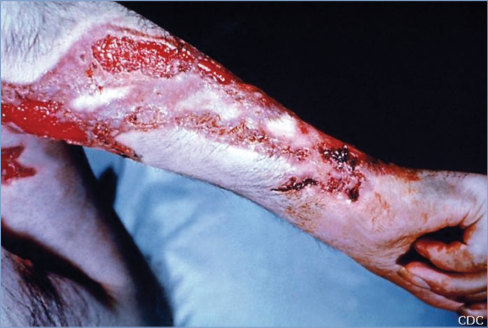
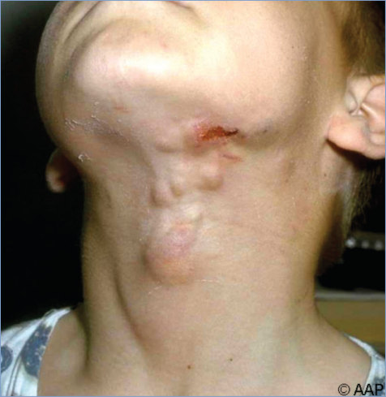
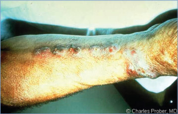
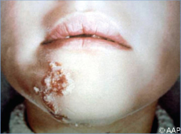
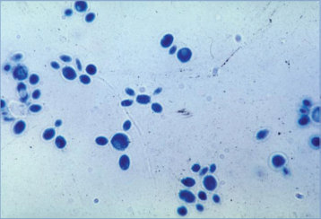
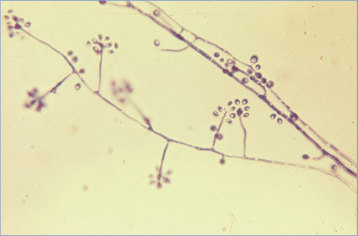
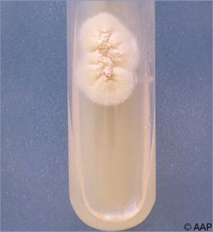

# 133. Sporotrichosis
> Reference: [source credits](../../SOURCE_CREDITS.md). Printed pp. 819-823; PDF pp. 833-837.
> Editorial study pathway: Fungal infections (not a part division in the source).
[Flashcards](../flashcards/133_flashcards.md) · [Quiz](../mcqs/133_mcqs.md) · [Full extraction](../../raw/chapters/133.md)

## Five study pillars

### Etiology and transmission
Sporothrix schenckii is a thermally dimorphic fungus that grows as a mold or mycelial form at room temperature and as a budding yeast at 35°C to 37°C and in host tissues. S schenckii is a complex of at least 6 species.
*Printed p. 819 / PDF p. 833*

### Clinical recognition
Three cutaneous patterns are described for sporotrichosis. The classic lymphocutaneous process with multiple nodules is seen more commonly in adults.
*Printed p. 819 / PDF p. 833*

### Diagnostic workup
Culture of Sporothrix species from a tissue, wound drainage, or sputum specimen is diagnostic. The mold phase of the organism can be isolated on a variety of fungal media, including Sabouraud dextrose agar at 25°C to 30°C.
*Printed p. 819 / PDF p. 833*

### Treatment in the atlas
Sporotrichosis usually does not resolve without treatment. Itraconazole is the drug of choice for children with lymphocutaneous and localized cutaneous disease.
*Printed p. 820 / PDF p. 834*

### Prevention and infection control
Use of protective gloves and clothing for occupational and recreational activities that could lead to exposure to S schenckii can decrease risk of disease. Interaction with stray cats should be minimized in areas where S brasiliensis is endemic or hyperendemic; gloves, clothing, and face shields should be used in these locales if handling a cat with suspected sporotrichosis.
*Printed p. 820 / PDF p. 834*

## Clinical search tags
Ulcers / eschar, Immunocompromised host, Animal exposure, Travel / endemic setting

## Full text, original tables, and images

# 133. Sporotrichosis
> Private study reference ([source credits](../../SOURCE_CREDITS.md)). PDF pages 833-837; printed pages 819-823.

## PDF page 833 | printed page 819

### CLINICAL MANIFESTATIONS

Three cutaneous patterns are described for sporotrichosis. The classic lymphocutaneous process with multiple nodules is seen more commonly in adults. Inoculation occurs at a site of minor trauma, causing a painless papule that enlarges slowly to become a firm, slightly tender, subcutaneous nodule that can develop a violaceous hue or ulcerate. Secondary lesions follow the same evolution and develop along the lymphatic distribution proximal to the initial lesion. A localized cutaneous form of sporotrichosis, also called the fixed cutaneous form, is seen more commonly in children and presents as a solitary crusted papule or papuloulcerative or nodular lesion in which lymphatic spread is not observed. The extremities and face are the most common sites of infection. A disseminated cutaneous form with multiple lesions is rare, usually occurring in immunocompromised patients.

Extracutaneous sporotrichosis accounts for 20% of all cases and usually occurs in the setting of unusual areas of trauma or in immunocompromised patients. Osteoarticular infection results from hematogenous spread or local inoculation. The most commonly affected joints are the knees, elbows, wrists, and ankles. Pulmonary sporotrichosis clinically resembles tuberculosis and occurs after inhalation or aspiration of aerosolized conidia. Disseminated disease generally occurs after hematogenous spread from primary skin or lung infection. Disseminated sporotrichosis can involve multiple foci (eg, eyes, pericardium, genitourinary tract, central nervous system) and occurs predominantly in immunocompromised patients. Pulmonary and disseminated forms of sporotrichosis are uncommon in children.

### ETIOLOGY

Sporothrix schenckii is a thermally dimorphic fungus that grows as a mold or mycelial form at room temperature and as a budding yeast at 35°C to 37°C and in host tissues. S schenckii is a complex of at least 6 species. Within this complex, S schenckii sensu stricto is responsible for most infections, followed by Sporothrix globosa; in South America, Sporothrix brasiliensis is a major cause of infection.

### EPIDEMIOLOGY

S schenckii is a ubiquitous organism that has worldwide distribution but is most common in tropical and subtropical regions of Central and South America and parts of North America and Asia. The fungus has been isolated from soil and plant material, including hay, straw, sphagnum moss, and decaying vegetation. Thorny plants such as rosebushes and pine trees commonly are implicated, because pricks from their thorns or needles inoculate the organism from the soil or moss around the bush or tree. S brasiliensis is responsible for hyperendemic cutaneous sporotrichosis in Rio de Janeiro. Primarily zoonotic, it is transmitted by direct inoculation through bites or scratches or mucosal exposure to secretions from infected cats.

The incubation period is 7 to 30 days after cutaneous inoculation but can be as long as 6 months.

### DIAGNOSTIC TESTS

Culture of Sporothrix species from a tissue, wound drainage, or sputum specimen is diagnostic. The mold phase of the organism can be isolated on a variety of fungal media, including Sabouraud dextrose agar at 25°C to 30°C. Filamentous colonies generally appear within 1 week. Definitive identification requires conversion to the yeast phase by subculture to enriched media, such as brain-heart infusion agar with 5% blood and incubation at 35°C to 37°C. In some cases, repeated subcultures are required for conversion. Culture of Sporothrix species from a blood specimen is definite evidence for disseminated infection, which is associated with immunodeficiency. Histopathologic examination of tissue often is not helpful, because the organism is seldom abundant, but may be useful to exclude clinically similar infections such as cutaneous leishmaniasis. Fungal stains including periodic acid-Schiff or Gomori methenamine silver to visualize this distinctive oval or cigarshaped organism are required. Antibody tests offered by some reference laboratories have been useful in a few cases of extracutaneous sporotrichosis. Molecular testing on tissue samples is available only in a few reference laboratories and is not standardized.

## PDF page 834 | printed page 820

### TREATMENT1,2

Sporotrichosis usually does not resolve without treatment. Itraconazole is the drug of choice for children with lymphocutaneous and localized cutaneous disease. Duration of therapy is 2 to 4 weeks after all lesions have resolved, usually for a total duration of 3 to 6 months. Serum trough concentrations of itraconazole should be 1 to 2 μg/mL. A trough level should be checked 10 days or later following initiation to ensure adequate drug exposure. When measured by high-pressure liquid chromatography, both itraconazole and its bioactive hydroxyitraconazole metabolite are reported, the sum of which should be considered in assessing the trough concentration. The itraconazole oral solution formulation is preferred over the capsule formulation because of improved absorption and should be taken on an empty stomach. However, a super bioavailable itraconazole is now approved by the U.S. Food and Drug Administration for the treatment of pulmonary and extrapulmonary blastomycosis in individuals 18 years or older, with pharmacokinetic studies of this formulation demonstrating less variable absorption than conventional itraconazole capsules and a similar side effect profile; data in children are lacking. Saturated solution of potassium iodide (1 drop taken orally, 3 times daily, increasing as tolerated to a maximum of 1 drop/kg of body weight or 40 to 50 drops, 3 times daily, whichever is lowest) is an alternative therapy for nonsevere forms.

Amphotericin B, preferably as a lipid formulation, is recommended as initial therapy for visceral or disseminated sporotrichosis in children. After clinical response to amphotericin B therapy is documented, itraconazole can be substituted and

should be continued for at least 12 months. Itraconazole may be required for lifelong therapy in children with HIV infection. Pulmonary and disseminated infections respond less well than cutaneous infection, despite prolonged therapy.

Local hyperthermia can be effective in treating cutaneous lesions, as S schenckii growth is impaired when temperatures exceed 42°C. Hyperthermia may be considered especially when patients cannot take recommended drugs safely (eg, pregnancy) but may not be well tolerated by young children.

### INFECTION PREVENTION AND CONTROL MEASURES IN HEALTH CARE SETTINGS

Standard precautions are indicated.

### CONTROL MEASURES

Use of protective gloves and clothing for occupational and recreational activities that could lead to exposure to S schenckii can decrease risk of disease. Interaction with stray cats should be minimized in areas where S brasiliensis is endemic or hyperendemic; gloves, clothing, and face shields should be used in these locales if handling a cat with suspected sporotrichosis.

1 Kauffman CA, Bustamante B, Chapman SW, Pappas PG;

Infectious Diseases Society of America. Clinical practice guidelines for the management of sporotrichosis: 2007 update by the Infectious Diseases Society of America. Clin Infect Dis. 2007;45(10):1255–1265 2 Thompson GR III, Le T, Chindamporn A, et al. Global guideline for the diagnosis and management of the endemic mycoses: an initiative of the European Confederation of Medical Mycology in cooperation with the International Society for Human and Animal Mycology. Lancet Infect Dis. 2021;21(12): e364–e374

## PDF page 835 | printed page 821

Image 133.1 This patient’s arm shows the effects of the fungal disease sporotrichosis, caused by the fungus Sporothrix schenckii. Courtesy of Centers for Disease Control and Prevention.

Image 133.2 Sporothrix schenckii was cultured from the biopsy specimen from an abscessed cervical lymph node of this 10-year-old boy. Test results were negative on stained smears of purulent material aspirated from a cervical lymph node.

## PDF page 836 | printed page 822

Image 133.3 The cervical lesions of a younger sister of the patient in Image 133.2 also responded to an oral-saturated solution of potassium iodide. There was no evidence of systemic sporotrichosis in these 3 siblings. The origin of their infections was not determined.

Image 133.5 Cutaneous sporotrichosis of the face in a preschool-aged child. Courtesy of Edgar O. Ledbetter, MD, FAAP.

Image 133.4 Linear lymphadenitis secondary to sporotrichosis infection of the foot and foreleg. Copyright Charles Prober, MD.

Image 133.6 This micrograph is taken from a slant culture of Sporothrix schenckii during its yeast phase. Courtesy of Centers for Disease Control and Prevention.

Image 133.7 Sporothrix schenckii, mold phase (48-hour potato dextrose agar, lactophenol cotton blue preparation); small tear-shaped conidia forming rosette-like clusters. Courtesy of Centers for Disease Control and Prevention.

## PDF page 837 | printed page 823

Image 133.8 Sporothrix schenckii on Sabouraud agar slant (specimen from the patient in Image 133.2).

Image 133.9 This is an image of a Sabhi agar plate culture of Sporothrix schenckii grown at 20°C (68°F). S schenckii is the causative agent for the fungal infection sporotrichosis, also known as rose handler’s disease, which affects individuals who handle thorny plants, sphagnum moss, or baled hay. Courtesy of Centers for Disease Control and Prevention.

