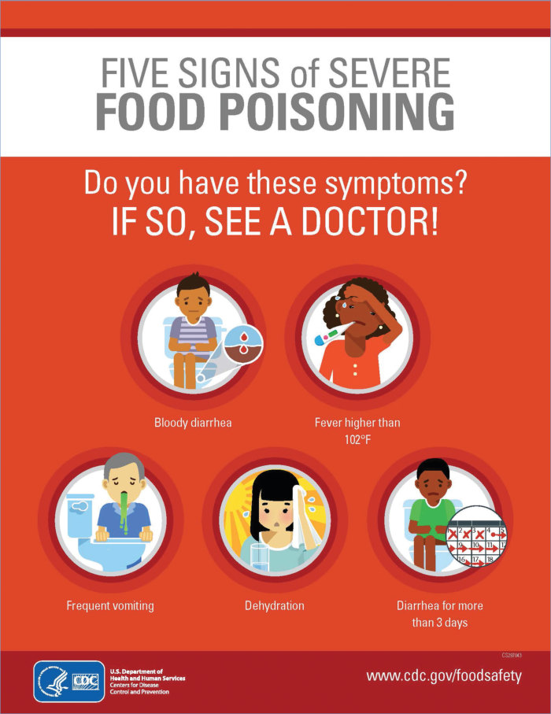

# 134. Staphylococcal Food Poisoning
> Reference: [source credits](../../SOURCE_CREDITS.md). Printed pp. 824-825; PDF pp. 838-839.
> Editorial study pathway: Bacterial infections (not a part division in the source).
[Flashcards](../flashcards/134_flashcards.md) · [Quiz](../mcqs/134_mcqs.md) · [Full extraction](../../raw/chapters/134.md)

## Five study pillars

### Etiology and transmission
Enterotoxins produced by strains of Staphylococcus aureus and, rarely, Staphylococcus epidermidis and Staphylococcus intermedius cause the symptoms of staphylococcal food poisoning. More than 20 such enterotoxins have been identified.
*Printed p. 824 / PDF p. 838*

### Clinical recognition
Staphylococcal foodborne illness is characterized by abrupt and sometimes violent onset of severe nausea, abdominal cramps, vomiting, and prostration, often accompanied by diarrhea. Low-grade fever or mild hypothermia can occur.
*Printed p. 824 / PDF p. 838*

### Diagnostic workup
In most cases, given the short duration of illness and rapid recovery with supportive care, diagnostic testing to confirm the diagnosis is not necessary. However, tests for enterotoxin are commercially available.
*Printed p. 824 / PDF p. 838*

### Treatment in the atlas
Antimicrobial agents are not indicated.
*Printed p. 824 / PDF p. 838*

### Prevention and infection control
Staphylococcal food poisoning is not spread from person to person. Standard precautions are recommended.
*Printed p. 824 / PDF p. 838*

## Clinical search tags
Fever, Diarrhea, Vomiting

## Full text, original tables, and images

# 134. Staphylococcal Food Poisoning
> Private study reference ([source credits](../../SOURCE_CREDITS.md)). PDF pages 838-839; printed pages 824-825.

## PDF page 838 | printed page 824

### CLINICAL MANIFESTATIONS

Staphylococcal foodborne illness is characterized by abrupt and sometimes violent onset of severe nausea, abdominal cramps, vomiting, and prostration, often accompanied by diarrhea. Low-grade fever or mild hypothermia can occur. The illness typically lasts no longer than 1 day, but symptoms are intense and can require hospitalization. The short incubation period, brevity of illness, and usual lack of fever help distinguish staphylococcal from other infectious causes of food poisoning, with the exception of the vomiting syndrome caused by Bacillus cereus. Clostridium perfringens food poisoning usually has a longer incubation period, and chemical food poisoning usually has a shorter incubation period. Patients with foodborne Salmonella, Campylobacter, or Shigella infection are more likely to have fever and a longer incubation period.

### ETIOLOGY

Enterotoxins produced by strains of Staphylococcus aureus and, rarely, Staphylococcus epidermidis and Staphylococcus intermedius cause the symptoms of staphylococcal food poisoning. More than 20 such enterotoxins have been identified. These are stable in the face of many environmental conditions (freezing, drying, heat treatment, low pH) and resistant to intestinal tract proteolysis. The degree and type of symptoms may vary by toxin type and dose.

### EPIDEMIOLOGY

Illness is caused by ingestion of food containing staphylococcal enterotoxins. The most commonly implicated foods are meats, most often pork (including sliced ham) and poultry served after inadequate heating. Food handlers may contaminate foods with enterotoxigenic strains of S aureus. When contaminated food remains at room temperature for several hours, the staphylococcal organisms multiply and produce toxins that are heat-stable (ie, not inactivated by reheating). The number of reported outbreaks caused by S aureus decreased in the 2000s. Possible reasons include less contamination of raw meat, improved food handling practices, and fewer investigations because of resource constraints.

The incubation period is typically 2 to 4 hours (range, 30 minutes to 8 hours) after ingestion.

### DIAGNOSTIC TESTS

In most cases, given the short duration of illness and rapid recovery with supportive care, diagnostic testing to confirm the diagnosis is not necessary. However, tests for enterotoxin are commercially available. In an outbreak, recovery of large numbers of staphylococci (≥105 S aureus organisms/g) from stool or vomitus or detection of enterotoxin in an implicated food can confirm the diagnosis, as can identification of the same subtype of S aureus from the stool or vomitus of 2 or more ill people. Guidance for confirming outbreaks of staphylococcal food poisoning can be found online (www.cdc.gov/foodsafety/outbreaks/ investigating-outbreaks/confirming_diagnosis. html). To aid in outbreak investigations, public health laboratories can determine whether strains are similar by using molecular methods. Local public health authorities should be notified about possible outbreaks because they can often determine the source and institute control measures to prevent similar outbreaks.

### TREATMENT

Treatment is supportive. Antimicrobial agents are not indicated.

### INFECTION PREVENTION AND CONTROL MEASURES IN HEALTH CARE SETTINGS

Staphylococcal food poisoning is not spread from person to person. Standard precautions are recommended.

### CONTROL MEASURES

Strict hand hygiene should be enforced for all food handlers. People with boils, abscesses, or other purulent lesions that could be from staphylococcal skin infection should be especially careful to wash hands thoroughly and use gloves or other protective equipment while handling food. Prepared foods should be refrigerated in wide, shallow containers within 2 hours after cooking (within 1 hour if the ambient temperature is higher than 90°F). Information on good food handling practices, including time and temperature recommendations for cooking, storage, and reheating, is available online (www.foodsafety.gov).

## PDF page 839 | printed page 825

Image 134.1 Staph food poisoning is a gastrointestinal illness caused by eating foods contaminated with toxins produced by the bacterium Staphylococcus aureus (Staph) bacteria. Courtesy of Centers for Disease Control and Prevention.

