# 137. Group A Streptococcal Infections
> Reference: [source credits](../../SOURCE_CREDITS.md). Printed pp. 847-862; PDF pp. 861-876.
> Editorial study pathway: Bacterial infections (not a part division in the source).
[Flashcards](../flashcards/137_flashcards.md) · [Quiz](../mcqs/137_mcqs.md) · [Full extraction](../../raw/chapters/137.md)

## Five study pillars

### Etiology and transmission
More than 240 distinct serotypes or genotypes of group A streptococci (Streptococcus pyogenes) have been identified based on M protein serotype or M protein gene sequence (emm types). In general, emm typing is more discriminating than M protein serotyping.
*Printed p. 847 / PDF p. 861*

### Clinical recognition
The most common group A streptococcal (GAS) infection is acute pharyngotonsillitis (pharyngitis), which manifests as sore throat with tonsillar inflammation and often tender anterior cervical lymphadenopathy, palatal petechiae, or a strawberry tongue. Purulent complications of pharyngitis include peritonsillar or retropharyngeal abscesses, suppurative cervical adenitis, and rarely, sinusitis and otitis media.
*Printed p. 847 / PDF p. 861*

### Diagnostic workup
Testing for Group A Streptococci in Pharyngitis Children with acute onset of sore throat and clinical signs and symptoms such as pharyngeal exudate, enlarged tonsils, pain on swallowing, fever, and enlarged tender anterior cervical nodes are more likely to have GAS infection and should be tested. Children with pharyngitis and obvious viral features (eg, rhinorrhea, cough, hoarseness, oral ulcers) should not be tested or treated for GAS infection.
*Printed p. 849 / PDF p. 863*

### Treatment in the atlas
S pyogenes is uniformly susceptible to all b-lactam antibiotics (penicillins and cephalosporins); thus, susceptibility testing is needed only for non– b-lactam agents, such as a macrolide or clindamycin, to which some strains of S pyogenes are resistant.
*Printed p. 851 / PDF p. 865*

### Prevention and infection control
In addition to standard precautions, droplet precautions are recommended for those with GAS pharyngitis or pneumonia until 24 hours after initiation of appropriate antimicrobial therapy. For burns with secondary GAS infection and extensive or draining cutaneous infections that cannot be covered or contained adequately by dressings, contact precautions should be used until at least 24 hours after initiation of appropriate therapy.
*Printed p. 856 / PDF p. 870*

## Clinical search tags
Fever, Petechiae / purpura, Lymphadenopathy, Pharyngitis, Pneumonia, Arthritis / bone pain, Abscess / soft tissue, Sepsis / shock, Congenital / neonatal, Travel / endemic setting

## Full text, original tables, and images

# 137. Group A Streptococcal Infections
> Private study reference ([source credits](../../SOURCE_CREDITS.md)). PDF pages 861-876; printed pages 847-862.

## PDF page 861 | printed page 847

### CLINICAL MANIFESTATIONS

The most common group A streptococcal (GAS) infection is acute pharyngotonsillitis (pharyngitis), which manifests as sore throat with tonsillar inflammation and often tender anterior cervical lymphadenopathy, palatal petechiae, or a strawberry tongue. Purulent complications of pharyngitis include peritonsillar or retropharyngeal abscesses, suppurative cervical adenitis, and rarely, sinusitis and otitis media. Nonsuppurative complications include acute rheumatic fever (ARF) and acute glomerulonephritis (AGN). The goals of antimicrobial therapy for GAS pharyngitis are to reduce acute morbidity, suppurative and nonsuppurative (ARF) complications, and transmission to close contacts. There is insufficient evidence to determine effectiveness of antimicrobials to prevent AGN after pyoderma or pharyngitis.

Scarlet fever occurs most often with pharyngitis and, rarely, with pyoderma or an infected wound. Scarlet fever involves a characteristic confluent erythematous sandpaper-like rash caused by one or more GAS erythrogenic exotoxins. Other than rash, the epidemiologic features, symptoms, signs, sequelae, and treatment of scarlet fever are the same as those of streptococcal pharyngitis.

Acute streptococcal pharyngitis is uncommon in children younger than 3 years. Instead, they may present with rhinitis and a more protracted illness with moderate fever, irritability, and anorexia (streptococcal fever or streptococcosis).

The second most common site of GAS infection is the skin. Streptococcal skin infections (eg, pyoderma or impetigo) can be followed by AGN, occasionally in epidemics. Historically, GAS skin infection has not been proven to lead to ARF; however, emerging evidence from Australia and New Zealand support that ARF can be a complication of GAS skin infection.

Other GAS infections include erysipelas, cellulitis (including perianal), vaginitis, bacteremia, sepsis, pneumonia, endocarditis, pericarditis, septic arthritis, necrotizing fasciitis, purpura fulminans, osteomyelitis, myositis, puerperal sepsis, surgical

wound infection, mastoiditis, and neonatal omphalitis. Invasive GAS infections often encompass bacteremia with or without a specific focus of infection and can present as streptococcal toxic shock syndrome (STSS), sepsis, or necrotizing fasciitis. Necrotizing fasciitis can follow minor or unrecognized trauma and uncommonly pharyngitis, often involves an extremity, and manifests as pain out of proportion to examination findings.

STSS is caused by infection with a toxin-producing GAS strain, manifesting as a severe acute illness, which usually has rapid onset. The case definition of STSS (see Table 137.1) requires detection of the GAS organism in a patient with rapid onset of hypotension and signs of multiorgan involvement characterized by 2 or more of the following: acute kidney injury, coagulopathy, liver involvement, acute respiratory distress syndrome, generalized erythematous macular rash, or soft-tissue necrosis. Local soft-tissue infection (eg, cellulitis, myositis, or necrotizing fasciitis) associated with severe, rapidly increasing pain is common, although STSS can occur without an identifiable focus of infection.

An association between GAS infection and sudden onset of obsessive-compulsive behavior, tic disorders, or other unexplained acute neurologic changes—called pediatric autoimmune neuropsychiatric disorders associated with streptococcal infections (PANDAS)—has been proposed. The American Academy of Pediatrics is reviewing PANDAS; it will not be covered in this chapter.

### ETIOLOGY

More than 240 distinct serotypes or genotypes of group A streptococci (Streptococcus pyogenes) have been identified based on M protein serotype or M protein gene sequence (emm types). In general, emm typing is more discriminating than M protein serotyping. Epidemiologic studies indicate an association between certain emm types (eg, types 1, 3, 5, 6, 14, 18, 19, and 24) and rheumatic fever, but a specific rheumatogenic factor remains unidentified. Several emm types (eg, types 2, 49, 55, 57, 59, 60, and 61) are more commonly associated with pyoderma and AGN. Other serotypes (eg, types 1, 6, and 12) are associated with pharyngitis and AGN. Although many emm types can cause STSS, most cases are caused by emm 1 and emm 3 strains producing at least 1 pyrogenic

## PDF page 862 | printed page 848

Table 137.1 Streptococcal Toxic Shock Syndrome: Clinical Case Definitiona

I. Isolation of group A Streptococcus (Streptococcus pyogenes) A. From a normally sterile site (eg, blood, cerebrospinal, peritoneal, joint, pleural, or pericardial fluid) B. From a nonsterile site (eg, throat, sputum, vagina, open surgical wound, or superficial skin lesion)

II. Clinical signs of severity A. Hypotension: systolic pressure 90 mm Hg or less in adults or lower than the fifth percentile for age in children <16 years of age

AND

B. Two or more of the following signs of multiorgan involvement: • Renal impairment: creatinine concentration 177 μmol/L (2 mg/dL) or greater for adults or at least 2 times the upper limit of normal for ageb

• Coagulopathy: platelet count 100,000/mm3 or less and/or disseminated intravascular coagulation defined by prolonged clotting times, low fibrinogen, and presence of fibrin degradation products • Hepatic involvement: elevated alanine aminotransferase, aspartate aminotransferase, or total bilirubin concentrations at least 2 times the upper limit of normal for ageb

• Acute respiratory distress syndrome defined by acute onset of diffuse pulmonary infiltrates and hypoxemia in absence of cardiac failure or by evidence of diffuse capillary leak • A generalized erythematous macular rash that may desquamate • Soft-tissue necrosis, including necrotizing fasciitis or myositis, or gangrene

Adapted from the 2010 Case Definition from the Council of State and Territorial Epidemiologists (https://ndc.services.cdc.gov/case-definitions/streptococcaltoxic-shock-syndrome-2010/) and from The Working Group on Severe Streptococcal Infections. Defining the group A streptococcal toxic shock syndrome: rationale and consensus definition. JAMA. 1993;269(3):390–391.

a An illness fulfilling criteria IA and IIA and IIB can be defined as a confirmed case. An illness fulfilling criteria IB and IIA and IIB can be defined as a probable case if no other cause for the illness is identified. Manifestations need not be detected within the first 48 hours of illness or hospitalization. b In patients with preexisting renal or hepatic disease, concentrations twofold or greater over patient’s baseline.

exotoxin, most commonly streptococcal pyrogenic exotoxin A (speA). These toxins are superantigens, stimulating production of tumor necrosis factor and other inflammatory mediators causing capillary leak and other physiologic changes including hypotension and multiorgan damage. In the United Kingdom, an increase in scarlet fever cases since 2016 has been associated with a new strain of emm1 (M1UK lineage).

### EPIDEMIOLOGY

Pharyngitis usually results from respiratory droplet transmission but can also occur through contact with respiratory secretions or wound discharge from an infected person. Although environmental transmission via surfaces and fomites was historically not believed to occur, evidence from outbreak investigations indicates that environmental transmission of GAS can occur. Household pets, such as dogs, are not vectors. Pharyngitis and impetigo (and their nonsuppurative complications) can be associated with crowding and often are present in socioeconomically disadvantaged populations. Close contact in schools, child care centers, contact sports (eg, wrestling), boarding

schools, and military installations facilitates transmission. Rare foodborne outbreaks of pharyngitis are a consequence of human contamination of food with improper food preparation or refrigeration.

GAS pharyngitis is most common among schoolaged children and adolescents, peaking at 7 to 8 years of age. GAS pharyngitis and pyoderma are substantially less common in adults than children.

Geographically, GAS pharyngitis and pyoderma are ubiquitous. Pyoderma is more common in tropical climates and warm seasons, in part because of antecedent insect bites and other minor skin trauma. Streptococcal pharyngitis is more common during late fall, winter, and spring in temperate climates in part because of close contact in schools. Communicability of streptococcal pharyngitis peaks during acute infection and when untreated, then gradually diminishes over a period of weeks.

Throat culture surveys of healthy asymptomatic children during the streptococcal season and during school outbreaks of pharyngitis yield GAS

## PDF page 863 | printed page 849

carriage prevalence rates as high as 25%. GAS carriage can persist for many months, but the risks of postinfectious or infectious complications and of transmission are low.

In streptococcal impetigo/pyoderma, the organism usually is acquired by direct contact from another person. GAS colonization of healthy skin usually precedes impetigo. Impetiginous lesions occur at the site of breaks in skin (eg, insect bites, burns, traumatic wounds, varicella lesions). After development of impetiginous lesions, the upper respiratory tract can become colonized with GAS organisms. Infection of surgical wounds and postpartum (puerperal) sepsis usually result from transmission through direct contact. Health care workers who are pharyngeal, anal, or vaginal GAS carriers and those with skin infection or skin colonization can transmit GAS infection to patients, particularly surgical and obstetrical patients, and long-term care facility residents, sometimes resulting in health care-associated outbreaks. Infections in neonates, uncommon in the United States but common in many low-income countries, result from intrapartum or contact transmission; the latter infection can begin as omphalitis, cellulitis, or necrotizing fasciitis. In the United States, the incidence of invasive GAS infections is highest in the elderly and lowest among children and adolescents. Pregnant people and those in the postpartum period are at increased risk of invasive GAS infection. Fatal cases in children are not common, but they can progress very rapidly (eg, overwhelming sepsis). Before varicella vaccine, varicella infection (chickenpox) was the most commonly identified predisposing factor for invasive GAS infection in children. Other risk factors include exposure to other children and household crowding. The portal of entry is unknown in most invasive GAS infections but presumably relates to skin or mucous membranes. Such infections very rarely follow symptomatic GAS pharyngitis.

STSS can occur at any age. Fewer than 5% of invasive streptococcal infections in children are associated with STSS. Childhood STSS has been reported with focal lesions (eg, varicella, cellulitis, trauma, osteomyelitis, pneumonia), and with bacteremia without a defined focus. Mortality rates are substantially lower for children than for adults with STSS.

ARF is endemic in parts of Africa, Asia, and the Pacific, including the Australian and New Zealand

indigenous populations. The United States, Canada, and most of Europe are considered ARF low-risk populations, although sporadic cases continue to occur. During GAS epidemics on military bases in the 1950s, ARF developed in up to 3% of untreated acute GAS pharyngitis cases. Very rare cases have occurred in treated patients. The current incidence in the United States is not precisely known but is believed to be <0.5%, with much higher rates reported among people of Samoan or Polynesian ancestry living in Hawaii or in residents of American Samoa. Focal outbreaks of ARF in school-aged children occurred in several areas in the United States in the 1990s, and small clusters are reported periodically, most likely related to circulation of particularly rheumatogenic GAS strains.

Poststreptococcal AGN is more common in resource-limited regions, in male individuals, and in children 5 to 12 years of age.1

The incubation period for streptococcal pharyngitis is 2 to 5 days. For impetigo, a 7- to 10-day period between GAS acquisition on healthy skin and the development of lesions has been demonstrated. The incubation period for STSS is not known but can be as short as 14 hours when associated with subcutaneous inoculation of organisms (eg, puerperal sepsis, penetrating trauma). The incubation period for ARF is generally 1 to 5 weeks following pharyngitis; chorea occurs 1 to 8 months following pharyngitis. The incubation period for poststreptococcal AGN is generally 10 days following pharyngitis and up to 3 weeks following GAS skin infections.

### DIAGNOSTIC TESTS2

Testing for Group A Streptococci in Pharyngitis

Children with acute onset of sore throat and clinical signs and symptoms such as pharyngeal exudate, enlarged tonsils, pain on swallowing, fever, and enlarged tender anterior cervical nodes are more likely to have GAS infection and should be tested. Children with pharyngitis and obvious viral features (eg, rhinorrhea, cough, hoarseness, oral ulcers) should not be tested or treated for GAS infection. Testing also is generally not recommended for children younger than 3 years, although testing and treatment may be considered for some symptomatic children younger than

## PDF page 864 | printed page 850

3 years who have other risk factors, such as an older sibling with GAS infection. Laboratory confirmation of GAS before initiation of antimicrobial treatment is required for children with pharyngitis without viral symptoms, because many will not have GAS pharyngitis. A specimen should be obtained by vigorously swabbing both tonsils and the posterior pharynx for rapid antigen testing or other diagnostic test, as discussed below. A second backup swab specimen from a child with a negative rapid antigen test should be submitted for culture or molecular testing. Culture on sheep blood agar can confirm GAS infection, with latex agglutination differentiating group A streptococci from other b-hemolytic streptococci (eg, group C or G). False-negative culture results occur in <10% of symptomatic patients when an adequate throat swab specimen is obtained and cultured by trained personnel. Recovery of GAS organisms from the pharynx or assessing the density of colonies does not distinguish those patients with acute streptococcal infection from streptococcal carriers with intercurrent viral pharyngitis. Cultures negative for GAS organisms after 18 to 24 hours’ incubation should be reincubated for a second day to optimize recovery of GAS bacteria.

Several rapid tests for GAS pharyngitis are available. The specificity of these tests generally is high (very few false-positive results), but reported sensitivities vary considerably and generally are 75% to 85% (ie, false-negatives occur). As with throat cultures, the sensitivity of these tests is highly dependent on the quality of the throat swab specimen and the experience of the test performer. Because of the very high specificity of rapid antigen-based tests, a positive result does not require culture confirmation, but a negative result requires a confirmatory test in children. Other diagnostic tests using techniques such as polymerase chain reaction, chemiluminescent DNA probes, and isothermal nucleic acid amplification tests (NAATs) have been developed. The U.S. Food and Drug Administration has approved some NAATs for detection of group A streptococci from throat swab specimens as stand-alone tests that, because of very high sensitivity, do not require routine culture confirmation of negative test results. Some studies suggest that in addition to providing more timely results, these tests may be even more sensitive than standard cultures of throat swab specimens on sheep blood agar.

Additional studies are ongoing to establish the benefits and limitations of these tests.

Testing Contacts for GAS Infection

Indications for testing contacts for GAS infection are few, outside of outbreak investigations. Testing asymptomatic household contacts is not recommended, except when the contacts are at increased risk for sequelae of GAS infection, such as with established ARF or AGN; if test results are positive, contacts should be treated.

In schools, child care centers, or other environments where many people are in close contact, the prevalence of GAS pharyngeal carriage in healthy children can reach 25%, even in the absence of an outbreak of streptococcal disease. Therefore, classroom or more widespread testing generally is not indicated.

Testing asymptomatic household contacts usually is not helpful. However, if multiple household members have pharyngitis or other GAS infections, simultaneous cultures of all household members and treatment of all with positive test results may be of value.

Follow-up Throat Cultures

Posttreatment throat cultures are indicated only for those at particularly high risk of ARF (eg, with previous history of ARF).

Testing for Group A Streptococci in Nonpharyngitis Infections

Cultures of impetigo lesions often yield both streptococci and staphylococci, and determination of the primary pathogen is generally difficult. Culture can be used to determine Staphylococcus aureus susceptibility; however, it is generally unnecessary in routine clinical practice. In suspected invasive GAS infections, cultures of blood and focal sites of possible infection are indicated. In necrotizing fasciitis, although imaging studies may be helpful in establishing the diagnosis, surgical exploration should never be delayed for imaging studies. Clinical suspicion of necrotizing fasciitis should prompt urgent surgical evaluation with possible urgent débridement of affected tissues, with Gram stain and culture of surgical specimens. STSS is diagnosed on the basis of clinical findings, laboratory findings, and isolation of GAS organisms (Table 137.1); more than 50% of

## PDF page 865 | printed page 851

patients with STSS have blood cultures positive for GAS organisms. Cultures of focal sites of infection are also usually positive and can remain positive for several days after initiation of appropriate antimicrobial agents.

Acute Rheumatic Fever

The Jones criteria for diagnosis of ARF were established in 1944 and revised and modified several times, most recently in 2015.3 The 2015 Jones criteria revision (Table 137.2) differentiates major and minor criteria on the basis of whether the child is from an area at low or moderate/high risk for ARF. Laboratory evidence of antecedent GAS infection should be confirmed in suspected ARF and includes an elevated or increasing antistreptolysin O or anti- DNase B titer, a positive rapid antigen test result, or positive streptococcal throat culture (this revision was made prior to widespread availability of molecular tests). Because of the long latency between GAS infection and chorea, laboratory evidence may

Table 137.2 Revised Jones Criteria (2015)

1. All patients require evidence of antecedent GAS infection for diagnosis of ARF (except in case of isolated chorea, in which evidence of antecedent GAS infection is not required). 2. To confirm an initial diagnosis of ARF, need 2 major OR 1 major and 2 minor criteria. 3. To confirm recurrent ARF diagnosis, need 2 major OR 1 major and 2 minor OR 3 minor criteria. 4. Criteria for diagnosis are dependent on whether patient is from a low-risk or a moderate-/high-risk population. Moderate- and high-risk populations include countries where ARF remains endemic (Africa, Asia-Pacific, indigenous population of Australia and New Zealand). The United States, Canada, and most of western Europe are examples of low-risk areas. 5. Major and minor criteria are listed below, by risk categorization; differences for moderate-/high-risk populations are bolded.

Low-Risk Population Major Criteria • Carditis (clinical or subclinical) • Arthritis (polyarthritis only) • Chorea • Subcutaneous nodules • Erythema marginatum

Major Criteria • Carditis (clinical or subclinical) • Arthritis (polyarthritis or monoarthritis, or • Chorea • Subcutaneous nodules • Erythema marginatum Minor Criteria • Polyarthralgia (unless arthritis is a major criterion) • Fever ≥38.5°C • ESR ≥60 mm/h and/or CRP ≥3 mg/dL • Prolonged PR interval (in absence of carditis)

Minor Criteria • Monoarthralgia (unless arthritis is a major criterion) • Fever ≥38oC • ESR ≥30 mm/h and/or CRP ≥3 mg/dL • Prolonged PR interval (in absence of carditis)

ARF indicates acute rheumatic fever; CRP, C-reactive protein; ESR, erythrocyte sedimentation rate; GAS, group A streptococcal. Modified from Table 7 in Gewitz MH, Baltimore RS, Tani LY, et al. Revision of the Jones criteria for the diagnosis of acute rheumatic fever in the era of Doppler echocardiography: a scientific statement from the American Heart Association. Circulation. 2015;131(20):1806–1818.

be lacking when chorea is the only major criterion. See Table 137.2 for the major and minor criteria.

Poststreptococcal Glomerulonephritis

Diagnosis is based on clinical findings of acute nephritis and evidence of a recent GAS infection in the throat or skin, generally by culture or serologic testing.

### TREATMENT4

S pyogenes is uniformly susceptible to all b-lactam antibiotics (penicillins and cephalosporins); thus, susceptibility testing is needed only for non– b-lactam agents, such as a macrolide or clindamycin, to which some strains of S pyogenes are resistant.

Pharyngitis

• Penicillin V, amoxicillin, or penicillin G benzathine are 3 options for first-line regimens for GAS pharyngitis.

Moderate- and High-Risk Population

polyarthralgia)

### Geometry-detected table

|Table 137.2 Revised Jones Criteria (2015)|Col2|
|---|---|
|1. All patients require evidence of antecedent GAS infection for diagnosis of ARF (except in case of isolated chorea, in which evidence of antecedent GAS infection is not required). 2. To confrm an initial diagnosis of ARF, need 2 major OR 1 major and 2 minor criteria. 3. To confrm recurrent ARF diagnosis, need 2 major OR 1 major and 2 minor OR 3 minor criteria. 4. Criteria for diagnosis are dependent on whether patient is from a low-risk or a moderate-/high-risk population. Moderate- and high-risk populations include countries where ARF remains endemic (Africa, Asia-Pacifc, indig- enous population of Australia and New Zealand). The United States, Canada, and most of western Europe are examples of low-risk areas. 5. Major and minor criteria are listed below, by risk categorization; differences for moderate-/high-risk populations are**bolded**.|1. All patients require evidence of antecedent GAS infection for diagnosis of ARF (except in case of isolated chorea, in which evidence of antecedent GAS infection is not required). 2. To confrm an initial diagnosis of ARF, need 2 major OR 1 major and 2 minor criteria. 3. To confrm recurrent ARF diagnosis, need 2 major OR 1 major and 2 minor OR 3 minor criteria. 4. Criteria for diagnosis are dependent on whether patient is from a low-risk or a moderate-/high-risk population. Moderate- and high-risk populations include countries where ARF remains endemic (Africa, Asia-Pacifc, indig- enous population of Australia and New Zealand). The United States, Canada, and most of western Europe are examples of low-risk areas. 5. Major and minor criteria are listed below, by risk categorization; differences for moderate-/high-risk populations are**bolded**.|
|**Low-Risk Population**|**Moderate- and High-Risk Population**|
|Major Criteria •  Carditis (clinical or subclinical) •  Arthritis (polyarthritis only) •  Chorea •  Subcutaneous nodules •  Erythema marginatum|Major Criteria •  Carditis (clinical or subclinical) •  Arthritis (polyarthritis or**monoarthritis**, or **polyarthralgia**) •  Chorea •  Subcutaneous nodules •  Erythema marginatum|
|Minor Criteria •  Polyarthralgia (unless arthritis is a major criterion) •  Fever≥38.5°C •  ESR≥60 mm/h and/or CRP≥3 mg/dL •  Prolonged PR interval(in absence of carditis)|Minor Criteria • ** Monoarthralgia** (unless arthritis is a major criterion) • ** Fever**≥**38ºC** • ** ESR**≥**30 mm/h** and/or CRP≥3 mg/dL •  Prolonged PR interval(in absence of carditis)|

[View original table](../../tables/ch137_p0865_1.jpg)

## PDF page 866 | printed page 852

• Administration of penicillin shortens the clinical course (if administered promptly), decreases the risk of transmission and suppurative sequelae, and prevents ARF, even when administered up to 9 days after illness onset. All patients with ARF should receive a complete course of penicillin or another appropriate antimicrobial agent for GAS pharyngitis, even if group A streptococci are not recovered from the throat.

• Amoxicillin, orally as a single daily dose (50 mg/kg; maximum, 1,000–1,200 mg) for 10 days, is as effective as penicillin V or amoxicillin administered orally multiple times per day for 10 days and is a more palatable suspension than penicillin V. This regimen is endorsed by the American Heart Association (AHA) and the Infectious Diseases Society of America in their guidelines for the treatment of GAS pharyngitis and the prevention of ARF.5 Adherence is particularly important for once-daily dosing regimens.

• The dose of oral penicillin V is 400,000 U (250 mg), 2 to 3 times per day, for 10 days for children weighing <27 kg and 800,000 U (500 mg), 2 to 3 times per day, for those weighing ≥27 kg, including adolescents and adults. To prevent ARF, oral penicillin or amoxicillin should be taken for 10 full days, regardless of the promptness of clinical recovery. Treatment failures occur more often with oral penicillin than with intramuscular penicillin G benzathine because of inadequate adherence. Notably, shortcourse treatment (<10 days) for GAS pharyngitis, particularly with penicillin V, is associated with inferior bacteriologic eradication rates.

• Intramuscular penicillin G benzathine is appropriate therapy, ensuring adequate blood concentrations and avoiding adherence issues, but administration may be painful. Discomfort is decreased if the preparation of penicillin G benzathine is brought to room temperature before intramuscular injection. Mixtures containing shorter-acting penicillins (eg, penicillin G procaine) in addition to penicillin G benzathine are not more effective than penicillin G benzathine alone but are less painful. Although supporting data are limited, the combination of 900,000 U (562.5 mg) of penicillin G benzathine and 300,000 U (187.5 mg) of penicillin G procaine is

satisfactory for most children; however, the effectiveness of this combination for heavier patients has not been documented.

• For patients who have a history of nonanaphylactic allergy to penicillin or amoxicillin, a 10-day course of a narrow-spectrum (firstgeneration) oral cephalosporin (eg, cephalexin) is indicated. Patients with immediate (anaphylactic) or type I hypersensitivity to penicillin or amoxicillin should receive oral clindamycin (20 mg/kg per day in 3 divided doses; maximum, 900 mg/day for 10 days) rather than a cephalosporin.

• An oral macrolide (eg, erythromycin, azithromycin, or clarithromycin) also is acceptable for penicillin-allergic patients. This medication should not be used in patients who can take a b-lactam agent. Therapy for 10 days is indicated, except for azithromycin, which is given for 5 days. GAS strains resistant to macrolides have resulted in treatment failures.

• In the United States, macrolide and clindamycin (inducible and constitutive) resistance rates of close to 30% have been reported among invasive GAS isolates (www.cdc.gov/abcs/bactfacts-interactive-dashboard.html). Testing for macrolide and clindamycin resistance may help in deciding the best antimicrobial agent for a specific patient with penicillin allergy.

• Tetracyclines, sulfonamides, and fluoroquinolones should not be used for treating GAS pharyngitis.

• Children with recurrent GAS pharyngitis shortly after a full course of a recommended oral agent can be retreated with the same antimicrobial agent (if it is a b-lactam), an alternative b-lactam oral drug (such as cephalexin or amoxicillinclavulanate), or an intramuscular dose of penicillin G benzathine. Susceptibility testing should be performed when considering a macrolide or clindamycin.

Frequent Acute Pharyngitis With Positive GAS Testing

Patients with repeated episodes of acute pharyngitis at short intervals in whom GAS infection is documented by culture or rapid antigen or NAAT present a special problem. Most often, they are GAS carriers experiencing frequent viral illnesses

## PDF page 867 | printed page 853

for whom repeated testing and antimicrobials are unnecessary. In assessing these patients, inadequate adherence to oral treatment also should be considered. To determine whether the patient is a long-term streptococcal pharyngeal carrier who is experiencing repeated episodes of intercurrent viral pharyngitis (the most common situation), it should be determined: (1) whether clinical findings are more suggestive of GAS or viral infection; (2) whether household or community epidemiologic factors support GAS or viral etiology; (3) the nature of the clinical response to antimicrobial therapy (in GAS pharyngitis, response to therapy usually is <24 hours); and (4) whether test results are positive for GAS between episodes of acute pharyngitis (suggesting the patient is a carrier). Measurement of serologic response to GAS extracellular antigens (eg, antistreptolysin O) is discouraged, because interpretation can be very difficult. Typing (M or emm typing) of GAS isolates generally is available only in research or public health laboratories, but if performed, repeated isolation of the same type suggests carriage, while isolation of differing types indicates repeated infections.

Pharyngeal Carriers

Antimicrobial therapy is not indicated for most GAS pharyngeal carriers. The few specific situations in which eradication of carriage may be indicated include the following: (1) a local outbreak of ARF, poststreptococcal glomerulonephritis, or severe or invasive GAS disease; (2) an outbreak of GAS pharyngitis in a closed or semiclosed community; (3) a family history of ARF; (4) multiple (“ping-pong”) episodes of documented symptomatic GAS pharyngitis occurring within a family for many weeks despite appropriate therapy; or (5) when a patient is being seriously considered for tonsillectomy solely because of frequent GAS isolations.

Table 137.3 Management of Streptococcal Toxic Shock Syndrome Without Necrotizing Fasciitis

• Fluid management to maintain adequate venous return and cardiac filling pressures to prevent end-organ damage • Anticipatory management of multisystem organ failure • Parenteral antimicrobial therapy at maximum doses with the capacity to:

8 Kill organism with bactericidal cell wall inhibitor (eg, penicillin when group A Streptococcus is confirmed) 8 Decrease enzyme, toxin, or cytokine production with protein synthesis inhibitor (eg, clindamycin, or linezolid if clindamycin resistant) • IGIV often is used as an adjunct, typically at 1 g/kg on day 1, followed by 0.5 g/kg on 1–2 subsequent days

IGIV indicates immunoglobulin intravenous.

GAS carriage is difficult to eradicate with conventional antimicrobial therapy. Several agents, including clindamycin, cephalosporins, amoxicillinclavulanate, azithromycin, or a combination that includes either 10 days of penicillin V or intramuscular penicillin G benzathine with rifampin for the last 4 days of treatment are more effective than penicillin alone in terminating chronic streptococcal carriage. Of these drugs, oral clindamycin, 20 to 30 mg/kg per day in 3 doses (maximum, 900 mg/day) for 10 days, has been reported to be the most effective, although clindamycin resistance is increasingly common in the United States. Documented eradication of carriage is helpful in evaluation of subsequent episodes of acute pharyngitis; however, carriage can recur after reacquisition of GAS infection, as some individuals are “carrier prone.”

Nonbullous Impetigo

Topical mupirocin or retapamulin ointment may be useful for limiting person-to-person spread of nonbullous impetigo and for eradicating localized disease. With multiple lesions or nonbullous impetigo in multiple family members, child care groups, or athletic teams, treatment should include oral agents active against both GAS and S aureus.

Toxic Shock Syndrome

As outlined in Tables 137.3 and 137.4, most aspects of management are the same for TSS caused by GAS or by S aureus. Paramount are prompt aggressive fluid resuscitation, management of respiratory and cardiac failure, if present, and prompt surgical débridement of any deepseated infection. Because S pyogenes and S aureus TSS are difficult to distinguish clinically, initial

## PDF page 868 | printed page 854

Table 137.4 Management of Streptococcal Toxic Shock Syndrome With Necrotizing Fasciitis

• Principles outlined in Table 137.3 • Immediate surgical evaluation

8 Exploration or incisional biopsy for diagnosis and culture 8 Resection of all necrotic tissue • Repeated resection of tissue may be needed if infection persists or progresses

therapy should include vancomycin, a b-lactam active against S aureus, and a protein synthesisinhibiting agent, such as clindamycin. The addition of clindamycin is recommended for serious GAS infections, because its antimicrobial activity is unaffected by inoculum size (does not manifest the Eagle effect, the phenomenon in which bacteria exposed to concentrations of antibiotic higher than an optimal bactericidal concentration have paradoxically improved levels of survival, that occurs with b-lactam antibiotics), it has a long postantimicrobial effect, and it inhibits bacterial protein synthesis, which results in suppression of synthesis of S pyogenes antiphagocytic M protein and bacterial toxins. Clindamycin should not be used alone as initial antimicrobial therapy in lifethreatening situations because of the potential for resistance, and susceptibility testing should be performed to assess inducible as well as constitutive resistance. In 2020, 29% of invasive GAS case isolates from the Active Bacterial Core surveillance system in the United States were resistant to clindamycin (www.cdc.gov/abcs/bact-factsinteractive-dashboard.html).

Once GAS infection is confirmed, antimicrobial therapy should be tailored to penicillin and clindamycin. If the isolate is resistant to clindamycin, linezolid can be used along with penicillin. Intravenous therapy should be continued at least until the patient is afebrile and stable hemodynamically and blood is documented to be sterile. Clindamycin (or linezolid) may be discontinued after a few days if there is adequate source control and clinical improvement, with continuation of the penicillin therapy. The total duration of therapy is based on duration established for the primary site of infection.

Aggressive drainage and irrigation of accessible sites of infection should be performed as soon as possible. If necrotizing fasciitis is suspected,

immediate surgical exploration or biopsy is crucial to identify and débride deep soft-tissue infection.

Immunoglobulin intravenous should be strongly considered as adjunctive therapy for STSS or necrotizing fasciitis if the patient is moderately to severely ill, although its use is supported by limited data.

Other Infections

Parenteral antimicrobial therapy is required for severe GAS infections, such as endocarditis, pneumonia, empyema, deep abscess, septicemia, meningitis, arthritis, osteomyelitis, erysipelas, necrotizing fasciitis, and neonatal omphalitis. Treatment often is prolonged (2–6 weeks).

Acute Rheumatic Fever

Treatment for ARF includes eradication of GAS with a standard pharyngitis regimen, treatment of acute inflammatory manifestations (eg, arthritis or valvulitis-associated heart failure), education for parents and patient, and initiation of secondary prophylaxis to prevent future GAS infection. Following initial treatment of ARF with a 10-day course of treatment-dose penicillin V or amoxicillin, patients with a well-documented history of ARF (including cases manifested solely as Sydenham chorea) and patients with documented rheumatic heart disease (RHD) should be given continuous antimicrobial prophylaxis to prevent recurrent ARF attacks (secondary prophylaxis), because asymptomatic and symptomatic GAS infections can trigger recurrence of ARF. Continuous secondary prophylaxis should be initiated as soon as the diagnosis of ARF or RHD is made, and initial antibiotic therapy is complete. It should be long-term, perhaps for life, for patients with RHD (even after prosthetic valve replacement), because they remain at risk of ARF recurrence. Risk of recurrence decreases as the interval

## PDF page 869 | printed page 855

from the most recent acute episode increases, and patients without RHD are at lower risk of recurrence than patients with residual cardiac involvement. These considerations and the estimate of future exposure to GAS infection all influence the duration of secondary prophylaxis in adults but should not alter the duration of secondary prophylaxis for children and adolescents. Secondary prophylaxis for all who have had ARF should be continued for at least 5 years or until the person is 21 years of age, whichever is longer (see Table 137.5). Prophylaxis also should be continued if the risk of contact with people with GAS infection is high (eg, for parents with school-aged children, teachers, and others in frequent contact with children).

The antibiotic regimens in Table 137.6 are effective for secondary prophylaxis. The intramuscular regimen is the most reliable because success of oral prophylaxis depends primarily on patient adherence; however, inconvenience and pain of injection may cause some patients to discontinue intramuscular prophylaxis. In non-U.S. populations in whom risk of ARF is particularly high, administration of penicillin G benzathine every 3 weeks is justified and recommended, because serum penicillin concentrations can decrease below a protective level in the fourth week after a dose. In the United States, administration every 4 weeks is likely adequate, except for those who have developed recurrent ARF despite adherence to an every-4-week regimen. For penicillin-allergic individuals, oral sulfadiazine is as effective as oral penicillin for secondary prophylaxis but may not

Table 137.5 Duration of Prophylaxis for People Who Have Had Acute Rheumatic Fever (ARF): Recommendations of the American Heart Associationa

Category Rheumatic fever without carditis 5 years since last episode of ARF or until 21 years of age, whichever is longer Rheumatic fever with carditis but without residual heart disease (no valvular diseaseb) 10 years since last episode of ARF or until 21 years of age, whichever is longer Rheumatic fever with carditis and residual heart disease (persistent valvular diseaseb) 10 years since last episode of ARF or until 40 years of age, whichever is longer; consider lifelong prophylaxis for people with severe valvular disease or likelihood of ongoing exposure to group A streptococcal infection

a Modified from Gerber MA, Baltimore RS, Eaton CB, et al. Prevention of rheumatic fever and diagnosis and treatment of acute Streptococcal pharyngitis: a scientific statement from the American Heart Association Rheumatic Fever, Endocarditis, and Kawasaki Disease Committee of the Council on Cardiovascular Disease in the Young, the Interdisciplinary Council on Functional Genomics and Translational Biology, and the Interdisciplinary Council on Quality of Care and Outcomes Research: endorsed by the American Academy of Pediatrics. Circulation. 2009;119(11):1541–1551. b Clinical or echocardiographic evidence.

be as readily available in the United States. By extrapolating from sulfadiazine, sulfisoxazole has been deemed an appropriate alternative; it is available in combination with erythromycin as a generic version.

Allergic reactions to oral penicillin are less common and usually less severe than reactions to parenteral penicillin and occur much more often in adults than in children. Severe allergic reactions rarely occur with intramuscular penicillin G benzathine prophylaxis, but the incidence may be higher in patients older than 12 years with severe RHD. Most severe reactions seem to be vasovagal responses rather than anaphylaxis. A serum sickness-like reaction characterized by fever and joint pains can occur in those receiving prophylaxis and can be mistaken for recurrence of ARF.

Reactions to continuous sulfadiazine or sulfisoxazole prophylaxis are rare and are usually minor; evaluation of blood cell counts may be advisable after 2 weeks of prophylaxis, because leukopenia has been reported. Prophylaxis with a sulfonamide during late pregnancy is contraindicated because of interference with fetal bilirubin metabolism. Febrile mucocutaneous syndromes (erythema multiforme, Stevens-Johnson syndrome, or toxic epidermal necrolysis) rarely have been associated with penicillin and sulfonamides.

When an adverse event occurs with any prophylactic regimen, the drug should be stopped immediately and an alternative drug selected. For

Duration

### Geometry-detected table

|Category|Duration|
|---|---|
|Rheumatic fever without carditis|5 years since last episode of ARF or until 21 years of age, whichever is longer|
|Rheumatic fever with carditis but without residual heart disease(no valvular diseaseb)|10 years since last episode of ARF or until 21 years of age, whichever is longer|
|Rheumatic fever with carditis and residual heart disease (persistent valvular diseaseb)|10 years since last episode of ARF or until 40 years of age, whichever is longer; consider lifelong prophylaxis for peo- ple with severe valvular disease or likelihood of ongoing exposure togroup A streptococcal infection|

[View original table](../../tables/ch137_p0869_1.jpg)

## PDF page 870 | printed page 856

Table 137.6 Chemoprophylaxis for Recurrences of Acute Rheumatic Fevera

Drug Penicillin G benzathine 1.2 million U, every 4 wkb; 600,000 U, every 4 wk for patients weighing less than 27 kg (60 lb)

OR

Penicillin V 250 mg, twice a day

OR

Sulfadiazine or sulfisoxazole 0.5 g, once a day for patients weighing 27 kg (60 lb) or less

1.0 g, once a day for patients weighing greater than 27 kg (60 lb)

For people who are allergic to penicillin and sulfonamide drugs:

Macrolide or azalide Variable (see text)

a Gerber MA, Baltimore RS, Eaton CB, et al. Prevention of rheumatic fever and diagnosis and treatment of acute Streptococcal pharyngitis: a scientific statement from the American Heart Association Rheumatic Fever, Endocarditis, and Kawasaki Disease Committee of the Council on Cardiovascular Disease in the Young, the Interdisciplinary Council on Functional Genomics and Translational Biology, and the Interdisciplinary Council on Quality of Care and Outcomes Research: endorsed by the American Academy of Pediatrics. Circulation. 2009;119(11):1541–1551. b In particularly high-risk situations (usually non-U.S. sites), administration every 3 weeks is recommended.

the rare patient allergic to both penicillins and sulfonamides, erythromycin is recommended. Other macrolides with less risk of gastrointestinal tract intolerance, such as azithromycin or clarithromycin, are also acceptable.

Poststreptococcal Reactive Arthritis

After an episode of acute GAS pharyngitis, reactive arthritis may develop without sufficient clinical and laboratory findings to fulfill the Jones criteria for diagnosis of ARF. This syndrome has been termed poststreptococcal reactive arthritis (PSRA). The precise relationship of PSRA to ARF is unclear. In contrast to the arthritis of ARF, PSRA does not respond dramatically to nonsteroidal anti-inflammatory agents. Because a very small proportion of patients with PSRA have been reported to develop late valvular heart disease, they should be observed carefully for 1 to 2 years for evidence of cardiac involvement, and some experts recommend secondary prophylaxis during the observation period. If valvular involvement develops, the patient should be considered to have had ARF, and secondary prophylaxis should be initiated (see above).

Poststreptococcal AGN

In addition to management of AGN, the patient should be treated to eradicate the nephritogenic strain with a standard pharyngitis regimen.

Dose Route Intramuscular

Oral

Oral

Oral

### INFECTION PREVENTION AND CONTROL MEASURES IN HEALTH CARE SETTINGS

In addition to standard precautions, droplet precautions are recommended for those with GAS pharyngitis or pneumonia until 24 hours after initiation of appropriate antimicrobial therapy. For burns with secondary GAS infection and extensive or draining cutaneous infections that cannot be covered or contained adequately by dressings, contact precautions should be used until at least 24 hours after initiation of appropriate therapy.

### CONTROL MEASURES

The most important means of controlling GAS disease and its sequelae is prompt identification and treatment of infections.

School and Child Care

Children with GAS pharyngitis or skin infections should not return to school or child care until well appearing and at least 12 hours after beginning appropriate antimicrobial therapy. In the setting of an outbreak, exclusion for at least 24 hours after treatment has been initiated should be considered, and consultation with the state or local public health department is recommended. Close contact with other children during this time should be avoided if possible.

Care of Exposed People. Symptomatic contacts of a child with documented GAS infection with

### Geometry-detected table

|Drug|Dose|Route|
|---|---|---|
|Penicillin G benzathine|1.2 million U, every 4 wkb; 600,000 U, every 4 wk for patients weighing less than 27 kg (60 lb)|Intramuscular|
|**OR**|**OR**|**OR**|
|Penicillin V|250 mg, twice a day|Oral|
|**OR**|**OR**|**OR**|
|Sulfadiazine or sulfsoxazole|0.5 g, once a day for patients weighing 27 kg (60 lb) or less|Oral|
|Sulfadiazine or sulfsoxazole|1.0 g, once a day for patients weighing greater than 27 kg (60 lb)|1.0 g, once a day for patients weighing greater than 27 kg (60 lb)|
|**For people who are allergic to penicillin and sulfonamide drugs:**|**For people who are allergic to penicillin and sulfonamide drugs:**|**For people who are allergic to penicillin and sulfonamide drugs:**|
|Macrolide or azalide|Variable (see text)|Oral|

[View original table](../../tables/ch137_p0870_1.jpg)

## PDF page 871 | printed page 857

recent or current clinical evidence of a GAS infection should undergo appropriate laboratory tests and be treated if test results are positive. Rates of GAS carriage are higher among sibling contacts of children with GAS pharyngitis than among parent contacts in nonepidemic settings; carriage rates as high as 50% for sibling contacts and 20% for parent contacts are reported during epidemics. Asymptomatic acquisition of GAS infection may pose some low risk of nonsuppurative complications; as many as one-third of patients with ARF have no history of recent streptococcal infection and another third have minor respiratory tract symptoms not brought to medical attention. However, routine laboratory evaluation of asymptomatic household contacts is not indicated except during outbreaks or when contacts are at increased risk of developing sequelae of infection. In rare circumstances, such as a large family with documented, repeated, intrafamilial transmission resulting in frequent episodes of GAS pharyngitis over a prolonged period, physicians may elect to treat all family members identified by laboratory tests as harboring GAS organisms.

Household contacts of patients with severe invasive GAS disease, including STSS, are at some increased risk of developing severe invasive GAS disease compared with the general population. However, the risk is not sufficiently high to warrant routine testing for GAS colonization, and a clearly effective regimen has not been identified to justify routine chemoprophylaxis of all household contacts. Because of increased risk of sporadic, invasive GAS disease among certain populations (eg, people with HIV infection) and because of increased risk of death in those 65 years and older who develop invasive GAS disease, physicians may choose to offer targeted chemoprophylaxis to household contacts 65 years and older or to members of other high-risk populations (eg, people with HIV infection, varicella, or diabetes mellitus). Because of the rarity of secondary cases and the low risk of invasive GAS infections in children, chemoprophylaxis is generally not recommended in schools or child care facilities.

Bacterial Endocarditis Prophylaxis.6

The AHA has reaffirmed its 2007 recommendations regarding use of antimicrobial agents to prevent infective endocarditis. The AHA no longer recommends prophylaxis for patients with RHD without a prosthetic valve. However, use of oral antiseptic solutions and maintenance of optimal oral health through daily oral hygiene and regular dental visits remain important components of an overall health care program. For individuals with a prosthetic valve, infective endocarditis prophylaxis still is recommended, and current AHA recommendations should be followed. If penicillin is being used for secondary ARF prevention, an agent other than penicillin or amoxicillin should be used for infective endocarditis prophylaxis, because penicillin-resistant a-hemolytic streptococci are likely to be present in the mouth.

1 The term male refers to sex assigned at birth. 2 Shulman ST, Bisno AL, Clegg HW, et al. Clinical practice guideline for the diagnosis and management of group A streptococcal pharyngitis: 2012 update by the Infectious Diseases Society of America. Clin Infect Dis. 2012;55(10):e86–e102 3 Gewitz MH, Baltimore RS, Tani LY, et al. Revision of the Jones criteria for the diagnosis of acute rheumatic fever in the era of Doppler echocardiography: a scientific statement from the American Heart Association. Circulation. 2015;131(20): 1806–1818 4 Shulman ST, Bisno AL, Clegg HW, et al. Clinical practice guideline for the diagnosis and management of group A streptococcal pharyngitis: 2012 update by the Infectious Diseases Society of America. Clin Infect Dis. 2012;55(10):e86–e102 5 Gerber MA, Baltimore RS, Eaton CB, et al. Prevention of rheumatic fever and diagnosis and treatment of acute Streptococcal pharyngitis: a scientific statement from the American Heart Association Rheumatic Fever, Endocarditis, and Kawasaki Disease Committee of the Council on Cardiovascular Disease in the Young, the Interdisciplinary Council on Functional Genomics and Translational Biology, and the Interdisciplinary Council on Quality of Care and Outcomes Research: endorsed by the American Academy of Pediatrics. Circulation. 2009;119(11):1541–1551 6 Wilson W, Taubert KA, Gewitz M, et al. Prevention of infective endocarditis. Recommendations by the American Heart Association. A guideline from the American Heart Association Rheumatic Fever, Endocarditis, and Kawasaki Disease Committee, Council on Cardiovascular Disease in the Young, and the Council on Clinical Cardiology, Council on Cardiovascular Surgery and Anesthesia, and the Quality of Care and Outcomes Research Interdisciplinary Working Group. Circulation. 2007;116(15):1736–1754

## PDF page 872 | printed page 858

Image 137.1 Streptococcus pyogenes. Colorized scanning electron microscope image of group A Streptococcus bacteria (orange) during phagocytic interaction with a human neutrophil (teal). Courtesy of National Institute of Allergy and Infectious Diseases.

Image 137.3 Group A streptococcal pharyngitis with inflammation of the tonsils and uvula. Courtesy of Centers for Disease Control and Prevention.

Image 137.5 Erythematous tonsils in a child with group A streptococcal pharyngitis.

Image 137.2 Streptococcus pyogenes. Colorized scanning electron micrograph of group A Streptococcus bacteria (yellow) and a human neutrophil (blue). Courtesy of National Institute of Allergy and Infectious Diseases.

Image 137.4 Note inflammation of the oropharynx with petechiae on the soft palate, small red spots caused by group A streptococcal pharyngitis. Courtesy of Centers for Disease Control and Prevention.

Image 137.6 Group A streptococcal pharyngitis with localized erythema and edema of the tonsils and soft palate. Copyright Neal Halsey, MD.

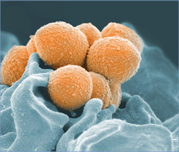

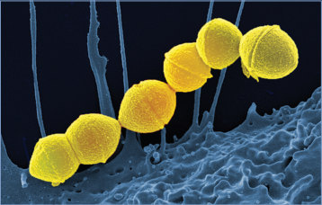

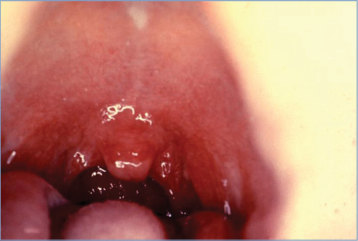

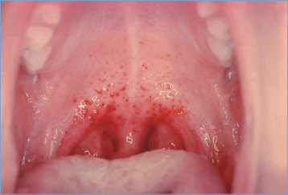

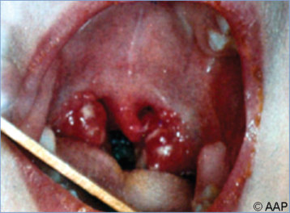

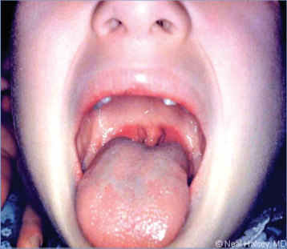

## PDF page 873 | printed page 859

Image 137.7 Group A streptococcal nasopharyngitis in a toddler, which is often associated with tender anterior cervical lymphadenopathy. A throat culture result is not always positive when the infection has localized to the cervical lymph nodes.

Image 137.9 Bilateral cervical lymphadenitis (posterior view).

Image 137.8 Posterior cervical lymph node aspiration. Culture result was positive for group A streptococci. Courtesy of Edgar O. Ledbetter, MD, FAAP.

Image 137.10 Group A streptococcal cellulitis and necrotizing fasciitis in the perineal area of a 7-month-old girl, complicating varicella. Courtesy of George Nankervis, MD.

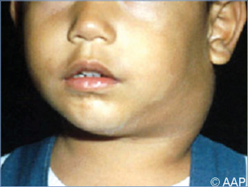

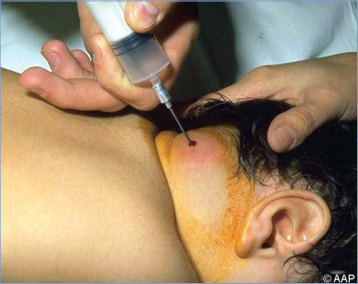

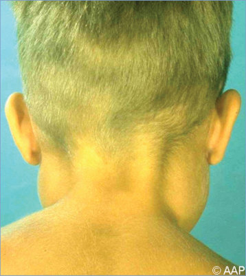

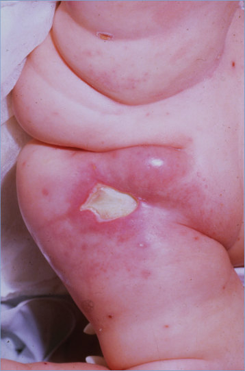

## PDF page 874 | printed page 860

Image 137.11 A 5-month-old boy with group A streptococcal cellulitis 12 hours after herniorrhaphy. Copyright Martin G. Myers, MD.

Image 137.13 Group A streptococcal necrotizing fasciitis complicating varicella in a 3-year-old girl. Courtesy of George Nankervis, MD.

Image 137.15 An infant boy with group A streptococcal infection at a heel-stick site. Copyright Martin G. Myers, MD.

Image 137.12 Group A streptococcal cellulitis (erysipelas) of the right leg in a school-aged child, secondary to impetigo. Courtesy of George Nankervis, MD.

Image 137.14 Necrotizing fasciitis of the left upper arm and shoulder secondary to group A streptococci. Copyright Charles Prober, MD.

Image 137.16 A newborn with group A streptococcal omphalitis and peritonitis. Copyright Martin G. Myers, MD

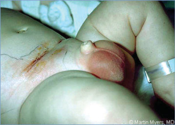

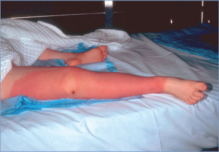

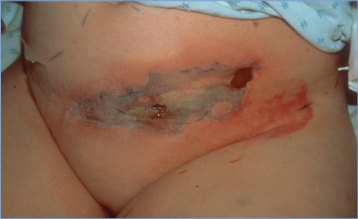

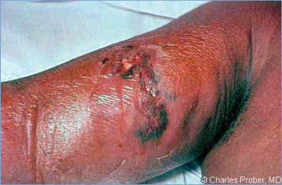

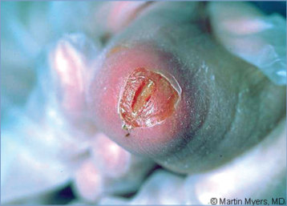

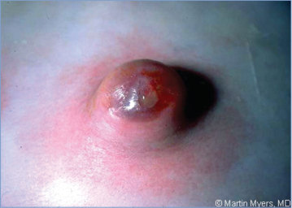

## PDF page 875 | printed page 861

Image 137.17 Group A streptococcal ethmoid sinusitis with periorbital cellulitis.

Image 137.19 The characteristic inflammatory changes in the tongue (ie, the strawberry tongue) of scarlet fever. Courtesy of Paul Wehrle, MD.

Image 137.18 Group A streptococcal scarlet fever with characteristic sandpaper-like rash with desquamation in a 6-year-old boy. Courtesy of Edgar O. Ledbetter, MD, FAAP.

Image 137.20 Group A streptococcal impetigo.

Image 137.21 Erythema marginatum in a 12-year-old girl. Although a characteristic rash of rheumatic fever, it is noted in <3% of cases. Its serpiginous border and evanescent nature distinguish it from the erythema migrans lesions of Lyme disease. Copyright Martin G. Myers, MD.

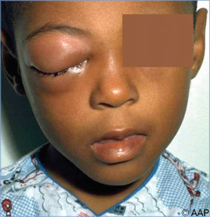

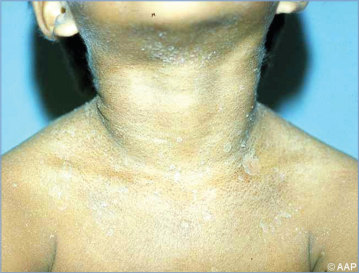

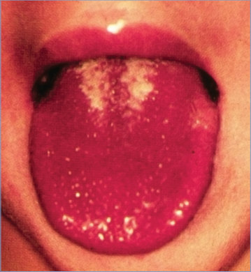

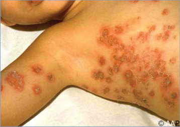

## PDF page 876 | printed page 862

Image 137.22 Petechial rash in a 6-year-old girl with Streptococcus pyogenes septicemia. Courtesy of Benjamin Estrada, MD.

Image 137.24 Purpura fulminans in a 6-year-old girl with Streptococcus pyogenes septicemia. Courtesy of Benjamin Estrada, MD.

Image 137.26 Streptococcus pyogenes on blood agar. The bacitracin disk has been placed to help distinguish group A streptococci from other b-hemolytic streptococci. The formation of any zone of inhibition is considered a positive test result. Courtesy of Julia Rosebush, DO; Robert Jerris, PhD; and Theresa Stanley, M(ASCP).

Image 137.23 Purpura fulminans in a 6-year-old girl with Streptococcus pyogenes septicemia. Courtesy of Benjamin Estrada, MD.

Image 137.25 Electron micrograph (magnification 370,000) of an ultrathin section of Streptococcus pyogenes. Courtesy of Centers for Disease Control and Prevention/Dr Vincent A. Fischetti, Rockefeller University.

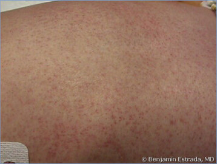

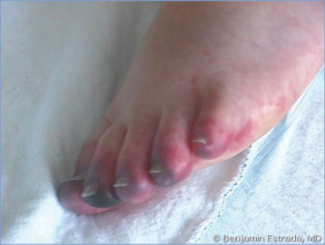

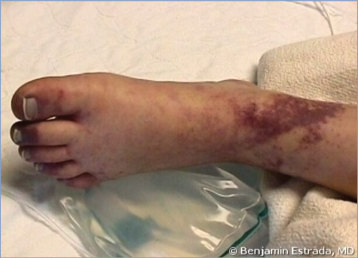

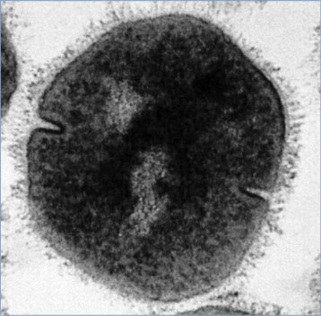

