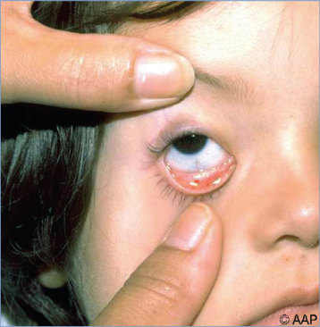
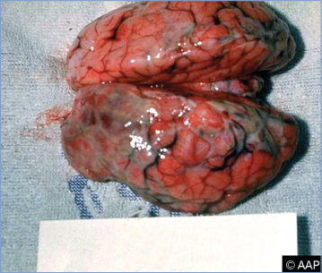
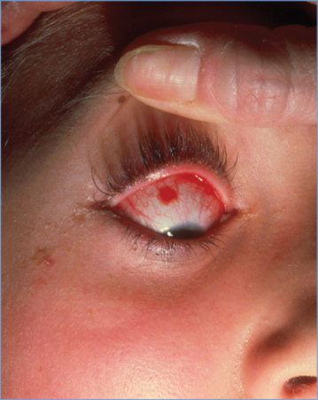
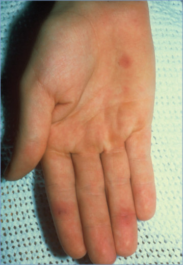
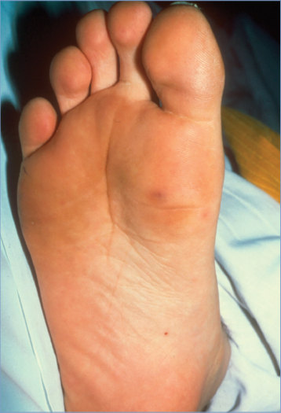
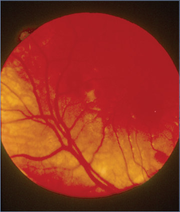
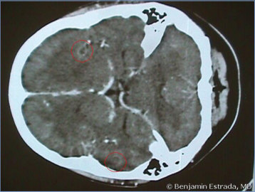

# 139. Non–Group A or B Streptococcal and Enterococcal Infections
> Reference: [source credits](../../SOURCE_CREDITS.md). Printed pp. 871-876; PDF pp. 885-890.
> Editorial study pathway: Bacterial infections (not a part division in the source).
[Flashcards](../flashcards/139_flashcards.md) · [Quiz](../mcqs/139_mcqs.md) · [Full extraction](../../raw/chapters/139.md)

## Five study pillars

### Etiology and transmission
Changes in taxonomy and nomenclature of the Streptococcus genus have evolved with advances in molecular technology . Among gram-positive organisms that are catalase negative and display chains by Gram stain, the genera associated most often with human disease are Streptococcus and Enterococcus.
*Printed p. 871 / PDF p. 885*

### Clinical recognition
Streptococci other than Lancefield groups A or B can be associated with invasive disease in infants, children, adolescents, and adults. The principal clinical syndromes of groups C and G streptococci (most belong to the Streptococcus dysgalactiae group) are bacteremia, septicemia, upper and lower respiratory tract infections (eg, pharyngitis, sinusitis, and pneumonia), skin and soft-tissue infections, septic arthritis, osteomyelitis, meningitis with a parameningeal focus, brain abscess, toxic shock syndrome, pericarditis, and endocarditis with various clinical manifestations.
*Printed p. 871 / PDF p. 885*

### Diagnostic workup
Diagnosis is established by culture of usually sterile body sites or abscesses with appropriate biochemical testing and serologic analysis for definitive identification. Mass spectrometry is unreliable in differentiation of S pneumoniae from viridians streptococci.
*Printed p. 872 / PDF p. 886*

### Treatment in the atlas
Penicillin G is the drug of choice for groups C and G streptococci. Other agents with good activity include ampicillin, third- and fourth-generation cephalosporins, vancomycin, and linezolid.
*Printed p. 872 / PDF p. 886*

### Prevention and infection control
Standard precautions are recommended. For patients with infection or colonization attributable to VRE, contact precautions in addition to standard precautions are indicated.
*Printed p. 874 / PDF p. 888*

## Clinical search tags
Pharyngitis, Pneumonia, Meningitis, Arthritis / bone pain, Abscess / soft tissue, Sepsis / shock, Congenital / neonatal, Immunocompromised host, Animal exposure

## Full text, original tables, and images

# 139. Non–Group A or B Streptococcal and Enterococcal Infections
> Private study reference ([source credits](../../SOURCE_CREDITS.md)). PDF pages 885-890; printed pages 871-876.

## PDF page 885 | printed page 871

### CLINICAL MANIFESTATIONS

Streptococci other than Lancefield groups A or B can be associated with invasive disease in infants, children, adolescents, and adults. The principal clinical syndromes of groups C and G streptococci (most belong to the Streptococcus dysgalactiae group) are bacteremia, septicemia, upper and lower respiratory tract infections (eg, pharyngitis, sinusitis, and pneumonia), skin and soft-tissue infections, septic arthritis, osteomyelitis, meningitis with a parameningeal focus, brain abscess, toxic shock syndrome, pericarditis, and endocarditis with various clinical manifestations. Viridans streptococci are the most common cause of bacterial endocarditis in children, especially children with congenital or valvular heart disease. Viridans streptococci are a common cause of bacteremia in neutropenic patients with cancer, especially following intensive induction chemotherapy for acute myeloid leukemia, after hematopoietic cell transplantation, and as a cause of central lineassociated bacteremia. Among the viridans streptococci, group F streptococci (most belong to the Streptococcus anginosus group) are implicated in complicated sinus infections but are an infrequent cause of invasive infection. More serious S anginosus group infections include brain or dental abscesses or abscesses in other sites, including lymph nodes, liver, pelvis, and lung. These organisms may also cause sinusitis and other head and neck infections, meningitis, spondylodiskitis, spinal epidural abscesses, subdural empyema, peritonitis, complicated intra-abdominal infections, and cholangitis. Enterococci are associated with bacteremia in neonates and immunocompromised hosts, device-associated infections, intra-abdominal abscesses, and urinary tract infections in patients with anatomical anomalies.

### ETIOLOGY

Changes in taxonomy and nomenclature of the Streptococcus genus have evolved with advances in molecular technology (see Table 139.1). Among gram-positive organisms that are catalase negative

and display chains by Gram stain, the genera associated most often with human disease are Streptococcus and Enterococcus.

With the advent of genome sequencing, the genus Streptococcus has been divided, evolutionarily, into 2 major clades (Mitis-Suis and Pyogenes-Equinus-Mutans) and 14 subclades. Members of this genus that are b-hemolytic on blood agar plates include Streptococcus pyogenes, Streptococcus agalactiae, groups C and G streptococci (S dysgalactiae subspecies equisimilis is the group C subspecies most often associated with human infections), and some members of groups F and H streptococci. Streptococci that are non– b-hemolytic (a-hemolytic or nonhemolytic) on blood agar plates include: (1) Streptococcus pneumoniae; (2) the Streptococcus gallolyticus (formerly Streptococcus bovis) group; and (3) viridans streptococci clinically relevant in humans, which include the S anginosus group, Streptococcus mitis group, Streptococcus sanguinis group, Streptococcus salivarius group, and Streptococcus mutans group. The anginosus group (formerly Streptococcus milleri group) includes S anginosus, Streptococcus constellatus, and Streptococcus intermedius. This group can have variable hemolysis, and approximately one-third possess Lancefield groups A, C, F, or G antigens. Nutritionally variant “streptococci,” once believed to be viridans streptococci, now are classified in the genera Abiotrophia and Granulicatella. Group D streptococci include S gallolyticus, Streptococcus infantarius, and Streptococcus pasteurianus, now classified under the S gallolyticus group. Streptococci formerly classified as Lancefield groups R, S, and T are now known as Streptococcus suis.

The genus Enterococcus contains dozens of species, many of which have not been reported in humans, with Enterococcus faecalis and Enterococcus faecium accounting for most enterococcal infections in people. Outbreaks and health care-associated spread of intrinsically vancomycin-resistant enterococcal species including Enterococcus gallinarum, Enterococcus casseliflavus, or Enterococcus flavescens have occurred.

### EPIDEMIOLOGY

The habitats that non–group A and B streptococci and enterococci occupy in humans include the

## PDF page 886 | printed page 872

Table 139.1 Classification of Streptococci Most Commonly Associated With Disease, by Lancefield Group and by Hemolysis

Species Streptococcus pyogenes Streptococcus agalactiae Streptococcus dysgalactiae subspecies equisimilis, Streptococcus equi subspecies zooepidemicus

Enterococcus faecalis, Enterococcus faecium, Streptococcus gallolyticus

Streptococcus canis Streptococcus pneumoniae, viridans streptococci

a Some E faecalis are b-hemolytic on horse blood agar but not sheep (the latter is more commonly used in clinical laboratories). b Occasional viridans streptococci have variable hemolysis and can display Lancefield group A, C, F, or G antigens.

skin (groups C and G), oropharynx (groups C and G and the mutans group), gastrointestinal tract (groups C and G streptococci, S gallolyticus group, and Enterococcus species), and vagina (groups C, D, and G streptococci and Enterococcus species). Typical human habitats of species of viridans streptococci are the oropharynx, epithelial surfaces of the oral cavity, teeth, skin, and gastrointestinal and genitourinary tracts. Intrapartum transmission is responsible for most cases of early-onset neonatal infection caused by nongroup A and B streptococci and enterococci. Environmental contamination or transmission via hands of health care professionals can lead to colonization of patients. Groups C and G streptococci can cause foodborne outbreaks of pharyngitis. Zoonotic infection, specifically from Streptococcus equi subspecies zooepidemicus and rarely S equi subspecies equi, can result from animal contact or consumption of unpasteurized dairy products or other contaminated food products and has been associated with the development of poststreptococcal glomerulonephritis. S suis infections are associated with contact with pigs or raw pork.

The incubation period and the period of communicability are unknown.

### DIAGNOSTIC TESTS

Diagnosis is established by culture of usually sterile body sites or abscesses with appropriate biochemical testing and serologic analysis for definitive identification. Mass spectrometry is unreliable in differentiation of S pneumoniae

Lancefield Group Hemolysis A β B β

C β

D a or ga

G β Not groupableb a

from viridians streptococci. Genomic methods are being used increasingly, particularly for rapid identification of positive blood cultures. Antimicrobial susceptibility testing of isolates from usually sterile sites should be performed to guide treatment of infections caused by viridans streptococci or enterococci. The proportion of vancomycin-resistant enterococci (VRE), the vast majority of which are E faecium, among health care-associated enterococcal infections is about 30%. Selective agars are available for screening of VRE from stool specimens. Molecular assays are available for direct detection of vanA and vanB genes (which confer vancomycin resistance) from rectal and blood specimens to identify VRE.

### TREATMENT

Penicillin G is the drug of choice for groups C and G streptococci. Other agents with good activity include ampicillin, third- and fourth-generation cephalosporins, vancomycin, and linezolid. The combination of gentamicin (when high-level resistance is not present) with a b-lactam antimicrobial agent (eg, penicillin or ampicillin) or vancomycin may enhance the antimicrobial activity needed for treatment of life-threatening infections (eg, endocarditis or meningitis).

Many viridans streptococci remain susceptible to penicillin (minimum inhibitory concentration [MIC] ≤0.12 μg/mL). Infections caused by strains susceptible to penicillin, including endocarditis, can be treated with penicillin or ceftriaxone. Strains with an MIC >0.12 mg/mL and <0.5 mg/mL

### Geometry-detected table

|Species|Lancefield Group|Hemolysis|
|---|---|---|
|_Streptococcus pyogenes_|A|β|
|_Streptococcus agalactiae_|B|β|
|_Streptococcus dysgalactiae_ subspecies_equisimilis_, _Streptococcus equi_ subspecies_zooepidemicus_|C|β|
|_Enterococcus faecalis_, _Enterococcus faecium_, _Streptococcusgallolyticus_|D|a orga|
|_Streptococcus canis_|G|β|
|_Streptococcus pneumoniae_, viridans streptococci|Notgroupableb|a|

[View original table](../../tables/ch139_p0886_1.jpg)

## PDF page 887 | printed page 873

are considered relatively resistant to penicillin by criteria in the American Heart Association guidelines for treatment of infective endocarditis in childhood.1 In this situation, penicillin, ampicillin, or ceftriaxone for 4 weeks, combined for the first 2 weeks with gentamicin, is recommended. Strains with a penicillin MIC ≥0.5 μg/mL are considered resistant. Nonpenicillin antimicrobial agents with good activity against viridans streptococci include cephalosporins (especially ceftriaxone), vancomycin, linezolid, and tigecycline, although pediatric experience with tigecycline is limited. Tigecycline also has a black box warning for an increase in all-cause mortality and should be reserved for situations where alternative agents are not suitable. Abiotrophia and Granulicatella organisms can exhibit relative or high-level resistance to penicillin. The combination of high-dose penicillin or vancomycin and an aminoglycoside can enhance treatment effectiveness. Some species of viridans streptococci (eg, Streptococcus oralis, S mitis, S sanguinis) have shown unexpected, rapid (eg, overnight) in vitro and/or in vivo development of high-level resistance to daptomycin (MIC ≥256 mg/mL), and therefore, daptomycin should be avoided for treatment of infections by these organisms.

Enterococci exhibit intrinsic resistance to cephalosporins, aztreonam, and antistaphylococcal penicillins. Most are intrinsically resistant to clindamycin and trimethoprim-sulfamethoxazole even if in vitro susceptibility indicates otherwise. The vast majority of E faecalis strains are susceptible to ampicillin (which can be extrapolated to amoxicillin, piperacillin-tazobactam, and imipenem but not to penicillin). E faecium strains may be multidrug resistant. Two types of vancomycin resistance are identified: intrinsic low-level resistance that occurs with E gallinarum and E casseliflavus/E flavescens (these species are ampicillin susceptible), and acquired resistance, which has been seen in E faecium and some E faecalis strains but also has been recognized in Enterococcus raffinosus, Enterococcus avium, and Enterococcus durans.

Systemic enterococcal infections, such as endocarditis or meningitis, should be treated with penicillin or ampicillin (if the isolate is susceptible) combined with ceftriaxone or gentamicin (see endocarditis guidelines2). Vancomycin plus an

aminoglycoside (with appropriate monitoring of renal function) is suggested for patients unable to tolerate penicillins and who cannot be desensitized. Studies have established ampicillin plus ceftriaxone as equivalent to ampicillin plus gentamicin for E faecalis endocarditis. Some experts consider ampicillin plus both ceftriaxone and gentamicin for treatment of enterococcal meningitis, although clinical data are lacking. Gentamicin should not be used if in vitro susceptibility testing demonstrates high-level resistance.

Combination therapy for treating central lineassociated bloodstream infections is usually not needed. Options for treatment of other systemic infections caused by vancomycin-resistant E faecium include linezolid or daptomycin. Linezolid is approved for use in children, including neonates. Isolates of VRE that are resistant to linezolid have been described, and resistance can develop during prolonged linezolid treatment. Most vancomycin-resistant isolates of E faecalis and E faecium are daptomycin-susceptible. Data suggest that clearance of daptomycin is more rapid in young children compared with adolescents and adults, and dosing may need to be adjusted accordingly. Daptomycin should not be used to treat meningitis or pneumonia, as penetration into cerebrospinal fluid is poor and daptomycin is inactivated by pulmonary surfactants. Microbiologic and clinical cure have been reported in children infected with vancomycinresistant E faecium who were treated with quinupristin-dalfopristin. This drug frequently causes phlebitis in peripheral intravenous lines, and pediatric dosing in children younger than 12 years is unclear. Tigecycline is approved for use in adults with complicated skin and skin structure infections or intra-abdominal infections caused by vancomycin-susceptible E faecalis. Tigecycline has activity against both vancomycinresistant E faecalis and vancomycin-resistant E faecium, but experience with this drug in children is limited. In children younger than 8 years, there may be reversible inhibition of bone growth and adverse effects on tooth development. Tigecycline has a black box warning for an increase in all-cause mortality and should be reserved for situations where alternative agents are not suitable.

## PDF page 888 | printed page 874

### INFECTION PREVENTION AND CONTROL MEASURES IN HEALTH CARE SETTINGS

Standard precautions are recommended. For patients with infection or colonization attributable to VRE, contact precautions in addition to standard precautions are indicated. Patients harboring vancomycin-resistant strains of E gallinarum or E casseliflavus/E flavescens may be managed using only standard precautions, because these species harbor chromosomally encoded vancomycin resistance genes (vanC, vanT) that are not easily exchanged between bacterial populations. Common practice is to maintain precautions until the patient no longer harbors the organism or is discharged from the health care facility. Some experts recommend discontinuation of contact precautions if screening cultures are negative; there is, however, no accepted standard regarding the frequency (1, 2, or 3 cultures), timing (weekly, daily), or preferred site selection (eg, stool, axilla, etc).3

### CONTROL MEASURES

Use of vancomycin and treatment with broadspectrum antimicrobial agents are risk factors for

Image 139.1 Conjunctival (palpebral) petechiae in an adolescent girl with Streptococcus viridans subacute bacterial endocarditis.

colonization and infection with VRE. Hospitals should develop institution-specific guidelines for the appropriate use of vancomycin.

Patients with a prosthetic valve or prosthetic material used for cardiac valve repair, previous infective endocarditis, or congenital heart disease associated with the highest risk of adverse outcome from endocarditis should receive antimicrobial prophylaxis to prevent endocarditis at the time of certain dental procedures. For these patients, early instruction in proper diet; oral health, including use of dental sealants and adequate fluoride intake; and prevention or cessation of smoking will aid in prevention of dental caries and potentially will lower their risk of recurrent endocarditis.

1 Baltimore RS, Gewitz M, Baddour LM, et al. Infective endocarditis in childhood: 2015 update. A scientific statement from the American Heart Association. Circulation. 2015;132(15): 1487–1515 2 Baltimore RS, Gewitz M, Baddour LM, et al. Infective endocarditis in childhood: 2015 update. A scientific statement from the American Heart Association. Circulation. 2015;132(15): 1487–1515 3 Banach DB, Bearman G, Barnden M, et al. Duration of contact precautions for acute-care settings. Infect Control Hosp Epidemiol. 2018;39(2):127–144

Image 139.2 Brain from a neonate with Enterococcus faecalis meningitis showing copious purulent exudate covering the meninges. Courtesy of Edgar O. Ledbetter MD, FAAP.

## PDF page 889 | printed page 875

Image 139.3 A conjunctival hemorrhage in an adolescent girl with enterococcal endocarditis. Courtesy of George Nankervis, MD.

Image 139.4 Osler nodes on the fingers and a Janeway lesion in the palm of the same patient as in Image 139.3, with enterococcal endocarditis. Courtesy of George Nankervis, MD.

Image 139.5 A Janeway lesion on the sole of the same patient as in Images 139.3 and 139.4, with enterococcal endocarditis. Courtesy of George Nankervis, MD.

## PDF page 890 | printed page 876

Image 139.6 Hemorrhagic retinitis with Roth spots in the adolescent girl with enterococcal endocarditis in Images 139.3–139.5. Courtesy of George Nankervis, MD.

Image 139.7 Brain abscesses (circled in red) in a 13-year-old with Streptococcus viridans endocarditis. Courtesy of Benjamin Estrada, MD.

Image 139.8 Computed tomographic scan showing a large liver abscess in a previously healthy 5-year-old girl with abdominal pain and nausea. Culture results were positive for Streptococcus anginosus (formerly Streptococcus milleri). Courtesy of Preeti Jaggi, MD.

