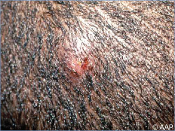
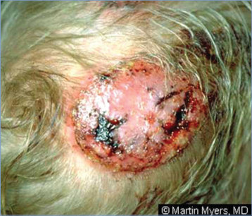
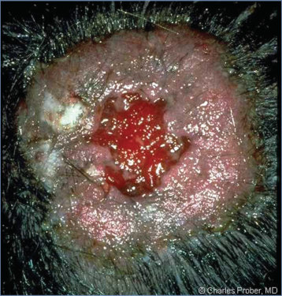

# 146. Tinea Capitis (Ringworm of the Scalp)
> Reference: [source credits](../../SOURCE_CREDITS.md). Printed pp. 943-947; PDF pp. 957-961.
> Editorial study pathway: Fungal infections (not a part division in the source).
[Flashcards](../flashcards/146_flashcards.md) · [Quiz](../mcqs/146_mcqs.md) · [Full extraction](../../raw/chapters/146.md)

## Five study pillars

### Etiology and transmission
Tinea capitis develops when dermatophyte fungal elements invade the scalp hair follicle and shaft. The specific pathogen varies by geographic region and mode of transmission.
*Printed p. 943 / PDF p. 957*

### Clinical recognition
Dermatophytic fungal infections of the scalp usually present with an area of localized alopecia and scaling but may include subtle findings of mild hair loss with faint scaling or a large hairless, boggy erythematous area (kerion). Other manifestations include a common “black dot” pattern reflecting stubs of broken-off hairs at the scalp surface; a less common “gray patch” seborrheic dermatitis-like pattern with or without hair loss and prominent, well-demarcated areas of scaling and erythema; or a vesiculopustular pattern resembling bacterial folliculitis.
*Printed p. 943 / PDF p. 957*

### Diagnostic workup
The presence of alopecia, pruritus, scale, and posterior cervical lymphadenopathy makes the diagnosis of tinea capitis almost certain. Treatment can be initiated based on clinical findings, but fungal culture should be obtained to confirm the diagnosis.
*Printed p. 944 / PDF p. 958*

### Treatment in the atlas
Tinea capitis always requires systemic medication, because the fungal infection is found within the hair follicles, where topical agents do not reach. Optimal treatment of tinea capitis includes consideration of drug tolerability, availability, and cost.
*Printed p. 944 / PDF p. 958*

### Prevention and infection control
If discovered while at school, the affected student need not be sent home early. Once therapy is initiated, children should not be excluded from school.
*Printed p. 945 / PDF p. 959*

## Clinical search tags
Vesicles, Lymphadenopathy, Immunocompromised host

## Full text, original tables, and images

# 146. Tinea Capitis (Ringworm of the Scalp)
> Private study reference ([source credits](../../SOURCE_CREDITS.md)). PDF pages 957-961; printed pages 943-947.

## PDF page 957 | printed page 943

(Ringworm of the Scalp)

### CLINICAL MANIFESTATIONS

Dermatophytic fungal infections of the scalp usually present with an area of localized alopecia and scaling but may include subtle findings of mild hair loss with faint scaling or a large hairless, boggy erythematous area (kerion). Other manifestations include a common “black dot” pattern reflecting stubs of broken-off hairs at the scalp surface; a less common “gray patch” seborrheic dermatitis-like pattern with or without hair loss and prominent, well-demarcated areas of scaling and erythema; or a vesiculopustular pattern resembling bacterial folliculitis. Regional lymphadenopathy may be present.

The differential diagnosis for tinea capitis depends on the clinical presentation. In the classic scaling presentation, clinicians should consider atopic dermatitis, seborrheic dermatitis, and psoriasis. Alopecia should raise the possibility of trichotillomania and alopecia areata, although these disorders usually are not associated with scaling. When vesiculopustular in nature, lice infestation and bacterial infection should be considered. A boggy fluctuant mass likely represents a kerion, but primary (or secondary) bacterial infection can be considered. Although scalp scarring can result from tinea, particularly when a kerion suppurates, presence of scalp scarring should raise the possibility of an autoimmune disorder, such as discoid lupus.

An associated skin eruption, known as a dermatophytic or “id” reaction, can occur as a hypersensitivity reaction to the infecting fungus and can manifest as diffuse, pruritic, papular, vesicular, and/or eczematous lesions occurring at sites distant from the fungal infection including the trunk and extremities. Id reactions often begin after starting therapy but do not represent a drug allergy and should not prompt discontinuation of treatment.

Tinea capitis can occur in association with tinea corporis. Examination of the body (face, trunk, and limbs) should be performed, particularly in wrestlers and others engaged in contact sports.1 Close contacts including parents, siblings, and

other close contacts should be examined for clinical findings consistent with tinea capitis.

### ETIOLOGY

Tinea capitis develops when dermatophyte fungal elements invade the scalp hair follicle and shaft. The specific pathogen varies by geographic region and mode of transmission. The primary causes are fungi of the genus Trichophyton, including Trichophyton tonsurans and Trichophyton violaceum, as well as Microsporum, including Microsporum canis and Microsporum audouinii.

### EPIDEMIOLOGY

Tinea capitis primarily occurs in prepubertal children but may occur in children of all ages and in adults. In the United States, T tonsurans is responsible for up to 95% of tinea capitis and is most common in school-aged children. Infection with T tonsurans is contracted from direct contact with an infected individual, animal, or contaminated object such as a hat or brush. T violaceum is the dominant organism in Eastern Europe and south Asia and is seen more frequently in immigrant populations in the United States.

M canis is associated with less than 5% of infections in the United States. M canis infection almost always results from contact with infected pets, particularly kittens or puppies. M canis outbreaks in schools and child care facilities have followed visits from infected animals. Unlike infections caused by Trichophyton species, infections caused by M canis are often associated with inflammatory lesions early in the course.

The dermatophyte organism remains viable for prolonged periods on fomites (eg, brushes, combs, hats, towels), and the rate of asymptomatic carriage and infected individuals among family members of index cases is high. Asymptomatic carriers almost certainly serve as a reservoir of infection within families, schools, and communities.

Immunocompromised people and those with trisomy 21 have an increased susceptibility to dermatophyte infections.

The incubation period is unknown but is believed to be 1 to 3 weeks. Dermatophyte infections have been reported as early as 3 days of age.

## PDF page 958 | printed page 944

### DIAGNOSTIC TESTS

The presence of alopecia, pruritus, scale, and posterior cervical lymphadenopathy makes the diagnosis of tinea capitis almost certain. Treatment can be initiated based on clinical findings, but fungal culture should be obtained to confirm the diagnosis. Diagnosis can also be confirmed at the time of initial evaluation by dermatoscopic examination of the affected area and by microscopic evaluation of a potassium hydroxide wet mount of cutaneous scrapings. Dermatoscopic evaluation of areas of alopecia with a lighted magnifier may show comma, corkscrew, or elbow-shaped hairs. Potassium hydroxide wet mount microscopy may be used to examine hairs and scale obtained by gentle scraping of an area of the scalp with a blunt scalpel or scalpel blade, hairbrush, toothbrush, or cotton swab or by plucking with tweezers. Visualization of spores filling the interior of the hair shaft indicates an endothrix infection caused by T tonsurans, while coating of the outside of the hair shaft with spores indicates an ectothrix infection, such as from M canis. In both

Table 146.1 Recommended Systemic Therapy for Tinea Capitis

Drug Dosage Griseofulvin microsize (liquid, 125 mg/5 mL) 15–25 mg/kg/day (max 1 g/day)

Griseofulvin ultramicrosize (tablets of varying size) 10–15 mg/kg/day (max 750 mg/day)

Terbinafine tablets (250 mg)a 4–6 mg/kg/day (max: 250 mg); or

10–20 kg: 62.5 mg 20–40 kg: 125 mg >40 kg: 250 mg

Terbinafine granules (125 mg and 187.5 mg)b <25 kg: 125 mg 25–35 kg: 187.5 mg >35 kg: 250 mg

Fluconazole (liquid, 10 mg/mL; suspension, 40 mg/mL; tablet, 50 mg, 100 mg, 150 mg, and 200 mg)

6 mg/kg/day (max 400 mg/day)

Itraconazole solution (10 mg/mL) 3 mg/kg/day (max 600 mg/day)

Itraconazole capsule (65 mg, 100 mg) 5 mg/kg/day (max 600 mg/day)

a Some experts use “higher” dosing listed for terbinafine granules instead. b Terbinafine granules have been discontinued in the United States.

forms, septate hyphae may be visualized in scrapings from the scalp surface. Clinicians should obtain a fungal culture to establish a diagnosis, in conjunction with microscopy. To obtain a fungal culture, a cotton-tipped applicator can be used to swab an affected area. The sample is transported to a mycology laboratory for processing; 2 to 4 weeks of incubation on Sabouraud dextrose agar are required for results. Nucleic acid amplification tests are very useful and increasingly available. Under Wood lamp, tinea lesions are not fluorescent unless the etiologic agent is of the Microsporum genus, in which blue-green fluorescence is noted, because it is an ectothrix infection.

### TREATMENT

Tinea capitis always requires systemic medication, because the fungal infection is found within the hair follicles, where topical agents do not reach. Optimal treatment of tinea capitis includes consideration of drug tolerability, availability, and cost. Current treatment options are summarized in Table 146.1.

Duration FDA Approved for Tinea Capitis 6–8 wk; continue until clinically clear Yes (children ≥2 y)

T tonsurans: 4–6 wk M canis: 8–12 wk

No

T tonsurans: 4–6 wk M canis: 8–12 wk Yes (children ≥4 y)

3–6 wk, depending on severity

No

2–4 wk or longer, depending on severity

No

### Geometry-detected table

|Drug|Dosage|Duration|FDA Approved for Tinea Capitis|
|---|---|---|---|
|Griseofulvin microsize (liquid, 125 mg/5 mL)|15–25 mg/kg/day (max 1 g/day)|6–8 wk; continue until clinically clear|Yes (children≥2 y)|
|Griseofulvin ultramicrosize (tablets of varying size)|10–15 mg/kg/day (max 750 mg/day)|10–15 mg/kg/day (max 750 mg/day)|10–15 mg/kg/day (max 750 mg/day)|
|Terbinafne tablets (250 mg)a|4–6 mg/kg/day (max: 250 mg); or 10–20 kg: 62.5 mg 20–40 kg: 125 mg >40 kg: 250 mg|_T tonsurans_: 4–6 wk _M canis_: 8–12 wk|No|
|Terbinafne granules (125 mg and 187.5 mg)b|<25 kg: 125 mg 25–35 kg: 187.5 mg >35 kg: 250 mg|_T tonsurans_: 4–6 wk _M _canis: 8–12 wk|Yes (children≥4 y)|
|Fluconazole (liquid, 10 mg/mL; suspension, 40 mg/mL; tablet, 50 mg, 100 mg, 150 mg, and 200 mg)|6 mg/kg/day (max 400 mg/day)|3–6 wk, depending on severity|No|
|Itraconazole solution (10 mg/mL)|3 mg/kg/day (max 600 mg/day)|2–4 wk or longer, depending on severity|No|
|Itraconazole capsule (65 mg, 100 mg)|5 mg/kg/day (max 600 mg/day)|5 mg/kg/day (max 600 mg/day)|5 mg/kg/day (max 600 mg/day)|

[View original table](../../tables/ch146_p0958_1.jpg)

## PDF page 959 | printed page 945

Griseofulvin is approved by the U.S. Food and Drug Administration (FDA) for children 2 years and older, is available in either liquid or tablet form, can be administered on a daily basis, and should be taken with fatty foods. Experts generally use higher doses of griseofulvin than have been approved by the FDA or that were used in clinical trials. Laboratory testing of serum hepatic enzymes is not required if duration of griseofulvin therapy is less than 8 weeks (but treatment of longer than 8 weeks is often required for resolution of infection). High-dose griseofulvin is considered standard of care for M canis infection.

Terbinafine granules are approved by the FDA for tinea capitis in children 4 years and older but are no longer available in the United States. Terbinafine clearance is higher in children than adults; pharmacokinetic data derived from studies of the granule formulation are the best information available regarding terbinafine clearance in children, and some experts extrapolate this “higher dosing” when utilizing tablets. Advantages of terbinafine for treatment of T tonsurans infection include the possibility of shorter treatment duration (Table 146.1) and equal or superior effectiveness compared with griseofulvin.

Two triazole agents can be considered in therapy. Fluconazole is the only oral antifungal agent approved by the FDA for children younger than 2 years, albeit not for tinea capitis. It had lower cure rates than other oral agents in a large randomized controlled trial. Accumulating evidence supports that itraconazole (currently not FDA approved for use in children or for tinea capitis) can be effective and safe for this disease. Liver function testing need not be assessed at baseline unless the child has preexisting liver disease or is on concomitant hepatotoxic medications.

Topical treatment, such as shampoos containing selenium sulfide, ketoconazole, or ciclopirox, may be useful as an adjunct to systemic therapy to decrease carriage of viable conidia for all forms of tinea capitis. Shampoo can be applied 2 to 3 times per week and left in place for 5 to 10 minutes. Treatments should continue for at least 2 weeks, and some experts recommend

continuing topical treatments until clinical and mycologic cure occurs.

Affected patients receiving therapy should be reassessed in 1 month for clinical response. Fungal cultures may be obtained to evaluate for a mycologic response. Poor response may prompt retreatment with a different agent if compliance with the initial drug is confirmed.

Kerion is managed by systemic antifungal treatment as outlined previously. Removal of crusts with wet compresses is thought to decrease the risk of secondary bacterial infection. Combined antifungal and corticosteroid therapy (either oral or intralesional) has not been shown to be superior to antifungal therapy alone. Nonetheless, if the condition is unresponsive to traditional therapy, many experts will add systemic prednisone, 1 mg/kg/day for 2 weeks, to decrease likelihood of scarring. Treatment with antibacterial agents is unnecessary unless secondary bacterial infection occurs.

### INFECTION PREVENTION AND CONTROL MEASURES IN HEALTH CARE SETTINGS

Standard precautions apply.

### CONTROL MEASURES

If discovered while at school, the affected student need not be sent home early. Once therapy is initiated, children should not be excluded from school. Family members and close contacts should be questioned regarding symptoms, and anyone with symptoms should be evaluated. Some experts recommend topical antifungal shampoo therapy for asymptomatic family members, but evidence is lacking regarding effectiveness of this intervention. Sharing of items such as hats and combs/brushes should be avoided in households with an affected person. If pets are suspected as a source of M canis infection, evaluation and appropriate treatment of the affected animal should be implemented.

1 Davies HD, Jackson MA, Rice SG; American Academy of

Pediatrics, Committee on Infectious Diseases, Council on Sports Medicine and Fitness. Infectious diseases associated with organized sports and outbreak control. Pediatrics. 2017;140(4):e20172477

## PDF page 960 | printed page 946

Image 146.1 Tinea capitis may cause hair loss. Remnants of infected hairs (“black dots”) that have broken at the scalp line may be noted within areas of alopecia.

Image 146.3 An 8-year-old boy with a bald spot, hair loss, and enlarging posterior cervical lymph node for 2 weeks. The node was described as tender, not fluctuant, and without erythema of the overlying scalp. The area of hair loss was boggy and fluctuant. The patient responded well to treatment with griseofulvin. Copyright Stan Block, MD, FAAP.

Image 146.2 A 4-year-old with multiple areas of alopecia and hair loss. This boy had a 3-week history of “dandruff.” The scaling became more apparent after a shaved haircut. The barber saw areas of hair loss and was concerned about ringworm. He recommended medical evaluation. Physical examination indicated multiple patches of alopecia with a light appearance to the broken hair stubs in the areas of alopecia. Wood lamp examination indicated numerous patches of fluorescence. Culture result was positive for Microsporum canis. He was treated with griseofulvin for a total of 7 weeks. His hair has grown back without scarring. Follow-up examination result with Wood lamp was negative, although a sibling was noted to have a kerion and required treatment. Courtesy of Will Sorey, MD.

Image 146.4 A 21/2-year-old boy with a kerion secondary to chronic, progressive tinea capitis. Copyright Martin G. Myers, MD.

![Image 146.2 A 4-year-old with multiple areas of alopecia and hair loss. This boy had a 3-week history of “dandruff.” The scaling became more apparent after a shaved haircut. The barber saw areas of hair loss and was concerned about ringworm. He recommended medical evaluation. Physical examination indicated multiple patches of alopecia with a light appearance to the broken hair stubs in the areas of alopecia. Wood lamp examination indicated numerous patches of fluorescence. Culture result was positive for Microsporum canis. He was treated with griseofulvin for a total of 7 weeks. His hair has grown back without scarring. Follow-up examination result with Wood lamp was negative, although a sibling was noted to have a kerion and required treatment. Courtesy of Will Sorey, MD.](../../figures/ch146_p0960_02.jpg)

## PDF page 961 | printed page 947

Image 146.5 Close-up of tinea capitis (Microsporum audouinii). Copyright Charles Prober, MD.

Image 146.6 Microsporum audouinii. Microsporum canis, a zoophilic dermatophyte often found in cats and dogs, is a common cause of tinea corporis and tinea capitis in humans. Other dermatophytes are included in the genera Epidermophyton and Trichophyton. Courtesy of Centers for Disease Control and Prevention.

