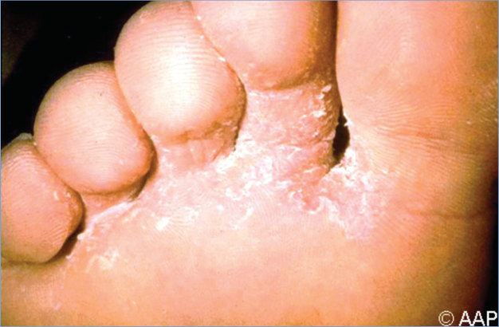
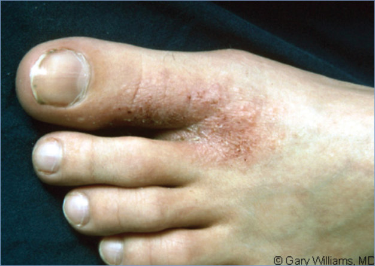
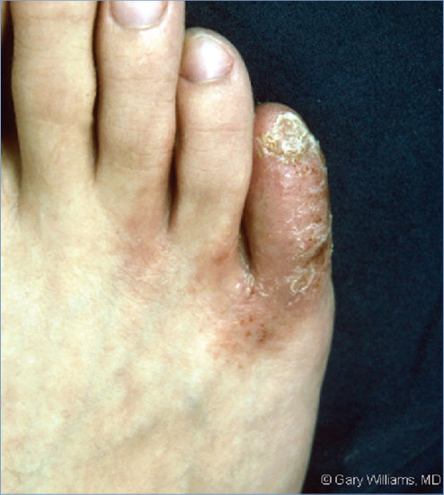

# 149. Tinea Pedis and Tinea Unguium (Onychomycosis) (Athlete’s Foot, Ringworm of the Feet)
> Reference: [source credits](../../SOURCE_CREDITS.md). Printed pp. 956-959; PDF pp. 970-973.
> Editorial study pathway: Fungal infections (not a part division in the source).
[Flashcards](../flashcards/149_flashcards.md) · [Quiz](../mcqs/149_mcqs.md) · [Full extraction](../../raw/chapters/149.md)

## Five study pillars

### Etiology and transmission
Tinea pedis and unguium develop when dermatophytic fungi invade the skin layers and nails of the affected body region. The fungi Trichophyton rubrum, Trichophyton mentagrophytes, and Epidermophyton floccosum are the most common causes of tinea pedis.
*Printed p. 956 / PDF p. 970*

### Clinical recognition
Tinea pedis can have a variety of clinical manifestations in children. Lesions can involve all areas of the foot but usually are patchy in distribution, with a predisposition to cause fissures, macerated areas, and scaling between toes.
*Printed p. 956 / PDF p. 970*

### Diagnostic workup
Confirmatory diagnostic tests for tinea pedis are similar to those for tinea corporis. Fungal infection of the nail (tinea unguium or onychomycosis) can be verified by direct microscopic examination with potassium hydroxide, fungal culture of desquamated subungual material, or fungal stain of nail clippings fixed in formalin.
*Printed p. 956 / PDF p. 970*

### Treatment in the atlas
A myriad of topical options are available for treatment of tinea pedis . Therapy duration of 2 weeks usually is sufficient for milder cases of tinea pedis in children.
*Printed p. 957 / PDF p. 971*

### Prevention and infection control
Treatment of patients with active infections should decrease transmission. Using public areas conducive to transmission (eg, swimming pools) is discouraged in those with untreated, active infection.
*Printed p. 957 / PDF p. 971*

## Clinical search tags
Vesicles, Congenital / neonatal, Immunocompromised host, Water exposure

## Full text, original tables, and images

# 149. Tinea Pedis and Tinea Unguium (Onychomycosis) (Athlete’s Foot, Ringworm of the Feet)
> Private study reference ([source credits](../../SOURCE_CREDITS.md)). PDF pages 970-973; printed pages 956-959.

## PDF page 970 | printed page 956

(Athlete’s Foot, Ringworm of the Feet)

### CLINICAL MANIFESTATIONS

Tinea pedis can have a variety of clinical manifestations in children. Lesions can involve all areas of the foot but usually are patchy in distribution, with a predisposition to cause fissures, macerated areas, and scaling between toes. A pruritic, fine scaly, or vesiculopustular eruption is most common and can be associated with a confluent, hyperkeratotic, dry scaling of the soles. Recurrence of tinea pedis is common, and it can be a chronic infection. Toenails can be infected (onychomycosis or tinea unguium) and become distorted, discolored, and thickened with accumulation of subungual debris. A superficial white form of toenail fungal infection can occur in children. Toenails may be the source for recurrent tinea pedis.

Tinea pedis must be differentiated from dyshidrotic eczema, atopic dermatitis, psoriasis, contact dermatitis, juvenile plantar dermatosis, palmoplantar keratoderma, and erythrasma (reddish brown patches that can affect the feet and axillae resulting from superficial bacterial skin infection caused by Corynebacterium minutissimum).

An associated skin eruption, known as a dermatophytid or “id” reaction, can occur as a hypersensitivity reaction to the infecting fungus and manifests as diffuse, pruritic, papular, vesicular, or eczematous lesions at sites distant from the fungal infection. An id reaction can first occur following institution of therapy but does not represent a drug allergy. Id reaction lesions may appear as grouped papules or pustules unaccompanied by erythema or scaling in patients with diminished T-lymphocyte function (eg, HIV infection).

The differential diagnosis of tinea unguium includes trauma (particularly if only 1 nail is involved), psoriasis, congenital malalignment of the great toenails (if only great toenails are involved), twenty-nail dystrophy (trachyonychia), and subungual exostosis if only 1 nail is involved.

Concomitant tinea in other body sites has been reported in patients with tinea pedis and tinea unguium.

### ETIOLOGY

Tinea pedis and unguium develop when dermatophytic fungi invade the skin layers and nails of the affected body region. The fungi Trichophyton rubrum, Trichophyton mentagrophytes, and Epidermophyton floccosum are the most common causes of tinea pedis.

### EPIDEMIOLOGY

Tinea pedis is a common infection worldwide in adolescents and adults but is less common in young children. Fungi are acquired by contact with infected skin scales or organisms present in damp areas, such as swimming pools, locker rooms, and showers. Tinea pedis may spread among family members in the household; this may represent enhanced genetic susceptibility as well as increased exposure to the organism. The incidence of onychomycosis, which is more common in toenails, increases with age, with worldwide prevalence in children estimated to be from 0.1% to 0.87%. The increased use of occlusive footwear earlier in childhood and exposure to high-risk areas (eg, swimming pools, gyms) earlier in life may be associated with an increase of tinea pedis in children. Childhood onychomycosis is associated with a history of tinea pedis, a history of family member infection, increased number of siblings, and male sex.1

Immunocompromised people and those with trisomy 21 have increased susceptibility to dermatophyte infections.

The incubation period is unknown.

### DIAGNOSTIC TESTS

Confirmatory diagnostic tests for tinea pedis are similar to those for tinea corporis. Fungal infection of the nail (tinea unguium or onychomycosis) can be verified by direct microscopic examination with potassium hydroxide, fungal culture of desquamated subungual material, or fungal stain of nail clippings fixed in formalin. Nucleic acid amplification tests are a useful and increasingly used tool.

## PDF page 971 | printed page 957

### TREATMENT

A myriad of topical options are available for treatment of tinea pedis (see Tinea Corporis, Table 147.1). Therapy duration of 2 weeks usually is sufficient for milder cases of tinea pedis in children. Acute vesicular lesions can be treated with intermittent use of open wet compresses (eg, with Burow solution, diluted 1:80). Tinea pedis that is severe, chronic, or refractory to topical treatment can be treated with oral therapy similar to that for tinea capitis (see Tinea Capitis, Table 146.1).

Recurrence of tinea pedis is prevented by proper foot hygiene, which includes keeping the feet dry and cool, cleaning gently, drying between the toes, use of absorbent antifungal foot powder, exposing affected areas to air frequently, and avoidance of occlusive footwear, nylon socks, and other fabrics that interfere with dissipation of moisture. Wearing protective footwear in public facilities such as pools and gyms may prevent transmission.

Topical antifungal lacquers and solutions that are effective for distal toenail infections that do not involve the nail matrix now are available. Despite lower cure rates, topical agents are preferred because of substantially lower adverse effects, lack of drug-drug interactions, and avoidance of need for laboratory test monitoring for toxicity. Topical ciclopirox 8% lacquer, with a U.S. Food and Drug Administration (FDA) indication for tinea unguium for patients 12 years and older, can be applied to affected toenail(s) once daily for up to 48 weeks, or twice daily for shorter durations, in combination with a comprehensive nail management program. Efinaconazole 10% solution and tavaborole 5% solution are indicated for onychomycosis for patients 6 years and older, applied once daily for up to 48 weeks; both have higher cure rates in adults than ciclopirox. Topical therapies appear to show a higher cure rate in children than in adults, possibly because of thinner nail plates and faster nail growth rate in children. Most of these agents are expensive and not usually covered by insurance.

Studies in adults have demonstrated the best cure rates for onychomycosis (tinea unguium) are with oral terbinafine or itraconazole. Although oral therapies are more likely to lead to cure, they also require laboratory monitoring and can induce drug-drug interactions. Guidelines for dosing of

terbinafine for children are based on studies for treatment of tinea capitis and are weight based (see Table 146.1). The duration of therapy is the same as for adults (6 weeks for fingernail infection, 12 weeks for toenail infection). Pediatric dosing of oral itraconazole is not established for superficial mycoses, although a suggested dosing may follow that for tinea capitis (see Table 146.1). Griseofulvin, although approved by the FDA for treatment of tinea unguium, is rarely used for this indication.

Factors that influence choice of therapy include severity of infection, results of fungal culture or potassium hydroxide preparation (if performed), prior treatments, concomitant drug therapy for other illnesses, patient preference, and cost. Topical and systemic therapy may be used concurrently to increase therapeutic response. Cure rates following oral or combined therapy approach 80% in children. Mechanical and chemical débridement of the nail, using 40% urea ointment daily under occlusion for 10 days to soften the nail, should be performed in refractory cases or when severe thickening of the nail is likely to decrease absorption and response to therapy.

Dermatophyte infections in other locations, if present, should be treated concurrently.

### INFECTION PREVENTION AND CONTROL MEASURES IN HEALTH CARE SETTINGS

Standard precautions apply.

### CONTROL MEASURES

Treatment of patients with active infections should decrease transmission. Using public areas conducive to transmission (eg, swimming pools) is discouraged in those with untreated, active infection. Chemical footbaths can facilitate spread of infection. Because recurrence after treatment is common, proper foot hygiene is important (as described in Treatment). Patients should be advised to dry the groin area before drying the feet to avoid inoculating dermatophytes from tinea pedis into the groin area. Prevention of tinea unguium includes keeping nails short and not sharing nail clippers.

1 The term male refers to sex assigned at birth.

## PDF page 972 | printed page 958

Image 149.1 This patient presented with ringworm of the feet (specifically the toes), or tinea pedis, which is also known as athlete’s foot. Tinea pedis is a fungal infection of the feet, principally involving the toe webs and soles. Athlete’s foot can be caused by the fungus Epidermophyton floccosum or by numerous members of the Trichophyton genus. Courtesy of Centers for Disease Control and Prevention.

Image 149.3 Tinea pedis and tinea unguium.

Image 149.2 This patient presented with ringworm of the foot (tinea pedis) caused by the dermatophytic fungus Trichophyton rubrum. Individuals who practice generally poor hygiene, wear enclosed footwear such as tennis shoes, experience prolonged wetting of the skin (ie, sweating during exercise), and experience minor skin or nail injuries are more prone to experience tinea infections. Courtesy of Centers for Disease Control and Prevention.

## PDF page 973 | printed page 959

Image 149.4 Tinea pedis and tinea unguium. Copyright Gary William s, MD.

Image 149.5 Tinea pedis and tinea unguium infection. This is the same patient as in Image 149.4. Copyright Gary Williams, MD.

