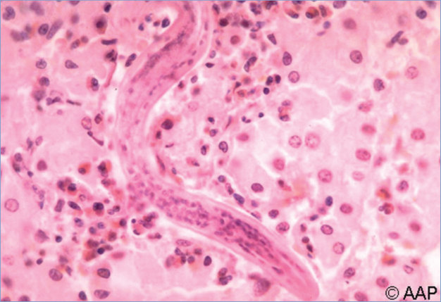
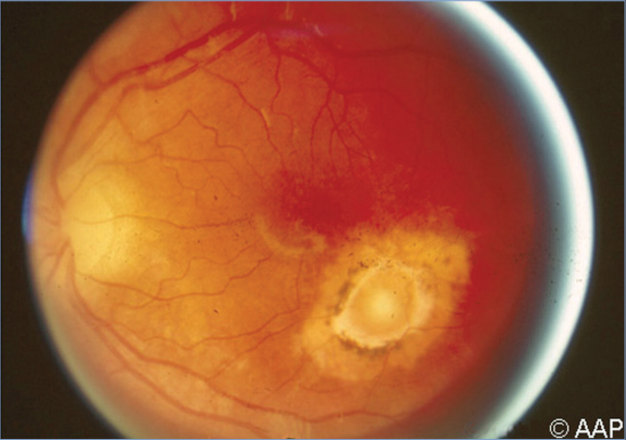

# 150. Toxocariasis
> Reference: [source credits](../../SOURCE_CREDITS.md). Printed pp. 960-963; PDF pp. 974-977.
> Editorial study pathway: Helminths and ectoparasites (not a part division in the source).
[Flashcards](../flashcards/150_flashcards.md) · [Quiz](../mcqs/150_mcqs.md) · [Full extraction](../../raw/chapters/150.md)

## Five study pillars

### Etiology and transmission
Toxocariasis is caused by Toxocara species, which are nematode (roundworm) parasites of dogs and cats, specifically Toxocara canis and Toxocara cati, respectively; most cases are caused by T canis.
*Printed p. 960 / PDF p. 974*

### Clinical recognition
Clinical disease is caused by migration of parasitic nematode larvae through tissues. Signs and symptoms differ depending on the affected organ and host inflammatory response.
*Printed p. 960 / PDF p. 974*

### Diagnostic workup
Laboratory findings include marked leukocytosis with eosinophilia and occasionally anemia and hypergammaglobulinemia (elevated serum concentrations of immunoglobulin [Ig] G and IgE). Patients with visceral disease frequently have increased titers of isohemagglutinin to the A and B blood group antigens.
*Printed p. 960 / PDF p. 974*

### Treatment in the atlas
Albendazole is recommended for treatment of visceral and ocular toxocariasis. The drug has been approved by the U.S.
*Printed p. 960 / PDF p. 974*

### Prevention and infection control
Standard precautions are recommended. There is no person-to-person spread.
*Printed p. 961 / PDF p. 975*

## Clinical search tags
Fever, Cough, Pneumonia, Wheeze / bronchiolitis, Hepatosplenomegaly, Encephalitis / seizures, Eosinophilia

## Full text, original tables, and images

# 150. Toxocariasis
> Private study reference ([source credits](../../SOURCE_CREDITS.md)). PDF pages 974-977; printed pages 960-963.

## PDF page 974 | printed page 960

### CLINICAL MANIFESTATIONS

Clinical disease is caused by migration of parasitic nematode larvae through tissues. Signs and symptoms differ depending on the affected organ and host inflammatory response. Toxocariasis can be of the following types: covert toxocariasis, visceral larva migrans, neurotoxocariasis, or ocular larva migrans. Most infected children are asymptomatic. Covert disease presents with nonspecific symptoms and may be accompanied by eosinophilia. Symptoms of visceral toxocariasis include fever, cough, wheezing, abdominal pain, anorexia, and malaise, with myocarditis and rash less common. Hepatomegaly or pneumonia may be present, along with eosinophilia. Neurotoxocariasis may manifest with an eosinophilic meningoencephalitis, space-occupying lesions, myelitis, or cerebral vasculitis, and may present with change in mental status or seizures. Laboratory abnormalities include leukocytosis, eosinophilia, and hypergammaglobulinemia. Ocular invasion (resulting in uveitis, endophthalmitis, or retinal granulomas) most often manifests as unilateral vision loss (with subsequent strabismus), frequently without other systemic signs or eosinophilia.

### ETIOLOGY

Toxocariasis is caused by Toxocara species, which are nematode (roundworm) parasites of dogs and cats, specifically Toxocara canis and Toxocara cati, respectively; most cases are caused by T canis.

### EPIDEMIOLOGY

Toxocariasis is most common in the tropics. In the United States, 5% of the population 6 years and older have serologic evidence of Toxocara infection. Visceral toxocariasis typically occurs in children 2 to 7 years of age but can occur in older children and adults. Ocular toxocariasis usually occurs in older children and adolescents. Infection is more likely among people who own dogs and people living in poverty and is more prevalent in hot and humid regions (in the United States, the southern states) where eggs

can remain viable in soil for years. Humans are infected by ingestion of soil containing infective eggs of the parasite. Eggs may be found wherever dogs and cats defecate, often in sandboxes and playgrounds. Eggs become infective after 2 to 4 weeks in the environment and may persist long-term in the soil. Direct contact with dogs or cats does not typically lead to infection, because eggs are not infectious immediately when shed in the feces.

The incubation period cannot be determined accurately.

### DIAGNOSTIC TESTS

Laboratory findings include marked leukocytosis with eosinophilia and occasionally anemia and hypergammaglobulinemia (elevated serum concentrations of immunoglobulin [Ig] G and IgE). Patients with visceral disease frequently have increased titers of isohemagglutinin to the A and B blood group antigens. Diagnosis is made most commonly by enzyme-linked immunosorbent assay for Toxocara antibodies in serum or vitreous fluid. A positive antibody test result does not distinguish between past and current infection, and the test is less sensitive for diagnosis of ocular toxocariasis. For visceral disease, imaging of the liver using ultrasonography, computed tomography, or magnetic resonance imaging may reveal diffuse nodular lesions measuring less than 2 cm in diameter. Microscopic identification of larvae in a liver biopsy specimen is diagnostic, but this test is not sensitive or specific and therefore rarely indicated.

### TREATMENT

Albendazole is recommended for treatment of visceral and ocular toxocariasis. The drug has been approved by the U.S. Food and Drug Administration but not for this indication. Mebendazole is an alternative. In severe cases with myocarditis or involvement of the central nervous system, corticosteroid therapy administered concurrently with albendazole is warranted. Control of inflammation of the eye with oral or topical corticosteroids may be required; surgical therapy may be helpful in complicated ophthalmic cases.

## PDF page 975 | printed page 961

### INFECTION PREVENTION AND CONTROL MEASURES IN HEALTH CARE SETTINGS

Standard precautions are recommended. There is no person-to-person spread.

### CONTROL MEASURES

Proper disposal of cat and dog feces is essential. Regular veterinary care and periodic deworming of

Image 150.1 Visceral toxocariasis (previously visceral larva migrans) with Toxocara canis larvae on liver biopsy.

dogs and cats, and especially puppies and kittens, decreases environmental contamination with Toxocara eggs and has public health benefit. Covering sandboxes when not in use is helpful. No specific management following exposure is recommended.

## PDF page 976 | printed page 962

Image 150.2 Toxocara canis. Fundus damage from larval invasion. Courtesy of Hugh Moffet, MD.

Image 150.3 Eggs of Toxocara canis. These eggs are passed in dog feces, especially puppy feces. Humans do not produce or excrete eggs; therefore, eggs are not a diagnostic finding in human toxocariasis. The egg to the left is fertilized but not yet embryonated, whereas the egg to the right contains a well-developed larva. The latter egg would be infective if ingested by a human (frequently, a child).

## PDF page 977 | printed page 963

Image 150.4 Toxocara canis accomplishes its life cycle in dogs, with humans acquiring the infection as unintentional hosts. After ingestion by dogs, the infective eggs yield larvae that penetrate the gut wall and migrate into various tissues, where they encyst if the dog is >5 weeks of age. In younger dogs, the larvae migrate through the lungs, bronchial tree, and esophagus; adult worms develop and oviposit in the small intestine. In the older dogs, the encysted stages are reactivated during pregnancy and infect the transplacental and transmammary routes of the puppies, in whose small intestine adult worms become established. Thus, infective eggs are excreted by lactating adult female dogs and puppies. Humans are paratenic hosts who become infected by ingesting infective eggs in contaminated soil. After ingestion, the eggs yield larvae that penetrate the intestinal wall and are carried by the circulation to a wide variety of tissues (ie, liver, heart, lung, brain, muscle, eye). Although the larvae do not undergo any further development in these sites, they can cause severe local reactions that are the basis of toxocariasis. Courtesy of Centers for Disease Control and Prevention/ Alexander J. da Silva, PhD/Melanie Moser.

![Image 150.4 Toxocara canis accomplishes its life cycle in dogs, with humans acquiring the infection as unintentional hosts. After ingestion by dogs, the infective eggs yield larvae that penetrate the gut wall and migrate into various tissues, where they encyst if the dog is >5 weeks of age. In younger dogs, the larvae migrate through the lungs, bronchial tree, and esophagus; adult worms develop and oviposit in the small intestine. In the older dogs, the encysted stages are reactivated during pregnancy and infect the transplacental and transmammary routes of the puppies, in whose small intestine adult worms become established. Thus, infective eggs are excreted by lactating adult female dogs and puppies. Humans are paratenic hosts who become infected by ingesting infective eggs in contaminated soil. After ingestion, the eggs yield larvae that penetrate the intestinal wall and are carried by the circulation to a wide variety of tissues (ie, liver, heart, lung, brain, muscle, eye). Although the larvae do not undergo any further development in these sites, they can cause severe local reactions that are the basis of toxocariasis. Courtesy of Centers for Disease Control and Prevention/ Alexander J. da Silva, PhD/Melanie Moser.](../../figures/ch150_p0977_01.jpg)
