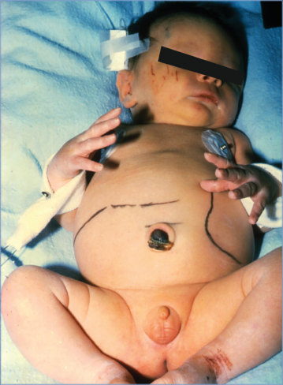
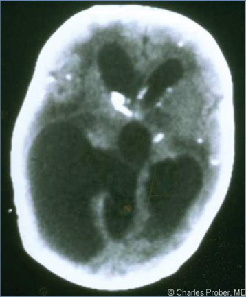
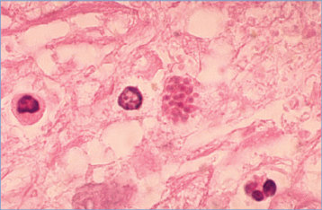
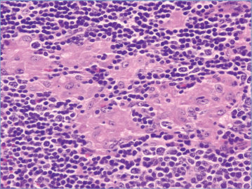
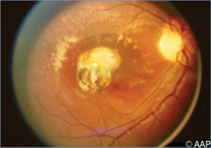
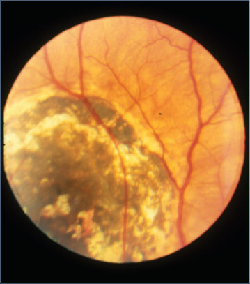
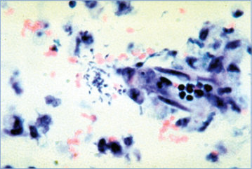
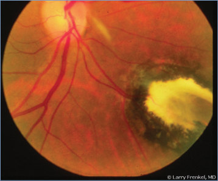

# 151. Toxoplasma gondii Infections (Toxoplasmosis)
> Reference: [source credits](../../SOURCE_CREDITS.md). Printed pp. 964-974; PDF pp. 978-988.
> Editorial study pathway: Protozoal infections (not a part division in the source).
[Flashcards](../flashcards/151_flashcards.md) · [Quiz](../mcqs/151_mcqs.md) · [Full extraction](../../raw/chapters/151.md)

## Five study pillars

### Etiology and transmission
T gondii is a protozoan and obligate intracellular parasite. The infectious forms include tachyzoites, tissue cysts containing bradyzoites, and oocysts containing sporozoites.
*Printed p. 965 / PDF p. 979*

### Clinical recognition
Up to 50% of patients with acute Toxoplasma infection are asymptomatic. When present, common signs and symptoms of acute Toxoplasma infection can include influenza-like symptoms, lymphadenopathy with atypical lymphocytosis, fever, myalgia, arthralgia, sweats, chills, fatigue, headache, chorioretinitis, hepatic dysfunction, pneumonitis, meningoencephalitis, myocarditis, myositis, acute disseminated encephalomyelitis, and myelitis.
*Printed p. 964 / PDF p. 978*

### Diagnostic workup
Serologic tests are the primary means of diagnosis. Toxoplasma immunoglobulin (Ig) G and IgM can be performed by commercial laboratories in most situations; exceptions are testing of pregnant people with suspected acute Toxoplasma infections during gestation and neonates with suspected congenital toxoplasmosis, for whom testing should be performed at a reference laboratory (see below).
*Printed p. 965 / PDF p. 979*

### Treatment in the atlas
Most cases of acquired acute T gondii infections in immunocompetent hosts do not require specific therapy unless: (a) infection occurs during pregnancy; (b) there is ocular involvement; or (c) symptoms are severe or persistent. Treatment of acute T gondii infections in immunocompromised patients is always recommended.
*Printed p. 967 / PDF p. 981*

### Prevention and infection control
Standard precautions are recommended.
*Printed p. 970 / PDF p. 984*

## Clinical search tags
Fever, Petechiae / purpura, Maculopapular rash, Lymphadenopathy, Pneumonia, Hepatitis / jaundice, Hepatosplenomegaly, Encephalitis / seizures, Arthritis / bone pain, Abscess / soft tissue, Sepsis / shock, Anemia / hemolysis, Cytopenia, Eosinophilia, Congenital / neonatal, Immunocompromised host, Animal exposure

## Full text, original tables, and images

# 151. Toxoplasma gondii Infections (Toxoplasmosis)
> Private study reference ([source credits](../../SOURCE_CREDITS.md)). PDF pages 978-988; printed pages 964-974.

## PDF page 978 | printed page 964

(Toxoplasmosis)

### CLINICAL MANIFESTATIONS

Up to 50% of patients with acute Toxoplasma infection are asymptomatic. When present, common signs and symptoms of acute Toxoplasma infection can include influenza-like symptoms, lymphadenopathy with atypical lymphocytosis, fever, myalgia, arthralgia, sweats, chills, fatigue, headache, chorioretinitis, hepatic dysfunction, pneumonitis, meningoencephalitis, myocarditis, myositis, acute disseminated encephalomyelitis, and myelitis. Reactivation of chronic Toxoplasma infection in immunocompromised patients may result in fever, pneumonia, septic shock, brain abscesses, diffuse encephalitis without brain space-occupying lesions, seizures, chorioretinitis, myocarditis, myelitis, and polymyositis.

Congenital Infection

People are not screened routinely for toxoplasmosis during pregnancy in the United States. Clinically apparent signs and symptoms of congenital toxoplasmosis are found on routine physical examination in a minority of infected infants at birth, but more specific testing (of cerebrospinal fluid [CSF], dilated eye examination, or central nervous system imaging) can reveal evidence of infection. Visual or hearing impairment, learning disabilities, or severe developmental delay will become apparent later in life in a large proportion of congenitally infected infants. Chorioretinitis occurs in approximately 70% of congenitally infected infants whose birthing parents were not treated during pregnancy and in up to 25% of those whose birthing parents were treated.

Clinical illness is more likely to be severe when infection occurs in the first trimester and is not treated during pregnancy. The classic triad of chorioretinitis, cerebral calcifications, and hydrocephalus is highly suggestive of congenital toxoplasmosis. Additional signs at birth include microcephaly, seizures, hearing loss, strabismus, petechial rash, jaundice, generalized lymphadenopathy, hepatomegaly, splenomegaly,

pneumonia, thrombocytopenia, and anemia. Meningoencephalitis may be associated with CSF abnormalities including high protein concentrations, hypoglycorrhachia, and eosinophilia. Some severely affected fetuses/infants with disseminated congenital toxoplasmosis die in utero or within a few days of birth. Cerebral calcifications can be demonstrated by plain radiography, ultrasonography, computed tomography (CT), or magnetic resonance imaging (MRI) of the head. CT is the radiologic technique most sensitive for intracranial calcifications and can reveal them when ultrasonographic studies are normal.

Postnatally Acquired Primary Infection

Postnatally acquired Toxoplasma gondii infections in immunocompetent patients usually are asymptomatic. When symptoms develop, they may be nonspecific and can include malaise, fever, headache, sore throat, arthralgia, and myalgia. Lymphadenopathy, frequently cervical, is the most common sign. Patients occasionally have a mononucleosis-like illness associated with a maculopapular rash, hepatosplenomegaly, hepatic dysfunction, and atypical lymphocytosis. The clinical course usually is benign and self-limited.

In a subset of patients, primary infection may be severe and/or persistent, including fever, myocarditis, pericarditis, myositis, hepatitis, pneumonia, encephalitis with and without brain abscesses, and skin lesions (maculopapular rash). These severe syndromes are especially common in patients who acquired primary T gondii infections with high parasite loads and/or in areas where atypical, more virulent strains are present (eg, Mexico, French Guiana, Brazil, and Colombia).

Chorioretinitis

Toxoplasmic chorioretinitis can occur: (a) with congenital infection; (b) from a postnatally acquired acute infection; and (c) from reactivation of a congenital or postnatally acquired infection. Acute onset of blurred vision, eye pain, decreased visual acuity, floaters, scotoma, photophobia, epiphora, nystagmus, or strabismus are noted. Ocular findings in toxoplasmic eye disease include white focal retinitis with overlying vitreous inflammation (“headlight in the fog”), nearby prior pigmented retinochoroidal scar,

## PDF page 979 | printed page 965

retinal vasculitis, vitreous inflammation, cataracts, iridocyclitis and stellate keratic precipitates (accompanying chorioretinitis), and elevated intraocular pressure. Complications can include retinal detachment, cystoid macular edema, optic atrophy, chronic iridocyclitis, cataract formation, secondary glaucoma, or band keratopathy.

Reactivation of Chronic Infection in Immunocompromised Patients

Reactivation of latent infection may occur in immunosuppressed patients. Reactivation can result in encephalitis, brain abscesses, seizures, pneumonia, myocarditis, hepatitis, skin lesions, posterior uveitis or panuveitis with chorioretinitis, fever of unknown origin, and disseminated disease and death. Toxoplasmic encephalitis (TE) can present as a single or multiple brain lesions on MRI or as a “diffuse form” with a rapidly progressive clinical course leading to death despite apparently normal brain imaging. MRI is superior to CT for the diagnosis of TE. In patients with AIDS, TE is the most common cause of spaceoccupying brain lesions and typically presents with acute to subacute neurologic or psychiatric symptoms and multiple ring-enhancing brain lesions. In these patients, a clear improvement in the neurologic examination within 7 to 10 days of beginning empiric anti-Toxoplasma therapy is considered diagnostic of TE. Lack of radiographic response 2 weeks after initiation of anti-Toxoplasma therapy is an indication to consider alternative diagnoses. Patients without AIDS who have multiple brain lesions should not be treated empirically for only toxoplasmosis, and other etiologies should be considered for diagnostic and empiric treatment purposes.

Seropositive hematopoietic cell transplant and solid organ transplant recipients are at risk of reactivation of latent infection in the absence of appropriate prophylaxis. Transmission occurs in ≥50% of seronegative recipients who receive hearts from seropositive donors unless appropriate prophylaxis is prescribed. Toxoplasmosis in this setting presents as pneumonia, unexplained fever or seizures, myocarditis, hepatitis, hepatosplenomegaly, lymphadenopathy, skin lesions, or brain abscesses and diffuse encephalitis. Transplant donors and recipients should be screened pretransplant for Toxoplasma infection.

### ETIOLOGY

T gondii is a protozoan and obligate intracellular parasite. The infectious forms include tachyzoites, tissue cysts containing bradyzoites, and oocysts containing sporozoites. The tachyzoite and the corresponding host immune reaction are responsible for observed symptoms. The tissue cyst is responsible for latent infection and usually is present in brain, eye, cardiac tissue, and skeletal muscle.

### EPIDEMIOLOGY

Seroprevalence of T gondii infection varies by geographic locale and socioeconomic strata of the population. The overall T gondii seropositivity rate in the United States (according to the National Health and Nutrition Examination Survey 2011– 2014) in people older than 6 years was 11.1% and among women 15 to 44 years of age was 7.5%.

Individuals become infected through foodborne, zoonotic, or person-to-person modes of transmission (eg, vertical transmission). Congenital transmission occurs in most cases as a result of acute primary infection acquired during pregnancy or within 3 months before conception. In utero infection rarely can occur as a result of reactivated parasitemia in a latently infected immunocompromised person in the absence of prophylaxis. Rarely, congenital toxoplasmosis is acquired from an immunocompetent pregnant person reinfected with a different T gondii strain. Incidence of acute primary T gondii infection during pregnancy in the United States is estimated to be 0.2 to 1.1/1,000 pregnant people on the basis of data from Massachusetts and New Hampshire, which are the only 2 states in the United States with universal toxoplasmosis newborn screening. Transmission through organ donation or blood transfusions is rare.

The incubation period of postnatally acquired infection is approximately 7 days, with a range of 4 to 21 days. Parasites can be detected in the blood for up to 2 weeks after acute infection; prolonged parasitemia also has been reported.

### DIAGNOSTIC TESTS

Serologic tests are the primary means of diagnosis. Toxoplasma immunoglobulin (Ig) G and IgM can be performed by commercial laboratories in most situations; exceptions are testing of pregnant people with suspected acute Toxoplasma

## PDF page 980 | printed page 966

infections during gestation and neonates with suspected congenital toxoplasmosis, for whom testing should be performed at a reference laboratory (see below). Toxoplasma IgM results from commercial laboratories can be falsely positive; confirmation should be obtained from reference laboratories with special expertise such as the Palo Alto Medical Foundation Toxoplasma Serology Laboratory (PAMF-TSL; Palo Alto, CA; www.sutterhealth.org/RemingtonLab; telephone: 650-853-4828; email: RemingtonLab@ sutterhealth.org). Confirmatory testing at the reference laboratory may include IgM, IgA, IgE, IgG avidity, and the differential agglutination (of acetone [AC]-fixed versus that of formalin [HS]-fixed tachyzoites) test (AC/HS test).

IgG-specific antibodies achieve a peak concentration 3 to 5 months after infection and remain positive indefinitely. IgM-specific antibodies can be detected 1 to 2 weeks after infection (IgG-specific antibodies usually are negative during this period), achieve peak concentrations in 1 month, and usually become undetectable within 6 to 9 months, but may also persist for years without apparent clinical significance. The lack of T gondii-specific IgM antibodies in a person with low-positive titers of IgG antibodies (eg, a dye test at PAMF-TSL ≤1:512) indicates infection of at least 6 months’ duration. In contrast, detectable T gondii-specific IgM antibodies can indicate recent infection, chronic (latent) infection, or a false-positive reaction. If timing of infection is clinically important (eg, in a pregnant person), sera with positive T gondii IgM test results can be sent to PAMF-TSL to establish acute versus chronic infection using an additional panel of tests such as IgG avidity, AC/HS, and IgA- and IgE-specific antibody tests.

Polymerase chain reaction (PCR) detection has been applied to body fluid or tissue, and T gondii-specific immunoperoxidase staining can be performed with any tissue, depending on the clinical scenario. A positive PCR test result in tissue must be interpreted with caution, because it may amplify tachyzoite or bradyzoite DNA and cannot distinguish between tachyzoites with acute infection or reactivation or bradyzoites with chronic latent infection. CSF PCR for T gondii has high specificity (96%–100%), but sensitivity is only 50%. CSF PCR results can also be negative because of anti-Toxoplasma therapy.

Congenital Toxoplasmosis

During pregnancy, PCR assay of amniotic fluid is the method of choice to confirm fetal infection. Fetal ultrasonography can assess for anatomical abnormalities. Examination of the placenta by histologic testing and PCR assay may provide additional information but is not sufficiently sensitive or specific for diagnostic purposes. At birth or postnatally, serologic tests for IgG, IgM, and IgA should be performed. Neonates who are born to persons with primary infection during pregnancy, or in whom there is high suspicion for congenital toxoplasmosis, should have a lumbar puncture for CSF analysis and toxoplasma PCR. Urine and whole blood should be sent for T gondii PCR assay. Positive neonatal serum Toxoplasma IgM (after 5 days of life) and/or IgA (after 10 days of life), along with a positive IgG, is considered diagnostic of congenital toxoplasmosis. IgM immunosorbent agglutination assay test results can be falsely positive after transfusion of blood products but usually become negative 14 days after transfusion. Occasionally, false-positive results for IgG, IgM, and IgA can be observed as a result of platelet transfusions or immunoglobulin intravenous infusions. Diagnosis of congenital toxoplasmosis also can be made definitively in an infant who remains Toxoplasma IgG positive at 12 months of life.

Newborn infants being evaluated for toxoplasmosis also should have a complete blood cell count (CBC) with differential, liver function tests, and CSF cell count, differential, protein, and glucose performed (in addition to T gondii PCR, above). Ophthalmologic and audiologic assessments should be conducted, and head ultrasonography (readily available but does not detect calcifications well), brain MRI (allows avoidance of radiation but may require sedation), or brain CT (the best modality for detecting calcifications) should be performed. Abdominal ultrasonography can be considered to evaluate for hepatosplenomegaly or intrahepatic calcifications.

Asymptomatic newborn infants with low suspicion for congenital toxoplasmosis but who were initially IgG positive but IgM and IgA negative should have follow-up serologic testing with IgG only at 4- to 6-week intervals until complete disappearance of transplacentally acquired IgG antibodies, usually within 6 to 12 months. In the

## PDF page 981 | printed page 967

absence of postnatal treatment, disappearance of IgG antibodies in the infant safely excludes the diagnosis of congenital toxoplasmosis.

Expert advice for evaluation and management of neonates/infants with suspected or confirmed congenital toxoplasmosis is available at: (a) the PAMF-TSL (www.sutterhealth.org/RemingtonLab; telephone 650-853-4828; email RemingtonLab@ sutterhealth.org) and (b) the Toxoplasmosis Center, University of Chicago, Chicago, IL (www. uchicagomedicine.org/conditions-services/ ophthalmology/toxoplasmosis-center; telephone 773-834-4131; email rmcleod@bsd. uchicago.edu).

### TREATMENT

Most cases of acquired acute T gondii infections in immunocompetent hosts do not require specific therapy unless: (a) infection occurs during

Table 151.1 Treatment of Neonates/Infants With Confirmed or Strongly Suspected Congenital Toxoplasmosis

Regimen Dosing and Duration Pyrimethamine PLUS Sulfadiazine PLUS Folinic acida

Doses: Pyrimethamineb: 1 mg/kg every 12 hours orally for 2 days, followed by 1 mg/kg once daily for 2–6 months (6 months should be considered for symptomatic cases), followed by 1 mg/kg once per day every Monday, Wednesday, Friday to complete a total course of 12 months

PLUS

Sulfadiazine: 50 mg/kg every 12 hours orally for 12 months

PLUS

Folinic acid (leucovorin): 10 mg/dose 3 times per week orally (during and up to 1 week after completing pyrimethamine)

Duration: Treatment usually is recommended for 1 yearc

Prednisone (if CSF protein ≥1 g/dL or severe chorioretinitis in vision-threatening area): 0.5 mg/kg (maximum 20 mg/dose) every 12 hours orally until CSF protein <1 g/dL or resolution of severe chorioretinitis (if prednisone is used, it should be started 48–72 hours after the initiation of anti-Toxoplasma therapy)

CSF indicates cerebrospinal fluid.

a Folic acid should not be used as a substitute for folinic acid (leucovorin). b In some centers in Europe, the regimen of pyrimethamine/sulfadoxine (Fansidar) every 10 days, plus folinic acid, is used for subclinical/mild forms of congenital toxoplasmosis and/or for poor compliance and/or frequent hematologic adverse effects. This regimen is used after the first 2 months of daily therapy with pyrimethamine/ sulfadiazine (plus folinic acid 2 to 3 times per week). No other alternative medications have been studied adequately for treatment of congenital toxoplasmosis. c For infants with delayed diagnosis of congenital toxoplasmosis (several months after birth), optimal duration of treatment should be discussed with a toxoplasmosis expert.

pregnancy; (b) there is ocular involvement; or (c) symptoms are severe or persistent. Treatment of acute T gondii infections in immunocompromised patients is always recommended.

Neonates and infants with confirmed/ strongly suspected congenital toxoplasmosis should receive oral therapy with pyrimethamine, sulfadiazine, and folinic acid (P/S/FA), usually for 12 months, as outlined in Table 151.1. While receiving pyrimethamine, neonates/infants should be monitored for development of neutropenia weekly for 4 weeks; if the absolute neutrophil count (ANC) is stable, then a CBC should be obtained every 2 weeks for 2 to 3 months and then every 3 to 4 weeks for the remainder of treatment. If the ANC decreases to <750 cells/mm3, the frequency of folinic acid administration should be increased to daily dosing and pyrimethamine therapy should be held temporarily.

### Geometry-detected table

|Regimen|Dosing and Duration|
|---|---|
|Pyrimethamine PLUS Sulfadiazine PLUS Folinic acida|Doses: Pyrimethamineb: 1 mg/kg every 12 hours orally for 2 days, followed by 1 mg/kg once daily for 2–6 months (6 months should be considered for symptom- atic cases), followed by 1 mg/kg once per day every Monday, Wednesday, Friday to complete a total course of 12 months PLUS Sulfadiazine: 50 mg/kg every 12 hours orally for 12 months PLUS Folinic acid (leucovorin): 10 mg/dose 3 times per week orally (during and up to 1 week after completing pyrimethamine) Duration: Treatment usually is recommended for 1 yearc Prednisone (if CSF protein≥1 g/dL or severe chorioretinitis in vision-threatening area): 0.5 mg/kg (maximum 20 mg/dose) every 12 hours orally until CSF protein<1 g/dL or resolu- tion of severe chorioretinitis (if prednisone is used, it should be started 48–72 hours after the initiation of anti-_Toxoplasma_ therapy)|

[View original table](../../tables/ch151_p0981_1.jpg)

## PDF page 982 | printed page 968

Ophthalmologic evaluations should be continued at least every 3 to 6 months during the first 3 years of life for children with confirmed/probable congenital toxoplasmosis, even if the initial evaluation at or near birth was normal. Long-term neurodevelopmental evaluation also is required.

Infected neonates/infants with asymptomatic congenital toxoplasmosis with normal fetal ultrasonography and normal findings in all postnatal evaluations, including head ultrasonography or head CT/MRI, abdominal ultrasonography, eye examination, hearing test, CBC, and liver function

Table 151.2 Treatment of Older Children With Active Toxoplasmic Chorioretinitis

• Active toxoplasmic chorioretinitis, particularly in patients with severe eye disease in vision-threatening areas, is a medical emergency and treatment should begin as soon as possible. • Duration: Treatment is usually given for 1 to 2 weeks beyond resolution of clinical manifestations, and usually is approximately 4–6 weeks total; prolonged treatment courses up to 3 months sometimes may be needed. • Consultation with a retinal specialist (with experience in management of patients with toxoplasmic chorioretinitis) AND with a toxoplasmosis infectious disease expert should be requested to assist with optimal medication dosing, duration of therapy, and necessary monitoring.

Doses: Pyrimethaminea,b,c: Loading dose: 1 mg/kg once every 12 hours orally (maximum 50 mg/day) for 2 days, followed by maintenance dose: 1 mg/kg once per day orally (maximum 25 mg/day)

PLUS

Sulfadiazine: Loading dose: 75 mg/kg (first dose), followed (12 hours later) by maintenance dose: 50 mg/kg every 12 hours orally (maximum 4 g/day)

PLUS

Folinic acid (leucovorin)d: 10–20 mg/dose daily orally (during and 1 week after therapy with pyrimethamine)

Prednisone (for severe eye disease in vision-threatening areas [eg, fovea/macula]): 0.5 mg/kg every 12 hours orally (maximum 40 mg/day). If steroids are used, they should be started after 48–72 hours of anti-Toxoplasma therapy, with rapid taper. Use steroids at the lowest possible dose and for the shortest possible duration. Suppressive therapy for recurrent toxoplasmic chorioretinitis: Although there are no pediatric clinical trials for primary or secondary prophylaxis (suppressive therapy), 2 adult randomized trials in Brazil for secondary prophylaxis showed that after recurrent active toxoplasmic chorioretinitis, initiation of chronic suppressive anti-Toxoplasma therapy (1 double strength TMP/SMX every 2–3 days, for 12–20 months) significantly decreased the incidence of recurrences.e

a If pyrimethamine tablets cannot be obtained immediately, compounded pyrimethamine can be obtained by calling Imprimis Rx at: 844-446-6979. Treatment should change back to pyrimethamine tablets as soon as they are acquired. b Trimethoprim-sulfamethoxazole (TMP/SMX) can also be used when the first-line therapy (pyrimethamine/sulfadiazine) is not readily available, but ONLY until the first-line therapy with pyrimethamine/sulfadiazine/folinic acid becomes available. In those cases, the highest doses should be used (15–20 mg/kg TMP, 75–100 mg/kg SMX per day, divided every 6–8 h). c While on pyrimethamine therapy, a complete blood cell count should be performed weekly. Screening for glucose-6-phosphate dehydrogenase (G6PD) deficiency before starting sulfadiazine or TMP/SMX should be performed for patients from regions with high prevalence of severe G6PD deficiency. d Folic acid should not be used as a substitute for folinic acid (leucovorin). e Silveira C, Belfort R Jr, Muccioli C, et al. The effect of long-term intermittent trimethoprim-sulfamethoxazole treatment on recurrences of toxoplasmic retinochoroiditis. Am J Ophthalmol. 2002;134(1):41–46; and Fernandez Felix JP, Cavalcanti Lira RP, Santos Zacchia R, et al. Trimethoprim-sulfamethoxazole versus placebo to reduce the risk of recurrences of Toxoplasma gondii retinochoroiditis: randomized controlled clinical trial. Am J Ophthalmol. 2014;157(4):762–766.e1.

tests, should be managed with the regimen used for symptomatic infants (P/S/FA). Treatment duration may be shorter than 12 months (but should be at least 3 months) and should be discussed with a congenital toxoplasmosis expert. Ophthalmologic and neurodevelopmental followup should be performed as detailed above.

Older children with active toxoplasmic chorioretinitis represent a medical emergency, and treatment should be initiated as soon as possible, as outlined in Table 151.2. Close monitoring by a

## PDF page 983 | printed page 969

retinal specialist with expertise in management of toxoplasmic eye disease and a toxoplasmosis infectious disease expert is recommended. Treatment for eye disease usually is given for 1 to 2 weeks beyond complete resolution of all clinical signs and symptoms and usually is approximately 4 to 6 weeks total. Treatment courses up to 3 months total are required occasionally.

Immunocompetent and immunocompromised children with severe primary (acute) toxoplasmosis and immunocompromised children with reactivation of latent (chronic) Toxoplasma infection should receive oral therapy with P/S/FA, as outlined in Table 151.3. In patients for whom P/S/FA is not immediately available, who are allergic or unable to take P or S,

Table 151.3 Treatment Regimens for Children and Adolescents With Severe Primary (Acute) Toxoplasmosisa and Immunocompromised Children and Adolescents With Severe Toxoplasmosis Attributable to Reactivationb

Regimen PREFERRED REGIMEN

Loading dose: 1 mg/kg every 12 hours (maximum 100 mg/ day) for 2 days; followed by 1 mg/kg once per day (up to 50 mg/day [if <60 kg] or up to 75 mg/day [if ≥60 kg] in older patients with severe disease)

Pyrimethaminec,d (PO)

PLUS

10–20 mg/dose once per day (up to 50 mg/day) (during and 1 week after therapy with pyrimethamine)

Folinic acide (PO)

PLUS

100–200 mg/kg/day divided every 6 hours (maximum 4–6 g/ day for severe disease) PREFERRED ALTERNATIVE REGIMEN Trimethoprim-sulfamethoxazoled (IV or PO) ALTERNATIVE REGIMENS (WITH LIMITED DATA) Pyrimethamine + Folinic acid + Clindamycin Pyrimethamine + Folinic acid + Atovaquone Pyrimethamine + Folinic acid + Clarithromycin Pyrimethamine + Folinic acid + Azithromycin Atovaquone + Sulfadiazine

Sulfadiazine (PO)

IV, intravenous; PO, oral.

a Includes immunocompetent or immunocompromised children with severe acute Toxoplasma gondii infection, particularly in the setting of myocarditis, myositis, hepatitis, pneumonia, brain lesions, and lymphadenopathy accompanied by severe or persisting symptoms (for drug dosing for ocular toxoplasmosis, see Table 151.2). For toxoplasmic encephalitis in HIV patients, treatment should be continued for 6 weeks, assuming clinical improvement, followed by suppressive therapy. Longer courses of treatment may be required for extensive disease or poor response after 6 weeks (https://clinicalinfo.hiv.gov/en/guidelines/ pediatric-opportunistic-infection/toxoplasmosis). b Expert advice is available at the PAMF-TSL (www.sutterhealth.org/RemingtonLab; telephone 650-853-4828; email RemingtonLab@sutterhealth.org) and the Toxoplasmosis Center, University of Chicago, Chicago, IL (www.uchicagomedicine.org/conditions-services/ophthalmology/toxoplasmosis-center; telephone 773-834-4131; email rmcleod@bsd.uchicago.edu). c If pyrimethamine tablets cannot be obtained immediately, compounded pyrimethamine can be obtained by calling Imprimis Rx at: 844-446-6979. Treatment should change back to pyrimethamine tablets as soon as they are acquired. Refer to www.daraprimdirect.com regarding access to pyrimethamine in the United States. d Trimethoprim-sulfamethoxazole (TMP/SMX) can also be used when the first-line therapy (pyrimethamine/sulfadiazine) is not readily available, and ONLY until the first-line therapy with pyrimethamine/sulfadiazine/folinic acid becomes available. In those cases, the highest doses of TMP/SMX should be used (10–15 mg/kg/day of the TMP component, divided every 8–12 hours). e Folinic acid = leucovorin; folic acid must not be used as a substitute for folinic acid.

or who have significant issues with absorption of oral medications, see alternative regimens listed in Table 151.3.

While children are receiving pyrimethamine, weekly monitoring with CBC and differential is recommended. If neutropenia is detected, the dose of folinic acid (leucovorin) should be increased.

Primary and Secondary Prophylaxis

Current treatment recommendations and recommendations for primary and secondary toxoplasmosis prophylaxis in children and adolescents with HIV infection are available at https:// clinicalinfo.hiv.gov/en/guidelines/pediatricopportunistic-infection/toxoplasmosis.

Dose

### Geometry-detected table

|Regimen|Dose|
|---|---|
|PREFERRED REGIMEN Pyrimethaminec,d (PO) PLUS Folinic acide (PO) PLUS Sulfadiazine (PO)|Loading dose: 1 mg/kg every 12 hours (maximum 100 mg/ day) for 2 days; followed by 1 mg/kg once per day (up to 50 mg/day [if<60 kg] or up to 75 mg/day [if≥60 kg] in older patients with severe disease) 10–20 mg/dose once per day (up to 50 mg/day) (during and 1 week after therapy with pyrimethamine) 100–200 mg/kg/day divided every 6 hours (maximum 4–6 g/ day for severe disease)|
|PREFERRED ALTERNATIVE REGIMEN Trimethoprim-sulfamethoxazoled (IV or PO)||
|ALTERNATIVE REGIMENS (WITH LIMITED DATA)||
| Pyrimethamine+ Folinic acid+ Clindamycin Pyrimethamine+ Folinic acid+ Atovaquone Pyrimethamine+ Folinic acid+ Clarithromycin Pyrimethamine+ Folinic acid+ Azithromycin Atovaquone+ Sulfadiazine| Pyrimethamine+ Folinic acid+ Clindamycin Pyrimethamine+ Folinic acid+ Atovaquone Pyrimethamine+ Folinic acid+ Clarithromycin Pyrimethamine+ Folinic acid+ Azithromycin Atovaquone+ Sulfadiazine|

[View original table](../../tables/ch151_p0983_1.jpg)

## PDF page 984 | printed page 970

### INFECTION PREVENTION AND CONTROL MEASURES IN HEALTH CARE SETTINGS

Standard precautions are recommended.

### CONTROL MEASURES

Testing household or close family members of individuals diagnosed with acute Toxoplasma infection should be considered in settings in which there are individuals at high risk (eg, pregnant people, immunocompromised individuals, and young children in whom visual impairment associated with acute infection may be missed). HIV-infected, immunocompromised, and pregnant individuals should be counseled about avoidance of sources of Toxoplasma infection (see below). Pregnant people and immunocompromised patients whose serostatus for T gondii is negative or unknown should avoid activities that may expose them to cat feces by avoiding changing litter boxes, gardening, and landscaping or wearing gloves while doing so and washing hands immediately thereafter. If it must be done, changing of cat litter daily decreases risk of infection, because oocysts are not infective during the first 1 to 2 days after passage. Domestic cats can be protected from infection by feeding them commercially prepared cat food and preventing them from eating undercooked meat and hunting wild rodents and birds.

Oral ingestion of viable T gondii can be prevented by the following:

• Avoiding consumption of raw or undercooked meat and cooking meat—particularly pork,

lamb, and venison—to an internal temperature of 65.5°C to 76.6°C (150°F–170°F), whole cuts of meat (excluding poultry) to at least 145°F (63°C), ground meat (excluding poultry) to at least 160°F (71°C), and all poultry to at least 165°F (74°C) before consumption;

• Avoiding consumption of smoked meat and meat cured in brine;

• Freezing meat to –20°C for 48 hours before consumption;

• Washing fruits and vegetables;

• Washing hands and cleaning kitchen surfaces after handling fruits, vegetables, and raw meat;

• Washing hands after gardening or other contact with soil;

• Preventing contamination of food with raw or undercooked meat or soil;

• Avoiding ingestion of raw shellfish such as oysters, clams, and mussels;

• Avoiding ingestion of raw goat milk; and

• Avoiding ingestion of untreated water, particularly in resource-limited countries.

Additional resources for health care personnel can be found at www.cdc.gov/parasites/ toxoplasmosis/health_professionals/index. html.

1 Maldonado YA, Read JS; American Academy of Pediatrics, Committee on Infectious Diseases. Diagnosis, treatment, and prevention of congenital toxoplasmosis in the United States. Pediatrics. 2017;139(2):e20163860

## PDF page 985 | printed page 971

Image 151.1 A 12-day-old boy with congenital toxoplasmosis with marked hepatosplenomegaly. Courtesy of George Nankervis, MD.

Image 151.3 A 3-day-old boy presented with a seizure. His computed tomographic scan demonstrated hydrocephalus and periventricular calcification, suggestive of congenital infection, such as toxoplasmosis, rubella, cytomegalovirus infection, or herpes simplex. A Toxoplasma serological test result was positive, and the neonate was treated for congenital toxoplasmosis with pyrimethamine, sulfadiazine, and folinic acid. Copyright Barbara Jantausch, MD, FAAP.

Image 151.2 Congenital infection evident on a computed tomographic scan of the head that shows diffuse calcifications and hydrocephaly. Copyright Charles Prober, MD.

## PDF page 986 | printed page 972

Image 151.4 Brain biopsy shows multiple Toxoplasma gondii organisms (Giemsa stain, original magnification × 400). Copyright Jerri Ann Jenista, MD.

Image 151.6 Toxoplasma lymphadenitis. Noncaseating epithelioid cell granulomas in lymph node. Courtesy of Dimitris P. Agamanolis, MD.

Image 151.8 Extensive chorioretinitis in an infant with congenital toxoplasmosis. Courtesy of George Nankervis, MD.

Image 151.5 Histopathologic features of toxoplasmosis of the brain in fatal AIDS. Pseudocyst contains numerous tachyzoites of Toxoplasma gondii. Courtesy of Centers for Disease Control and Prevention.

Image 151.7 Toxoplasma gondii retinitis. Note well-defined areas of chorioretinitis with pigmentation and irregular scarring.

## PDF page 987 | printed page 973

Image 151.9 Retinal scan obtained in a neonate with congenital toxoplasmosis with chorioretinitis. Courtesy of Larry Frenkel, MD.

Image 151.10 Cysts of Toxoplasma gondii usually range from 5 to 50 μm in diameter. Cysts are usually spherical in the brain but more elongated in cardiac and skeletal muscles. They may be found in various sites throughout the body of the host but are most common in the brain and the skeletal and cardiac muscles. T gondii cyst in brain tissue (hematoxylin-eosin stain). Courtesy of Centers for Disease Control and Prevention.

## PDF page 988 | printed page 974

Image 151.11 Pathways for infection with Toxoplasma gondii. The only source for the production of T gondii oocysts is the feline intestinal tract. Humans usually acquire the disease by direct ingestion of oocysts from contaminated sources (eg, soil, cat litter, garden vegetables) or the ingestion of tissue cysts present in undercooked tissues from infected animals. Fetal infection occurs most commonly after acute maternal infection in pregnancy, but it can also occur after reactivation of latent infection in women with immunocompromise. Pathways leading to human disease (solid arrows); pathways leading to feline infection (dashed arrows).

![Image 151.11 Pathways for infection with Toxoplasma gondii. The only source for the production of T gondii oocysts is the feline intestinal tract. Humans usually acquire the disease by direct ingestion of oocysts from contaminated sources (eg, soil, cat litter, garden vegetables) or the ingestion of tissue cysts present in undercooked tissues from infected animals. Fetal infection occurs most commonly after acute maternal infection in pregnancy, but it can also occur after reactivation of latent infection in women with immunocompromise. Pathways leading to human disease (solid arrows); pathways leading to feline infection (dashed arrows).](../../figures/ch151_p0988_01.jpg)
