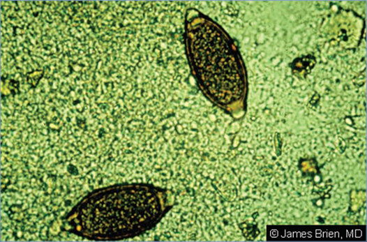
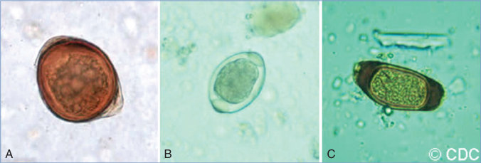

# 154. Trichuriasis (Whipworm Infection)
> Reference: [source credits](../../SOURCE_CREDITS.md). Printed pp. 985-987; PDF pp. 999-1001.
> Editorial study pathway: Helminths and ectoparasites (not a part division in the source).
[Flashcards](../flashcards/154_flashcards.md) · [Quiz](../mcqs/154_mcqs.md) · [Full extraction](../../raw/chapters/154.md)

## Five study pillars

### Etiology and transmission
T trichiura, the human whipworm, is the causative agent of trichuriasis. Adult worms are 30 to 50 mm long with a large, threadlike anterior end that embeds in the mucosa of the large intestine.
*Printed p. 985 / PDF p. 999*

### Clinical recognition
Disease caused by the whipworm Trichuris trichiura generally is proportional to the intensity of the infection. Most infected children are asymptomatic, but those with heavy infestations may develop colitis that mimics inflammatory bowel disease, with signs and symptoms that include chronic abdominal pain and diarrhea, physical growth restriction, and clubbing.
*Printed p. 985 / PDF p. 999*

### Diagnostic workup
Quantitative techniques like the Kato-Katz, McMaster, and FLOTAC methods are used typically in research settings to quantify fecal egg excretion as a measure of infection intensity. Direct microscopic visualization of eggs using stool concentrating techniques is recommended in routine clinical settings, and for screening atrisk populations such as immigrants, refugees, and international adoptees.
*Printed p. 985 / PDF p. 999*

### Treatment in the atlas
Mebendazole and albendazole are considered first-line therapies in the treatment of trichuriasis, although cure rates for both are low. Combination therapy with albendazole plus ivermectin is also a reasonable treatment approach.
*Printed p. 985 / PDF p. 999*

### Prevention and infection control
Standard precautions are recommended; there is no direct person-to-person transmission.
*Printed p. 985 / PDF p. 999*

## Clinical search tags
Diarrhea, Dysentery, Anemia / hemolysis, Eosinophilia, Travel / endemic setting

## Full text, original tables, and images

# 154. Trichuriasis (Whipworm Infection)
> Private study reference ([source credits](../../SOURCE_CREDITS.md)). PDF pages 999-1001; printed pages 985-987.

## PDF page 999 | printed page 985

(Whipworm Infection)

### CLINICAL MANIFESTATIONS

Disease caused by the whipworm Trichuris trichiura generally is proportional to the intensity of the infection. Most infected children are asymptomatic, but those with heavy infestations may develop colitis that mimics inflammatory bowel disease, with signs and symptoms that include chronic abdominal pain and diarrhea, physical growth restriction, and clubbing. A more serious condition is Trichuris dysentery syndrome, which is characterized by severe abdominal pain, tenesmus, bloody diarrhea, and occasionally rectal prolapse. Children may have anemia and peripheral eosinophilia.

### ETIOLOGY

T trichiura, the human whipworm, is the causative agent of trichuriasis. Adult worms are 30 to 50 mm long with a large, threadlike anterior end that embeds in the mucosa of the large intestine. Adult worms typically reside in the cecum and ascending colon; with heavy infection, worms may extend further into the colon and rectum.

### EPIDEMIOLOGY

T trichiura is the second most prevalent soil-transmitted helminth in the world, with approximately 600 to 800 million people infected worldwide, most in tropical regions that lack proper sanitation infrastructure. It is frequently coendemic with Ascaris and hookworm species. Humans are the natural reservoir. Eggs excreted in moist soil require a range of 10 days to 4 weeks of incubation, depending on temperature, before they are infectious. Children become infected by accidental ingestion of infective eggs in food or on hands contaminated with soil. The disease is not communicable directly from person to person.

The time between infection and appearance of eggs in the stool (incubation period) is approximately 12 weeks; worms may live 1 to 3 years or more.

### DIAGNOSTIC TESTS

Quantitative techniques like the Kato-Katz, McMaster, and FLOTAC methods are used typically in research settings to quantify fecal egg excretion as a measure of infection intensity. Direct microscopic visualization of eggs using stool concentrating techniques is recommended in routine clinical settings, and for screening atrisk populations such as immigrants, refugees, and international adoptees. Adult worms may be seen on proctoscopy or colonoscopy.

### TREATMENT

Mebendazole and albendazole are considered first-line therapies in the treatment of trichuriasis, although cure rates for both are low. Combination therapy with albendazole plus ivermectin is also a reasonable treatment approach. The recommended duration of therapy is 3 days, although a longer course (5–7 days) of albendazole may be warranted for heavy infections.

Stool specimens should be reexamined approximately 2 weeks after therapy to document cure. Those in whom therapy fails should be retreated, with consideration of combination therapy (albendazole plus ivermectin). Iron supplements should be prescribed to patients with severe or symptomatic anemia.

### INFECTION PREVENTION AND CONTROL MEASURES IN HEALTH CARE SETTINGS

Standard precautions are recommended; there is no direct person-to-person transmission.

### CONTROL MEASURES

Proper disposal of contaminated feces is the most effective means of control for whipworm and other soil-transmitted helminths. Depending on prevalence, annual or biannual administration of anthelmintics in communities with endemic Trichuris burden is currently recommended by the World Health Organization for control of soil-transmitted helminth infections, including T trichiura.

## PDF page 1000 | printed page 986

Image 154.1 Trichuris trichiura ova. Copyright James Brien, MD.

A B

Image 154.2 Trichuris trichiura ova. A–C, Atypical Trichuris species eggs. Courtesy of Centers for Disease Control and Prevention.

Image 154.3 This micrograph of an adult Trichuris female human whipworm reveals its size as approximately 4 cm. The female Trichuris trichiura worms begin to oviposit in the cecum and ascending colon 60 to 70 days after infection. Female worms in the cecum shed between 3,000 and 20,000 eggs per day. The life span of the adults is about 1 year. Courtesy of Centers for Disease Control and Prevention.

C

## PDF page 1001 | printed page 987

Image 154.4 Trichuris trichiura life cycle. The unembryonated eggs are passed with the stool (1). In the soil, the eggs develop into a 2-cell stage (2) and an advanced cleavage stage (3) and then embryonate (4); eggs become infective in 15 to 30 days. After ingestion (soil-contaminated hands or food), the eggs hatch in the small intestine and release larvae (5) that mature and establish themselves as adults in the colon (6). The adult worms (approximately 4 cm in length) live in the cecum and ascending colon. The adult worms are fixed in that location, with the anterior portions threaded into the mucosa. The females begin to oviposit 60 to 70 days after infection. Female worms in the cecum shed between 3,000 and 20,000 eggs per day. The life span of the adults is about 1 year. Courtesy of Centers for Disease Control and Prevention.

![Image 154.4 Trichuris trichiura life cycle. The unembryonated eggs are passed with the stool (1). In the soil, the eggs develop into a 2-cell stage (2) and an advanced cleavage stage (3) and then embryonate (4); eggs become infective in 15 to 30 days. After ingestion (soil-contaminated hands or food), the eggs hatch in the small intestine and release larvae (5) that mature and establish themselves as adults in the colon (6). The adult worms (approximately 4 cm in length) live in the cecum and ascending colon. The adult worms are fixed in that location, with the anterior portions threaded into the mucosa. The females begin to oviposit 60 to 70 days after infection. Female worms in the cecum shed between 3,000 and 20,000 eggs per day. The life span of the adults is about 1 year. Courtesy of Centers for Disease Control and Prevention.](../../figures/ch154_p1001_01.jpg)
