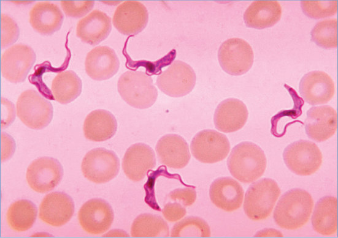

# 155. African Trypanosomiasis (Sleeping Sickness)
> Reference: [source credits](../../SOURCE_CREDITS.md). Printed pp. 988-991; PDF pp. 1002-1005.
> Editorial study pathway: Protozoal infections (not a part division in the source).
[Flashcards](../flashcards/155_flashcards.md) · [Quiz](../mcqs/155_mcqs.md) · [Full extraction](../../raw/chapters/155.md)

## Five study pillars

### Etiology and transmission
Human African trypanosomiasis (sleeping sickness) is caused by Trypanosoma brucei subspecies, which are protozoan parasites transmitted by blood-feeding tsetse flies. The west and central African (Gambian) form is caused by T brucei gambiense, and the east and southern African (Rhodesian) form is caused by T brucei rhodesiense.
*Printed p. 988 / PDF p. 1002*

### Clinical recognition
The clinical course of human African trypanosomiasis has 2 stages: the hemolymphatic stage, in which the parasite multiplies in subcutaneous tissues, lymph, and blood; and the neurologic stage, after the parasite crosses the blood-brain barrier and infects the central nervous system (CNS). The rapidity of disease progression and clinical manifestations vary with the infecting subspecies.
*Printed p. 988 / PDF p. 1002*

### Diagnostic workup
Diagnosis is made by identification of trypanosomes in specimens of blood, cerebrospinal fluid (CSF), or fluid aspirated from a chancre or lymph node, or by inoculation of susceptible laboratory animals (mice) with heparinized blood in the case of T brucei rhodesiense infection. Examination of CSF is critical to management, and all patients diagnosed in the United States should undergo lumbar puncture; concentration methods (such as the double centrifugation or modified single centrifugation techniques) typically should be used.
*Printed p. 989 / PDF p. 1003*

### Treatment in the atlas
The choice of drug(s) used for treatment depends on the type and stage of African trypanosomiasis (www.cdc.gov/parasites/sleepingsickness/ index.html). When no evidence of CNS involvement is present, the drugs of choice for the acute hemolymphatic stage of infection are pentamidine for T brucei gambiense infection and suramin for T brucei rhodesiense infection (pentamidine is also effective, although less well-documented).
*Printed p. 989 / PDF p. 1003*

### Prevention and infection control
Standard precautions are recommended.
*Printed p. 990 / PDF p. 1004*

## Clinical search tags
Fever, Pruritus, Lymphadenopathy, Hepatosplenomegaly, Encephalitis / seizures, Congenital / neonatal, Travel / endemic setting

## Full text, original tables, and images

# 155. African Trypanosomiasis (Sleeping Sickness)
> Private study reference ([source credits](../../SOURCE_CREDITS.md)). PDF pages 1002-1005; printed pages 988-991.

## PDF page 1002 | printed page 988

(Sleeping Sickness)

### CLINICAL MANIFESTATIONS

The clinical course of human African trypanosomiasis has 2 stages: the hemolymphatic stage, in which the parasite multiplies in subcutaneous tissues, lymph, and blood; and the neurologic stage, after the parasite crosses the blood-brain barrier and infects the central nervous system (CNS). The rapidity of disease progression and clinical manifestations vary with the infecting subspecies. With Trypanosoma brucei gambiense infection (found in western and central Africa), initial symptoms may be mild and include intermittent fever, headaches, muscle and joint aches, and malaise. Pruritus, rash, hepatosplenomegaly, weight loss, and lymphadenopathy (mainly posterior cervical [Winterbottom sign] but also possible in axillary, inguinal, and epitrochlear areas) can occur. CNS involvement typically develops after 1 to 2 years with development of confusion, behavioral changes, cachexia, headache, sensory disturbances, poor coordination and movement disorders, seizures, tremors, speech disorders (eg, dysarthria, logorrhea), hallucinations, delusions, and daytime somnolence followed by nighttime insomnia. Trypanosome infiltration of endocrine organs (mainly thyroid and adrenal glands) and the heart may lead to disruptions of hormonal secretions and mild perimyocarditis.

Symptoms of Trypanosoma brucei rhodesiense infection (found in eastern and southern Africa) are similar to those of T brucei gambiense infection. An inoculation chancre may develop at the site of the tsetse fly bite. Initial manifestations include high fever, headaches, pruritus, lymphadenopathy (more often submandibular, axillary, and inguinal), rash, and muscle and joint aches. Thyroid dysfunction, adrenal insufficiency, and hypogonadism are found more frequently in T brucei rhodesiense infection and myopericarditis may be earlier and more severe. Edema is reported more frequently in T brucei rhodesiense infection, and liver involvement with hepatomegaly is usually moderate, sometimes with ascites.

Clinical meningoencephalitis can develop after onset of the untreated systemic illness caused by both Trypanosoma subspecies. As the disease

progresses, severe but less frequent complications can include renal failure requiring dialysis, multiorgan failure, disseminated intravascular coagulopathy, and coma. Both forms of African trypanosomiasis have high fatality rates; without treatment, infected patients usually die within 6 months after clinical onset of disease caused by T brucei rhodesiense and within 2 to 3 years from disease caused by T brucei gambiense.

### ETIOLOGY

Human African trypanosomiasis (sleeping sickness) is caused by Trypanosoma brucei subspecies, which are protozoan parasites transmitted by blood-feeding tsetse flies. The west and central African (Gambian) form is caused by T brucei gambiense, and the east and southern African (Rhodesian) form is caused by T brucei rhodesiense. Both are extracellular protozoan hemoflagellates that live in blood and tissue of the human host.

### EPIDEMIOLOGY

The number of cases of human African trypanosomiasis is decreasing, with 663 cases reported to the World Health Organization (WHO) in 2020, a 98% reduction since 2000. Most reported cases worldwide (>95%) are caused by T brucei gambiense. There are occasional reported cases of African trypanosomiasis in the United States, typically in returning travelers who became infected with T brucei rhodesiense in East Africa. Transmission of T brucei subspecies is confined to an area in Africa between the latitudes of 14° north and 29° south, corresponding to the distribution of the tsetse fly vector (Glossina species), although many tsetse-infested areas are free of disease risk. Humans are the main reservoir of T brucei gambiense in West and Central Africa, although the parasite sometimes can be found in domestic animals, such as dogs and pigs. In East Africa, wild animals, such as antelope, bush buck, and hartebeest, constitute the major reservoirs for sporadic infections with T brucei rhodesiense, although cattle serve as reservoir hosts in local outbreaks. T brucei subspecies also can be transmitted congenitally. Accidental infections in laboratories have occurred as a result of pricks with contaminated needles.

The incubation period for acute disease symptoms from T brucei rhodesiense infection ranges

## PDF page 1003 | printed page 989

from 3 to 21 days, and for most cases is 5 to 14 days. For T brucei gambiense infection, the incubation period for acute disease symptoms usually is longer but is not well-defined; it is generally <1 month for travelers from countries without endemic disease.

### DIAGNOSTIC TESTS

Diagnosis is made by identification of trypanosomes in specimens of blood, cerebrospinal fluid (CSF), or fluid aspirated from a chancre or lymph node, or by inoculation of susceptible laboratory animals (mice) with heparinized blood in the case of T brucei rhodesiense infection. Examination of CSF is critical to management, and all patients diagnosed in the United States should undergo lumbar puncture; concentration methods (such as the double centrifugation or modified single centrifugation techniques) typically should be used. Concentration and Giemsa staining of the buffy coat layer of peripheral blood are easier for T brucei rhodesiense, because the density of organisms in circulating blood is higher than for T brucei gambiense. Wet preparations of the buffy coat and of concentrated CSF sediment should be examined within a few minutes for motile trypanosomes. T brucei gambiense is more likely to be found in lymph node aspirates than in blood. The most widely used criteria for stage determination to assess CNS involvement include identification of trypanosomes in CSF or a CSF white blood cell count of 6 cells/μL or higher; elevated CSF neopterin and an increase in intrathecal immunoglobulin M also may suggest secondstage disease. Serologic testing for antibodies to T brucei gambiense is available outside the United States and typically is used only for screening purposes to help identify suspect cases; there is no comparable serologic screening test for T brucei rhodesiense.

### TREATMENT

The choice of drug(s) used for treatment depends on the type and stage of African trypanosomiasis (www.cdc.gov/parasites/sleepingsickness/ index.html). When no evidence of CNS involvement is present, the drugs of choice for the acute hemolymphatic stage of infection are pentamidine for T brucei gambiense infection and suramin for T brucei rhodesiense infection

(pentamidine is also effective, although less well-documented). For treatment of T brucei gambiense infection with CNS involvement, the drug of choice is eflornithine in combination with nifurtimox, or eflornithine alone if nifurtimox is not available or contraindicated; for T brucei rhodesiense infection with CNS involvement, the drug of choice is melarsoprol (eflornithine is not effective for CNS treatment of T brucei rhodesiense infection). Melarsoprol encephalopathy may be reduced in severity by pretreatment with corticosteroids. Eflornithine is not approved by the U.S. Food and Drug Administration (FDA) but is available through the Centers for Disease Control and Prevention (CDC) under an individual provider investigational new drug application from the FDA. Oral fexinidazole, a nitroimidazole adapted for use in rural health facilities in Africa to be administered under directly observed therapy in selected patients, was approved recently (including by the FDA, in 2021) for children ≥6 years of age and ≥20 kg for the treatment of both first-stage (hemolymphatic) and second-stage (meningoencephalitic) gambiense trypanosomiasis. Because of decreased effectiveness observed in patients with severe second-stage human African trypanosomiasis (CSF white blood cell count >100 cells/μL) attributable to T brucei gambiense disease, fexinidazole tablets should be used only if there are no other available treatment options. Suramin, eflornithine, and melarsoprol can be obtained from the CDC (phone: 404-718-4745). As of 2023, fexinidazole is not available commercially or through the CDC in the United States. Consultation with a specialist familiar with the disease and its treatment is recommended. Patients who have had CNS involvement should undergo repeated follow-up CSF examinations every 6 months for 2 years because of the risk of relapse. The optimal approach to treatment of relapse is uncertain. The WHO has developed interim updated guidelines for the treatment of human African trypanosomiasis caused by T brucei gambiense (apps.who.int/iris/bitstream/han dle/10665/326178/9789241550567-eng. pdf?ua=1). These guidelines allow for certain patients (older children and adults without clinically apparent severe disease) to forgo a lumbar puncture when oral fexinidazole is an option and certain conditions are met by the patient.

## PDF page 1004 | printed page 990

### INFECTION PREVENTION AND CONTROL MEASURES IN HEALTH CARE SETTINGS

Standard precautions are recommended.

### CONTROL MEASURES

Travelers to areas with endemic infection should avoid known foci of sleeping sickness and tsetse fly infestation and should minimize fly bites

Image 155.1 A and B, Two areas from a thin blood smear (Giemsa stain) from a patient with African trypanosomiasis. Typical trypomastigote stages (the only stages found in patients) are a posterior kinetoplast, a centrally located nucleus, an undulating membrane, and an anterior flagellum. The 2 Trypanosoma brucei species that cause human trypanosomiasis, Trypanosoma brucei gambiense and Trypanosoma brucei rhodesiense, are indistinguishable morphologically. The trypanosome length range is 14 to 33 μm. Courtesy of Centers for Disease Control and Prevention.

Image 155.2 Trypanosoma forms in blood smear from a patient with African trypanosomiasis (hematoxylin-eosin stain).

by wearing long-sleeved shirts and pants of medium-weight material in neutral colors. Avoid light-weight cloth that tsetse flies can bite through and bright or dark colors that attract the flies (especially blue and black). Newborn infants whose birthing parent is infected should be examined clinically and their blood should be tested for trypanosomes; breastfeeding may continue during treatment.

A B

![Image 155.1 A and B, Two areas from a thin blood smear (Giemsa stain) from a patient with African trypanosomiasis. Typical trypomastigote stages (the only stages found in patients) are a posterior kinetoplast, a centrally located nucleus, an undulating membrane, and an anterior flagellum. The 2 Trypanosoma brucei species that cause human trypanosomiasis, Trypanosoma brucei gambiense and Trypanosoma brucei rhodesiense, are indistinguishable morphologically. The trypanosome length range is 14 to 33 μm. Courtesy of Centers for Disease Control and Prevention.](../../figures/ch155_p1004_01.jpg)

## PDF page 1005 | printed page 991

Image 155.3 Life cycle. During a blood meal on the mammalian host, an infected tsetse fly (genus Glossina) injects metacyclic trypomastigotes into skin tissue. The parasites enter the lymphatic system and pass into the bloodstream (1). Inside the host, they transform into bloodstream trypomastigotes (2), are carried to other sites throughout the body, reach other body fluids (eg, lymph, spinal fluid), and continue the replication by binary fission (3). The entire life cycle of African trypanosomes is represented by extracellular stages. The tsetse fly becomes infected with bloodstream trypomastigotes when taking a blood meal on an infected mammalian host (4, 5). In the fly’s midgut, the parasites transform into procyclic trypomastigotes, multiply by binary fission (6), leave the midgut, and transform into epimastigotes (7). The epimastigotes reach the fly’s salivary glands and continue multiplication by binary fission (8). The cycle in the fly takes approximately 3 weeks. Humans are the main reservoir for Trypanosoma brucei gambiense, but this species can also be found in animals. Wild game animals are the main reservoir of Trypanosoma brucei rhodesiense. Courtesy of Centers for Disease Control and Prevention.

![Image 155.3 Life cycle. During a blood meal on the mammalian host, an infected tsetse fly (genus Glossina) injects metacyclic trypomastigotes into skin tissue. The parasites enter the lymphatic system and pass into the bloodstream (1). Inside the host, they transform into bloodstream trypomastigotes (2), are carried to other sites throughout the body, reach other body fluids (eg, lymph, spinal fluid), and continue the replication by binary fission (3). The entire life cycle of African trypanosomes is represented by extracellular stages. The tsetse fly becomes infected with bloodstream trypomastigotes when taking a blood meal on an infected mammalian host (4, 5). In the fly’s midgut, the parasites transform into procyclic trypomastigotes, multiply by binary fission (6), leave the midgut, and transform into epimastigotes (7). The epimastigotes reach the fly’s salivary glands and continue multiplication by binary fission (8). The cycle in the fly takes approximately 3 weeks. Humans are the main reservoir for Trypanosoma brucei gambiense, but this species can also be found in animals. Wild game animals are the main reservoir of Trypanosoma brucei rhodesiense. Courtesy of Centers for Disease Control and Prevention.](../../figures/ch155_p1005_01.jpg)
