# 157. Tuberculosis
> Reference: [source credits](../../SOURCE_CREDITS.md). Printed pp. 999-1028; PDF pp. 1013-1042.
> Editorial study pathway: Bacterial infections (not a part division in the source).
[Flashcards](../flashcards/157_flashcards.md) · [Quiz](../mcqs/157_mcqs.md) · [Full extraction](../../raw/chapters/157.md)

## Five study pillars

### Etiology and transmission
The causative agent is M tuberculosis complex, a group of closely related acid-fast bacilli (AFB): M tuberculosis, M bovis, Mycobacterium africanum, and a few additional species infrequently associated with human infection. M africanum is rare in the United States, so clinical laboratories do not distinguish it routinely, and treatment recommendations are the same as for M tuberculosis.
*Printed p. 999 / PDF p. 1013*

### Clinical recognition
Tuberculosis (TB) disease is caused by organisms of the Mycobacterium tuberculosis complex. Most infections caused by M tuberculosis complex in children and adolescents are asymptomatic.
*Printed p. 999 / PDF p. 1013*

### Diagnostic workup
Testing for M tuberculosis Infection Tuberculin Skin Test The TST is one of two indirect methods for detecting M tuberculosis complex infection, the other method being IGRA. Both methods rely on specific lymphocyte sensitization after infection.
*Printed p. 1001 / PDF p. 1015*

### Treatment in the atlas
Specific Drugs Regimen and dosage recommendations and the more commonly reported adverse reactions of first-line antituberculosis drugs are summarized in Tables 157.4, 157.5, and 157.6. The less commonly used antituberculosis drugs, their doses, and adverse effects are listed in Table 157.7.
*Printed p. 1006 / PDF p. 1020*

### Prevention and infection control
Most children with TB disease, especially children younger than 10 years, are not contagious. Possible exceptions are the following: (1) children with pulmonary cavities; (2) children with positive sputum AFB smears; (3) children with laryngeal involvement; (4) children with extensive pulmonary disease; or (5) neonates or infants with congenital TB disease undergoing procedures that involve the oropharyngeal airway (eg, endotracheal intubation).
*Printed p. 1019 / PDF p. 1033*

## Clinical search tags
Fever, Lymphadenopathy, Cough, Pneumonia, Hepatosplenomegaly, Meningitis, Sepsis / shock, Congenital / neonatal, Immunocompromised host, Travel / endemic setting

## Full text, original tables, and images

# 157. Tuberculosis
> Private study reference ([source credits](../../SOURCE_CREDITS.md)). PDF pages 1013-1042; printed pages 999-1028.

## PDF page 1013 | printed page 999

### CLINICAL MANIFESTATIONS

Tuberculosis (TB) disease is caused by organisms of the Mycobacterium tuberculosis complex. Most infections caused by M tuberculosis complex in children and adolescents are asymptomatic. When pulmonary TB occurs, clinical manifestations most often appear 1 month to 2 years after infection and include fever, weight loss or poor weight gain, cough, night sweats, and chills. Chest radiographic findings rarely are specific for TB and include lymphadenopathy of the hilar, subcarinal, paratracheal, or mediastinal nodes; atelectasis or infiltrate of a segment or lobe; pleural effusion that can conceal small interstitial lesions; interstitial cavities; or miliarypattern infiltrates. In selected instances, computed tomography or magnetic resonance imaging of the chest can clarify nonspecific or subtle radiographic findings. Although cavitation is a typical presentation of TB in adults (and sometimes in adolescents), cavitation is uncommon in childhood TB. Necrosis and cavitation, however, can result from a progressive primary focus in very young or immunocompromised patients and in patients with lymphobronchial disease. Extrapulmonary manifestations include meningitis and granulomatous inflammation of the lymph nodes, bones, joints, skin, and middle ear and mastoid. Gastrointestinal tract TB can mimic inflammatory bowel disease. Renal TB is unusual in younger children but can occur in adolescents. In addition, chronic abdominal pain with peritonitis and intermittent partial intestinal obstruction can be present in disease caused by Mycobacterium bovis. Congenital TB can mimic neonatal sepsis, or the infant may come to medical attention in the first 90 days of life with bronchopneumonia and/or hepatosplenomegaly. Clinical findings in patients with drug-resistant (DR) TB disease are indistinguishable from manifestations in patients with drug-susceptible disease.

### ETIOLOGY

The causative agent is M tuberculosis complex, a group of closely related acid-fast bacilli (AFB): M tuberculosis, M bovis, Mycobacterium

africanum, and a few additional species infrequently associated with human infection. M africanum is rare in the United States, so clinical laboratories do not distinguish it routinely, and treatment recommendations are the same as for M tuberculosis. M bovis can be distinguished from M tuberculosis in reference laboratories, and although the spectrum of illness caused by M bovis is similar to that of M tuberculosis, the epidemiology, treatment, and prevention are different, as detailed later in the chapter.

Definitions

• Bacille Calmette-Guérin (BCG) is a live attenuated vaccine strain of M bovis. BCG vaccine rarely is administered to children in the United States but is one of the most widely used vaccines in the world. An isolate of BCG can be distinguished from wild-type M bovis only in a reference laboratory.

• Positive tuberculin skin test (TST) result. A positive TST result (see Table 157.1) indicates possible infection with M tuberculosis complex. Tuberculin reactivity appears 2 to 10 weeks after initial infection; the median interval is 3 to 4 weeks. BCG immunization can produce a positive TST result (see Diagnostic Tests, Testing for M tuberculosis Infection).

• Positive interferon-γ release assay (IGRA) result. A positive IGRA result indicates possible infection with M tuberculosis complex. IGRAs measure ex vivo interferon-γ production from T lymphocytes in response to stimulation with antigens mostly specific to M tuberculosis complex, including M tuberculosis and M bovis. The antigens used in IGRAs are not found in BCG or most pathogenic nontuberculous mycobacteria (eg, are not found in Mycobacterium avium complex, but are found in Mycobacterium kansasii, Mycobacterium szulgai, and Mycobacterium marinum).

• TB infection (TBI) is defined as M tuberculosis complex bacteria present in the body. Most commonly, TBI is used to describe infection in a person who has no symptoms or signs of disease and chest radiographic findings th at are normal or reveal evidence of healed infection

## PDF page 1014 | printed page 1000

Table 157.1 Definitions of Positive Tuberculin Skin Test (TST) Results in Infants, Children, and Adolescentsa,b

Induration 5 mm or greater

Children in close contact with known or suspected contagious people with tuberculosis (TB) disease Children suspected to have TB disease: • Findings on chest radiography consistent with active or previous TB disease • Clinical evidence of TB diseasec

Children receiving immunosuppressive therapyd or with immunosuppressive conditions, including HIV infection

Induration 10 mm or greater

Children at increased risk of disseminated TB disease: • Children younger than 4 y • Children with other medical conditions, including Hodgkin disease, lymphoma, diabetes mellitus, chronic renal failure, or malnutrition (see Table 157.2) • Children born in high-prevalence regions of the world • Children with significant travel to high-prevalence regions of the worlde

• Children frequently exposed to adults who are living with HIV, lacking housing, or incarcerated, or to people who inject or use drugs

Induration 15 mm or greater

Children without any risk factors

a See www.cdc.gov/tb/publications/guidelines/pdf/ciw778.pdf. b These definitions apply regardless of previous bacille Calmette-Guérin (BCG) immunization; erythema alone at TST site does not indicate a positive test result. Tests should be read at 48 to 72 hours after placement. c Evidence by physical examination or laboratory assessment that would include tuberculosis in the working differential diagnosis (eg, meningitis). d Including immunosuppressive doses of corticosteroids or tumor necrosis factor α antagonists or blockers or immunosuppressive drugs used in transplant recipients. e Some experts define significant travel as travel or residence in a country with an elevated TB rate for at least 1 month.

(eg, calcification in the lung, lymph nodes, or both) and a positive TST or IGRA result. This situation is also referred to as latent TBI.

• TB disease is illness in a person with infection attributable to M tuberculosis complex in whom symptoms, signs, or radiographic manifestations caused by M tuberculosis complex are apparent; disease can be pulmonary, extrapulmonary, or both.

• Multidrug-resistant (MDR) M tuberculosis is a strain of M tuberculosis that is resistant to at least isoniazid and rifampin.

• Extensively DR (XDR) M tuberculosis is a strain of M tuberculosis that is resistant to isoniazid, rifampin, any fluoroquinolone, and either bedaquiline or linezolid (or both).

• Pre-XDR M tuberculosis is defined by the

Centers for Disease Control and Prevention (CDC) as a strain of M tuberculosis that fulfills the definition of MDR and that is resistant to any fluoroquinolone.

• DR M tuberculosis is a strain of M tuberculosis that is resistant to any drug used to treat drug-susceptible TB and includes isoniazidresistant, rifampin-resistant, MDR, pre-XDR, and XDR strains.

• Directly observed therapy (DOT) is an intervention by which medications are taken by the patient while a health care professional or trained third party (not a relative or friend) observes and documents that the patient ingests each dose of medication and assesses for possible adverse drug effects. DOT can be in person or via video.

• Exposed person is anyone who has had contact with another person with suspected or confirmed contagious TB disease (ie, pulmonary, laryngeal, tracheal, or endobronchial disease). Recently (<3 months) exposed people may have an initially negative TST or IGRA result, normal physical examination findings, and chest radiographic findings that are normal or not compatible with TB. Some recently exposed people are

## PDF page 1015 | printed page 1001

or become infected (and subsequently develop a positive TST or IGRA result), and others do not become infected after exposure; the 2 groups cannot be distinguished initially.

• Source person is the person who has transmitted M tuberculosis complex to another person who subsequently develops TBI or disease.

### EPIDEMIOLOGY

Case rates of TB in all ages in North America are higher in urban, low-income areas. In recent years, more than 70% of all U.S. cases have occurred in people born outside the United States. Almost 80% of childhood TB disease in the United States is associated with some form of foreign contact of the child, parent, or a household member. Specific groups with greater rates of TB include immigrants, international adoptees, refugees from or travelers to high-prevalence regions (eg, Asia, Africa, Latin America, and countries of the former Soviet Union), people lacking housing or those with unstable housing, people who inject or use drugs, and residents of some correctional facilities and other congregate settings. Secondhand smoke exposure increases the risk of TB disease developing in infected children.

Infants and postpubertal adolescents are at increased risk of progression from TBI to TB disease. Other predictive factors for development of disease include recent infection (within the past 2 years); immunodeficiency, especially from uncontrolled HIV infection; use of immunosuppressive drugs, such as prolonged or high-dose corticosteroid therapy or chemotherapy and drugs for preventing transplant organ rejection; and certain diseases or medical conditions, including Hodgkin disease, lymphoma, diabetes mellitus, chronic renal failure, and malnutrition. Patients with TBI who are being treated with tumor necrosis factor (TNF)-α antagonists or blocking agents are at higher risk of progressing to TB disease. A positive TST or IGRA result should be accepted as indicative of infection in individuals receiving or soon to receive immunosuppressive medications,1,2 and the patient should be evaluated and treated accordingly.

A diagnosis of TBI or TB disease in a young child is a public health sentinel event often representing recent transmission. Transmission of M tuberculosis is airborne, with

inhalation of droplet nuclei usually produced by an adult or adolescent with contagious pulmonary, endobronchial, or laryngeal TB disease. The probability of transmission increases if the person has a positive acid-fast sputum smear, productive cough, or pulmonary cavities or is a household contact. Although contagiousness usually lasts only a few days to weeks after initiation of effective drug therapy, it can last longer if the source patient does not adhere to medical therapy or is infected with a DR strain. If the sputum smear becomes negative for AFB on 3 separate specimens at least 8 hours apart after treatment is initiated and the patient has improved clinically, the treated patient can be considered at low risk of transmitting M tuberculosis. Children younger than 10 years with only adenopathy in the chest or small pulmonary lesions (paucibacillary disease) and nonproductive cough are not contagious. Rare cases of pulmonary disease in young children, particularly with lung cavities or presence of AFB on sputum microscopy, and infants with congenital TB disease can be contagious.

M bovis is transmitted most often by unpasteurized dairy products, but airborne human-to-human transmission can occur.

The incubation period from infection to development of a positive TST or IGRA result is 2 to 10 weeks. The risk of developing TB disease is highest during the 12 months after infection and remains high for 2 years; however, many years can elapse between initial M tuberculosis infection and subsequent disease.

### DIAGNOSTIC TESTS

Testing for M tuberculosis Infection

Tuberculin Skin Test

The TST is one of two indirect methods for detecting M tuberculosis complex infection, the other method being IGRA. Both methods rely on specific lymphocyte sensitization after infection. Conditions that decrease lymphocyte numbers or function, including severe TB disease, can reduce the sensitivity of these tests. Tuberculin is a purified protein derivative (PPD) from heatinactivated M tuberculosis. The routine (ie, Mantoux) technique of administering the skin

## PDF page 1016 | printed page 1002

test consists of 5 tuberculin units of solution (PPD; 0.1 mL) injected intradermally using a 27-gauge needle and a 1.0-mL syringe into the volar aspect of the forearm. Creation of a palpable wheal 6 to 10 mm in diameter is crucial to accurate testing.

Administration of TSTs and interpretation of results should be performed by trained and experienced health care personnel because administration and interpretation by unskilled people or family members are unreliable. The standardized time for assessing the TST result is 48 to 72 hours after administration. The induration is measured transversely at its widest diameter, and the result should be recorded in millimeters. Positive TST results, as defined in Table 157.1, can persist for several weeks.

Lack of reaction to a TST does not exclude TBI or TB disease. Approximately 10% to 40% of immunocompetent children with culture-documented TB disease do not react initially to a TST. Host factors, such as young age, poor nutrition, immunosuppression, viral infections (especially measles, varicella, and influenza), and disseminated TB disease, can decrease TST reactivity.

Classification of TST results is based on epidemiologic and clinical factors. Interpretation of the size of induration (mm) as a positive result varies with the person’s epidemiologic risk of TBI and likelihood of progression to TB disease. Current guidelines from the CDC, the American Thoracic Society, and the American Academy of Pediatrics recommend interpretation of TST findings on the basis of an individual’s risk stratification and are summarized in Table 157.1. Prompt clinical and radiographic evaluation of all children and adolescents with a positive TST result is recommended.

BCG immunization, because of cross-reacting antigens present in the PPD, can result in induration of a TST. Distinguishing between a positive TST result caused by M tuberculosis complex infection and that caused by BCG requires a qualitative assessment of several factors. Reactivity of the TST (ie, mm of induration) attributable to prior BCG immunization may be absent or variable and depends on many factors, including age at BCG immunization, quality and strain of BCG vaccine used, number of doses of BCG vaccine received, nutritional and immunologic status of

the vaccine recipient, frequency of TST administration, and time between immunization and TST. Evidence that increases the probability that a positive TST result is attributable to TBI or TB disease includes known contact with a person with contagious TB disease, a family history of TB disease, more than 2 years since neonatal BCG immunization, and a TST reaction 15 mm or greater. Generally, interpretation of TST results in BCG recipients who are known contacts of a person with TB disease or who are at high risk of developing TB disease is the same as for people who have not received BCG vaccine.

Blood-Based Testing With IGRAs3,4,5

IGRAs measure ex vivo interferon-γ production from T lymphocytes in response to stimulation with proprietary polypeptide mixtures that simulate antigens specific to M tuberculosis complex. The IGRA antigens used are not found in BCG or most pathogenic nontuberculous mycobacteria (eg, M avium complex) but are found in the nontuberculous mycobacteria M kansasii, M szulgai, and M marinum. Examples of IGRAs are the T-SPOT.TB assay and the QuantiFERON-TB Gold Plus assay. As with TSTs, IGRAs cannot distinguish between TBI and TB disease, and a negative IGRA result cannot exclude infection with M tuberculosis complex or the possibility of TB disease in a patient with suggestive clinical findings. The sensitivity of IGRAs is similar to that of TSTs in adults and children who have untreated cultureconfirmed TB disease. In many clinical settings, the specificity of IGRAs is higher than that for the TST, because the antigens used are not found in BCG or most pathogenic nontuberculous mycobacteria. The published experience on testing children with IGRAs demonstrates that IGRAs consistently perform well in children of all ages. The negative predictive value of IGRAs is not clear, but in general, if the IGRA result is negative and the TST result is positive in an asymptomatic child with no known TB exposure, the diagnosis of TBI is unlikely, especially if the child has received a BCG vaccine.

TST Versus IGRA

Either TST or IGRA is acceptable for children of any age. IGRA is preferred for children who have received a BCG vaccine or who are unlikely to return for the TST reading. Low-grade,

## PDF page 1017 | printed page 1003

false-positive IGRA results occur in some individuals. For children without specific TB risk factors other than foreign birth or travel who have an unexpected low-level positive IGRA result (QuantiFERON-TB Gold Plus <1.00 IU/mL, T-SPOT.TB with 5–7 spots), a second diagnostic test, either an IGRA or a TST, should be performed; the child is considered infected only if both tests are positive. Indeterminate or invalid IGRA results have several possible causes that could be related to the patient, the assay itself, or its performance; these results do not exclude M tuberculosis infection and may necessitate repeat testing, possibly with a different test. Indeterminate/invalid IGRA results should not be used to make clinical decisions.

Specific recommendations for TST and IGRA use are provided in Table 157.2.

Use of Tests for M tuberculosis Infection

The most reliable strategies for identifying TBI and preventing TB disease in children are based on identification of known risk factors for TBI or

Table 157.2 Tuberculin Skin Test (TST) and IGRA Recommendations for Infants, Children, and Adolescentsa

Children for whom immediate TST or IGRA is indicatedb: • Contacts of people with confirmed or suspected contagious tuberculosis (contact tracing) • Children with radiographic or clinical findings suggesting TB disease • Children immigrating from countries with endemic infection (eg, Asia, Middle East, Africa, Latin America, countries of the former Soviet Union), including international adoptees • Children with history of significantc travel to countries with endemic infection who have substantial contact with the resident populationd

Children who should have annual TST or IGRA: • Children living with HIV

Children at increased risk of progression of TB infection to TB disease: Infants (age <1 year) and children with other medical conditions, including diabetes mellitus, chronic renal failure, malnutrition, congenital or acquired immunodeficiencies, and children receiving tumor necrosis factor (TNF) antagonists, deserve special consideration. Underlying immunodeficiencies associated with these conditions theoretically would enhance the possibility for rapid progression to severe disease. Initial histories of potential exposure to tuberculosis should be included for all these patients. If these histories or local epidemiologic factors suggest a possibility of exposure, immediate and periodic TST or IGRA should be considered.

A TST or IGRA should be performed before initiation of immunosuppressive therapy, including prolonged systemic corticosteroid administration, organ transplantation, use of TNF-α antagonists or blockers, or other immunosuppressive therapy in any child requiring these treatments.

IGRA indicates interferon-γ release assay; TBI, M tuberculosis infection.

a Bacille Calmette-Guérin (BCG) immunization is not a contraindication to a TST; IGRA is generally preferred for BCG-vaccinated children. b Beginning as early as 3 months of age for TST; IGRA may be used at all ages. c Some experts define significant travel as birth, travel, or residence in a country with an elevated tuberculosis rate for at least 1 month. d If the child is well and has no history of exposure, the TST or IGRA should be delayed for 8 to 10 weeks after return.

progression to TB disease and thorough and expedient contact tracing associated with cases of TB disease, rather than nonselective testing of large populations. Contact tracing is an intervention that should be coordinated through the local public health department. Universal testing with TST or IGRA, including programs based at schools, child care centers, and camps that include populations at low risk, is discouraged because it results in either a low yield of positive results or a large proportion of false-positive results, leading to an inefficient use of health care resources. However, using a questionnaire to determine risk factors for infection with M tuberculosis and identifying who should have a TST or IGRA performed can be useful (see Table 157.3). Risk assessment for TB should be performed at the first medical home encounter with a child and then annually if possible. Testing children for infection with M tuberculosis and clinical evaluation for possible TB disease is indicated whenever a TST or IGRA result of a household member converts from a negative to positive result (indicating recent

## PDF page 1018 | printed page 1004

Table 157.3 Validated Questions for Determining Risk of Infection with M tuberculosis in Children in the United States

• Has a family member or contact had tuberculosis disease? • Has a family member had a positive tuberculin skin test result? • Was your child born in a high-prevalence country (countries other than the United States, Canada, Australia, New Zealand, or Western and North European countries)? • Has your child traveled to a high-prevalence country? How much contact did your child have with the resident population?

infection) or after travel for >1 month to a country with endemic disease.

HIV Infection

In the United States, annual testing for infection with M tuberculosis is recommended for children living with HIV beginning at ages 3 to 12 months and annually thereafter for those who test negative, depending on the local epidemiology and the child’s region of birth and travel history. Conversely, children who have TB disease should be tested for HIV infection. The clinical manifestations and radiographic appearance of TB disease in children living with HIV tend to be similar to those in immunocompetent children, but manifestations in these children can be more severe, unusual, and more often include extrapulmonary involvement of multiple organs. In people living with HIV, a TST induration of ≥5 mm is considered a positive result (see Table 157.1); however, a false-negative TST or IGRA result attributable to HIV-related immunosuppression also can occur. Confirming TB disease in a child living with HIV using microbiological specimens is challenging, given the paucibacillary nature of TB in this population. Antituberculosis therapy for children living with HIV must be selected with careful consideration of antiretroviral drug interactions, which are very common with the rifamycins.

Organ Transplant Recipients

The risk of TB disease in organ transplant recipients is severalfold greater than in the general population. A careful history should be taken from all transplant candidates, including details about previous TST or IGRA results and exposure to individuals with TB disease. All transplant candidates should undergo evaluation by TST or IGRA before the initiation of immunosuppressive therapy. A positive result of either test should be taken as

evidence of infection with M tuberculosis complex. In addition, donor-derived TB disease can be transmitted via an infected organ and should be considered as a possible cause of posttransplant fever and related symptoms.

Patients Receiving Immunosuppressive Therapies Including Biologic Response Modifiers

In addition to a detailed history of risk factors for infection with M tuberculosis, all patients should have a TST or IGRA performed before the initiation of therapy with high-dose systemic corticosteroids, antimetabolite agents, TNF antagonists or blockers, and some other biologic responsemodifying drugs. Some experts recommend that if the child has at least 1 TB risk factor, both a TST and an IGRA should be performed to maximize sensitivity; a positive result of either test should be taken as evidence of M tuberculosis infection.

Other Considerations

Testing for infection with M tuberculosis complex at any age is not required before administration of live-virus vaccines. Live attenuated measles, mumps, and rubella vaccines temporarily can suppress tuberculin reactivity for at least 4 to 6 weeks, and data suggest a similar suppression with varicella and yellow fever vaccines. The effect of live attenuated influenza vaccines on TST reactivity is not known. If indicated, a TST can be performed or blood drawn for an IGRA at the same visit during which these vaccines are administered (ie, before substantial replication of the vaccine virus). The effects of live-virus vaccination on IGRA characteristics have not been determined; the same precautions as for TST should be followed.

Sensitivity to PPD tuberculin antigen persists for years in most instances, even after effective

## PDF page 1019 | printed page 1005

treatment. The durability of positive IGRA results has not been determined but is likely similar. Repeat testing with either TST or IGRA has no known clinical utility for assessing the effectiveness of treatment or for diagnosing newly acquired infection in patients who previously were infected with M tuberculosis.

Assessing for M tuberculosis Disease

Although both IGRA and TST provide evidence for infection with M tuberculosis complex, they cannot distinguish TBI from TB disease. Therefore, patients testing positive for M tuberculosis infection by IGRA or TST should be assessed for TB disease before therapeutic intervention is undertaken. This assessment should include: (1) asking about symptoms of TB disease and exposure to a possible source person; (2) physical examination for signs of TB disease; and (3) a chest radiograph. If radiographic signs of TB disease (eg, airspace opacities, pleural effusions, cavities, or changes on serial radiographs) are seen, then sputum, gastric aspirate, or nasopharyngeal aspirate sampling should be performed, as described below. Most experts recommend that children younger than 12 months who are suspected of having pulmonary or extrapulmonary TB disease (eg, have a positive TST result and symptoms, physical examination signs, or chest radiograph abnormalities consistent with TB disease), with or without neurologic symptoms, should have a lumbar puncture to evaluate for tuberculous meningitis. Children 12 months and older with TB disease require a lumbar puncture only if they have neurologic signs or symptoms.

Laboratory Confirmation of M tuberculosis

Laboratory isolation of M tuberculosis complex by culture from a specimen of sputum (expectorated or induced), gastric aspirate, nasopharyngeal aspirate, bronchial washing, pleural fluid, cerebrospinal fluid, urine or other body fluid, or a tissue biopsy specimen confirms the diagnosis of TB disease. Positive results from a rapid molecular method (eg, nucleic acid amplification tests [NAATs]) increasingly are also considered confirmatory, but culture isolation of the organism is still required for phenotypical susceptibility testing, genotyping, most rapid molecular detection of drug-resistance genes, and species identification with the M tuberculosis complex. Children

older than 2 years and adolescents frequently produce sputum spontaneously or by induction with aerosolized hypertonic saline. Studies have demonstrated successful collection of induced sputum from infants with pulmonary TB disease, but this requires special expertise. The best specimen for diagnosis of pulmonary TB disease in any child or adolescent in whom cough is absent or nonproductive and sputum cannot be induced is an earlymorning gastric aspirate, which is best obtained with a nasogastric tube on awakening the child and before ambulation or feeding. Aspirates collected on 3 separate mornings should be submitted for AFB staining and culture. Nasopharyngeal aspirates (multiple specimens or in addition to other specimen types) are an acceptable specimen for children particularly when gastric aspirates are difficult to obtain, but sensitivity may be lower compared to gastric aspirate samples. Stool has been recommended by the World Health Organization (WHO) as a specimen for young children because it is easier to obtain than gastric aspirates, and swallowed sputum passes through the gastrointestinal tract. The WHO has released guidance on processing stool for NAAT for the diagnosis of pulmonary TB disease in young children (www.who.int/publications/i/ item//9789240042650).

Fluorescent staining methods for specimen smears are more sensitive than the traditional Kinyoun acid-fast smears and are preferred. The overall diagnostic yield of microscopy of gastric aspirates, induced sputum, or nasopharyngeal aspirates is low in children with clinically suspected pulmonary TB disease, and false-positive stain results caused by the presence of nontuberculous mycobacteria occur rarely. Histologic examination for and demonstration of AFB and granulomas in biopsy specimens from lymph node, pleura, mesentery, liver, bone marrow, or other tissues can be useful, but M tuberculosis complex organisms cannot be distinguished reliably from other mycobacteria in stained specimens. The CDC and several reference laboratories offer molecular species identification of mycobacteria including M tuberculosis in fixed tissues. Regardless of results of the AFB smears, each specimen should be cultured.

Because M tuberculosis complex organisms are slow growing, detection of these organisms may take as long as 10 weeks using solid media; use of

## PDF page 1020 | printed page 1006

liquid media and continuous monitoring systems allows detection within 1 to 6 weeks and usually within 3 weeks. Even with optimal culture techniques, M tuberculosis complex organisms are isolated from fewer than 75% of infants and fewer than 50% of children with pulmonary TB disease diagnosed by clinical criteria; the culture yields for most forms of extrapulmonary TB disease are even lower. Current methods for species identification of isolates from culture include molecular probes, NAATs, genetic sequencing, mass spectrometry, and biochemical tests. M bovis usually is suspected because of isolated pyrazinamide resistance, which is characteristic of almost all M bovis isolates, but further biochemical or molecular testing is required to distinguish M bovis from M tuberculosis.

For a child with clinically suspected TB disease, finding the culture-positive source person supports the child’s presumptive diagnosis and provides the likely drug susceptibility of the child’s organism. Culture material should be collected from children with evidence of TB disease, especially when (1) an isolate from a source person is not available; (2) the presumed source person has DR TB; (3) the child is immunocompromised or ill enough to require hospital admission; or (4) the child has extrapulmonary disease. Traditional methods of determining drug susceptibility require bacterial isolation. Several molecular methods that rapidly detect drug resistance directly from clinical samples are available.

NAATs cleared by the U.S. Food and Drug Administration (FDA) are available for rapid detection of M tuberculosis complex organisms from smear-positive and smear-negative sputum specimens, and other laboratory-developed tests for rapid molecular detection are available locally. Some tests have been validated for specimens other than sputum; expert consultation is recommended for test availability and interpretation of results. Molecular methods, such as Xpert MTB/ RIF that find M tuberculosis genetic markers associated with drug resistance, are supplementing the culture-based (ie, phenotypic) methods for drug susceptibility testing as they decrease the time to detection of drug resistance from weeks to hours, and in some instances the results could be more reliable for patient care decisions. Some of the methods are verified for direct testing of patient specimens. It is recommended that results from molecular susceptibility testing are confirmed

through culture-based testing. Molecular methods continue to evolve, and consultation with an expert is useful to determine a testing strategy when drug resistance is suspected.

### TREATMENT (SEE TABLE 157.4)6

Specific Drugs

Regimen and dosage recommendations and the more commonly reported adverse reactions of first-line antituberculosis drugs are summarized in Tables 157.4, 157.5, and 157.6. The less commonly used antituberculosis drugs, their doses, and adverse effects are listed in Table 157.7. Some of these drugs have less effectiveness and greater toxicity or they are reserved for treating MDR, pre-XDR, or XDR TB disease; they should be used only in consultation with a specialist familiar with treatment of childhood TB disease. For treatment of TB disease, drugs always must be used in recommended combination and dosage to minimize emergence of DR strains. Use of nonstandard regimens for any reason (eg, drug allergy, drug resistance) should be undertaken only by an expert in treating TB disease.

Occasionally, a patient cannot tolerate oral medications. Isoniazid, rifampin, linezolid, fluoroquinolones, and aminoglycosides can be administered parenterally.

Treatment Regimens for TBI

Several regimens are recommended for TBI (without evidence of TB disease), depending on the circumstances for individual patients. Dosages and intervals are provided in Table 157.5.

Isoniazid-Rifapentine Therapy for TBI7

A 3-month course, comprising a once-weekly dose of isoniazid and rifapentine, is a regimen that is safe, well tolerated, and at least as effective as 9 months of isoniazid taken daily. Extensive published and unpublished experience with this combination in children has demonstrated excellent results. Isoniazid-rifapentine is a preferred regimen for treatment of TBI for children ≥2 years of age, although the pill burden in younger children is substantial and sometimes not well tolerated. Isoniazid-rifapentine should not be used in children <2 years of age because of a lack of pharmacokinetic data in this age group.

## PDF page 1021 | printed page 1007

Table 157.4 Recommended Usual Treatment Regimens for Drug-Susceptible TB Infection and TB Disease in Infants, Children, and Adolescents

Infection or Disease Category Regimen TB infection (positive TST or IGRA result, no disease)a

• Isoniazid susceptible 3 mo of isoniazid plus rifapentine, once a week

OR 4 mo of rifampin, once a day OR

3 mo of isoniazid plus rifampin, once a day OR 6 or 9 mo of isoniazid, once a day • Isoniazid resistant 4 mo of rifampin, once a day • Isoniazid-rifampin resistant

Consult a tuberculosis specialist Pulmonary and extrapulmonary TB disease (except meningitis and osteoarticular disease)b,c

If nonsevere pulmonary disease,d 2 mo of rifampin, isoniazid, pyrazinamide, and ethambutol (RIPE) daily, followed by 2 mo of isoniazid and rifampin daily for drug-susceptible Mycobacterium tuberculosis

If severe pulmonary disease, 2 mo of rifampin, isoniazid, pyrazinamide, and ethambutol (RIPE) daily, followed by 4 mo of isoniazid and rifampin daily for drug-susceptible M tuberculosis

If severe or nonsevere pulmonary disease in a patient ≥12 years of age (and ≥40 kg), an alternative is a 4-month regimen with isoniazid, rifapentine, moxifloxacin, and pyrazinamide (8 weeks of the 4 drugs given daily, followed by 9 weeks of isoniazid, rifapentine, and moxifloxacin given daily by DOT)e

Remarks

Isoniazid-rifapentine is a preferred regimen for treatment of TBI for children ≥2 years. Continuous daily therapy is required. Intermittent therapy even by DOT is not recommended.

To be considered if above 2 regimens are not feasible. 9 months preferred. If daily therapy is not possible, DOT twice a week can be used; medication doses differ with daily and twice-weekly regimens. Continuous daily therapy is required. Intermittent therapy even by DOT is not recommended.

Moxifloxacin or levofloxacin, with consideration of a second drug based on drug susceptibility testing of presumed source isolate and consultation with a tuberculosis specialist.

Some experts recommend a 3-drug initial regimen (isoniazid, rifampin, and pyrazinamide) if the risk of drug resistance is low.

DOT is highly desirable and, in many jurisdictions, DOT is required for all regimens.

In many public health jurisdictions, DOT is recommended for all regimens.

If a cavity is present, or sputum culture takes longer than 2 months to become negative, treatment should be extended to 9 months.

DOT is required for 4-month regimen containing isoniazid, rifapentine, moxifloxacin, and pyrazinamide.

Patients with a positive culture at completion of 2 months of therapy, with or without ongoing symptoms, should be evaluated to identify cause of delayed response.

(continues)

### Geometry-detected table

|Infection or Disease Category|Regimen|Remarks|
|---|---|---|
|**TB infection** (positive TST or IGRA result, no disease)a •  Isoniazid susceptible •  Isoniazid resistant •  Isoniazid-rifampin resistant|3 mo of isoniazid plus rifapentine, once a week OR 4 mo of rifampin, once a day OR 3 mo of isoniazid plus rifampin, once a day OR 6 or 9 mo of isoniazid, once a day 4 mo of rifampin, once a day Consult a tuberculosis specialist|Isoniazid-rifapentine is a preferred regimen for treatment of TBI for children≥2 years. Continuous daily therapy is required. Intermittent therapy even by DOT is not recommended. To be considered if above 2 regimens are not feasible. 9 months preferred. If daily therapy is not possible, DOT twice a week can be used; medication doses differ with daily and twice-weekly regimens. Continuous daily therapy is required. Intermittent therapy even by DOT is not recommended. Moxifoxacin or levofoxacin, with con- sideration of a second drug based on drug susceptibility testing of presumed source isolate and consultation with a tuberculosis specialist.|
|**Pulmonary and** **extrapulmonary** **TB disease (except** **meningitis and** **osteoarticular** **disease)b,c**|If nonsevere pulmonary disease,d 2 mo of rifampin, isoniazid, pyrazin- amide, and ethambutol (RIPE) daily, followed by 2 mo of isoniazid and rifampin daily for drug-susceptible _Mycobacterium tuberculosis_ If severe pulmonary disease, 2 mo of rifampin, isoniazid, pyrazinamide, and ethambutol (RIPE) daily, followed by 4 mo of isoniazid and rifampin daily for drug-susceptible_M tuberculosis_ If severe or nonsevere pulmonary disease in a patient≥12 years of age (and≥40 kg), an alternative is a 4-month regimen with isoniazid, rifapentine, moxifoxacin, and pyrazinamide (8 weeks of the 4 drugs given daily, followed by 9 weeks of isoniazid, rifapentine, and moxifoxacin given daily by DOT)e|Some experts recommend a 3-drug initial regimen (isoniazid, rifampin, and pyrazin- amide) if the risk of drug resistance is low. DOT is highly desirable and, in many jurisdictions, DOT is required for all regimens. In many public health jurisdictions, DOT is recommended for all regimens. If a cavity is present, or sputum culture takes longer than 2 months to become negative, treatment should be extended to 9 months. DOT is required for 4-month regimen containing isoniazid, rifapentine, moxi- foxacin, and pyrazinamide. Patients with a positive culture at com- pletion of 2 months of therapy, with or without ongoing symptoms, should be evaluated to identify cause of delayed response.|

[View original table](../../tables/ch157_p1021_1.jpg)

## PDF page 1022 | printed page 1008

Table 157.4 (continued)

Infection or Disease Category Regimen For Mycobacterium bovis disease, at least 9 mo of isoniazid and rifampin, with or without ethambutol, when the organism is susceptible to these drugs Meningitis 2 mo of isoniazid, rifampin, pyrazinamide, and ethionamide or a fluoroquinolone (levofloxacin or moxifloxacin)f followed by 4–10 mo of isoniazid and rifampin, once a day or 3 times per week (6–12 mo total) for drug-susceptible M tuberculosisg

At least 9 mo of therapy without pyrazinamide for M bovis susceptible to isoniazid and rifampin

TST indicates tuberculin skin test; IGRA, interferon-γ release assay; DOT, directly observed therapy.

a See text for comments and additional acceptable/alternative regimens. b Duration of therapy may be longer for people living with HIV, and additional drugs and dosing intervals may be indicated. c Consultation with an expert is recommended. Susceptible osteoarticular tuberculosis is generally treated with a 4-drug regimen of isoniazid, rifampin, pyrazinamide, and ethambutol for 2 months and isoniazid and rifampin for another 10 months. d Nonsevere pulmonary disease is defined as tuberculosis confined to one lobe with no cavities or isolated intrathoracic adenopathy, no signs of miliary tuberculosis, no complex pleural effusion, and no clinically significant airway obstruction. e For patients 12 and older receiving isoniazid, rifapentine, pyrazinamide, and moxifloxacin for treatment of susceptible pulmonary tuberculosis, the daily dose for patients 40 kg and over of isoniazid is 300 mg; rifapentine, 1,200 mg; and moxifloxacin, 400 mg. Dosing for pyrazinamide in patients weighing 40 to <55 kg is 1,000 mg, for patients weighing 55 to 75 kg is 1,500 mg, and for patients weighing >75 kg is 2,000 mg daily. Isoniazid, rifapentine, moxifloxacin, and pyrazinamide are administered by DOT daily for 8 weeks followed by isoniazid, rifapentine, and moxifloxacin daily by DOT for another 9 weeks (www.cdc.gov/mmwr/volumes/71/ wr/mm7108a1.htm). f Consultation with an expert in tuberculosis is recommended. When susceptibility to first-line drugs is established, the ethionamide or fluoroquinolone can be discontinued. g In children and adolescents with TB meningitis presumed to be drug susceptible, the WHO states that 6 months of isoniazid, rifampin, pyrazinamide, and ethionamide daily may be used, but the longer treatment regimen in this table is preferred.

Rifampin Therapy for TBI

A 4-month course of rifampin given daily also is a preferred regimen for the treatment of TBI, and especially when isoniazid resistance is present or likely, as judged from the exposure history. The data supporting the effectiveness and safety of this regimen are from randomized controlled trials and case control studies in adults, and several studies that included children. The regimen has been as effective as 9 months of daily isoniazid, the rates of adverse effects have been low, and the completion rates of therapy have been much higher than for 9 months of isoniazid. There has been extensive published and unpublished experience with this regimen in children demonstrating safety, tolerability, and high rates of completion.

Isoniazid-Rifampin Therapy for TBI

An additional possible regimen for treatment of TBI is 3 months of daily isoniazid and rifampin, with

Remarks

See text for information on corticosteroids. High-dose rifampin (30 mg/kg/day) for TB meningitis is recommended.

no age restriction on its use. This regimen is quite similar in principle to the isoniazid-rifapentine option; however, the medications are given daily because of the relatively short half-life of rifampin compared with rifapentine. Effectiveness and rates of completion are comparable or better when compared with isoniazid monotherapy.

Isoniazid Therapy for TBI

Isoniazid monotherapy has been the most widely recommended and utilized treatment for pediatric TBI. The effectiveness of isoniazid monotherapy reaches 98% against development of TB disease, but many studies have shown that the long duration of isoniazid monotherapy results in poor adherence and low completion rates. The WHO recommends a treatment duration of 6 months to provide high coverage of the population in countries with a high disease burden. A 9-month regimen gives an additional 20% to 30% increase in effectiveness. The CDC and National Tuberculosis

### Geometry-detected table

|Infection or Disease Category|Regimen|Remarks|
|---|---|---|
||For_Mycobacterium bovis_ disease, at least 9 mo of isoniazid and rifampin, with or without ethambutol, when the organism is susceptible to these drugs||
|**Meningitis**|2 mo of isoniazid, rifampin, pyrazin- amide, and ethionamide or a fuoroqui- nolone (levofoxacin or moxifoxacin)f followed by 4–10 mo of isoniazid and rifampin, once a day or 3 times per week (6–12 mo total) for drug-susceptible _M tuberculosis_g At least 9 mo of therapy without pyra- zinamide for_M bovis_ susceptible to isoniazid and rifampin|See text for information on corticoste- roids. High-dose rifampin (30 mg/kg/day) for TB meningitis is recommended.|

[View original table](../../tables/ch157_p1022_1.jpg)

## PDF page 1023 | printed page 1009

Weekly (SAT or DOT) 3 Not for children <2 y Take with food, containing fat if possible; pyridoxine for selected patientsa

Agent(s) Dose and Age Group Administration Duration (months) Age Restriction Comments

Regimens and Dosages Used in Pediatric Patients With TB Infection (TBI)

Table 157.5

INH: 15 mg/kg, rounded up to nearest 50 or 100 mg (max 900 mg)

Rifapentine (by weight): 10–14 kg: 300 mg 14.1–25 kg: 450 mg 25.1–32 kg: 600 mg 32.1–49.9 kg: 750 mg ≥50.0 kg: 900 mg

Age 2–11 y

INH + Rifapentine (3HP) Age ≥12 y

Same doses as when drugs are used individually for SAT Daily (SAT) 3 None Not considered unless 3HP or 4R are not feasible

INH Adult: 5 mg/kg (max dose 300 mg) Child: 10–20 mg/kg (max 300 mg) Daily (SAT) 6 or 9 None Seizures with overdose; pyridoxine for selected patientsa

a Exclusively breastfed infants and for children and adolescents on meat- and milk-deficient diets; children with nutritional deficiencies, including all symptomatic children living with HIV infection; and pregnant adolescents and pregnant adults. Adapted from Nolt D, Starke JR; American Academy of Pediatrics, Committee on Infectious Diseases. Clinical report. Tuberculosis infection in children: testing and treatment. Pediatrics. 2021;148(6):e2021054663.

Rifampin (4R) Adult: 10 mg/kg (max 600 mg) Child: 15–20 mg/kg (max 600 mg) Daily (SAT) 4 None Drug-drug interactions

Adult: 15 mg/kg (max dose 900 mg) Child: 20–40 mg/kg (max 900 mg) Twice weekly (DOT)

INH: 25 mg/kg, rounded up to nearest 50 or 100 mg (max 900 mg)

INH indicates isoniazid; DOT, directly observed therapy; SAT, self-administered therapy.

Rifapentine: see above

Rifampin

INH +

### Geometry-detected table

|Agent(s)|Dose and Age Group|Administration|Duration (months)|Age Restriction|Comments|
|---|---|---|---|---|---|
|INH+ Rifa- pentine (3HP)|**Age**≥12 y INH: 15 mg/kg, rounded up to nearest 50 or 100 mg (max 900 mg) Rifapentine (by weight): 10–14 kg: 300 mg 14.1–25 kg: 450 mg 25.1–32 kg: 600 mg 32.1–49.9 kg: 750 mg ≥50.0 kg: 900 mg **Age 2–11 y** INH: 25 mg/kg, rounded up to nearest 50 or 100 mg (max 900 mg) Rifapentine: see above|Weekly (SAT or DOT)|3|Not for children<2 y|Take with food, containing fat if possible; pyridoxine for selected patientsa|
|Rifampin (4R)|** Adult:** 10 mg/kg (max 600 mg) **Child:** 15–20 mg/kg (max 600 mg)|Daily (SAT)|4|None|Drug-drug interactions|
|INH+ Rifampin|Same doses as when drugs are used individually for SAT|Daily (SAT)|3|None|Not considered unless 3HP or 4R are not feasible|
|INH|**Adult:** 5 mg/kg (max dose 300 mg) **Child:** 10–20 mg/kg (max 300 mg)|Daily (SAT)|6 or 9|None|Seizures with overdose; pyridoxine for selected patientsa|
|INH|**Adult:** 15 mg/kg (max dose 900 mg) **Child:** 20–40 mg/kg (max 900 mg)|Twice weekly (DOT)|Twice weekly (DOT)|Twice weekly (DOT)|Twice weekly (DOT)|

[View original table](../../tables/ch157_p1023_1.jpg)

## PDF page 1024 | printed page 1010

30e 15–20d 600 mg Orange discoloration of secretions or urine, staining of contact lenses, vomiting, hepatitis, hyperbilirubinemia, influenza-like reaction, thrombocytopenia, pruritus; oral contraceptives may be

20 (15–25) 50 Daily, 1 g Twice a week, 2.5 g Optic neuritis (usually reversible), decreased red-green color discrimination, gastrointestinal tract disturbances, hypersensitivity

Isoniazidb Scored tablets 100 mg 10 (10–15)b 20–30 Daily, 300 mg Mild hepatic enzyme elevation, hepatitis,c peripheral neuritis, hypersensitivity 300 mg Twice a week, 900 mg Pyrazinamide Scored tablets 500 mg 35 (30–40) 50 2 g Hepatotoxic effects, hyperuricemia, arthralgia, gastrointestinal tract upset, pruritus, rash

Drugs for Treatment of Drug-Susceptible Pulmonary TB Disease in Infants, Children, and Adolescentsa

Three Times per Week Dosage, mg/kg per Dose Maximum Dose Most Common Adverse Reactions

Table 157.6

Drugs Dosage Forms Daily Dosage (Range), mg/kg

15–20d

Rifampin Capsules 150 mg 300 mg Syrup formulated

Ethambutol Tablets 100 mg 400 mg

a Rifamate is a capsule containing 150 mg of isoniazid and 300 mg of rifampin. Two capsules provide the usual adult (greater than 50 kg) daily doses of each drug. Rifater, in the United States, is a capsule containing 50 mg of isoniazid, 120 mg of rifampin, and 300 mg of pyrazinamide. Isoniazid and rifampin also are available for parenteral administration. b Concomitant administration of pyridoxine is recommended for breastfeeding infants and for children or adolescents at risk for nutritional deficiency. c When isoniazid in a dosage exceeding 10 mg/kg/day is used in combination with rifampin, the incidence of hepatotoxic effects may be increased. d Many experts recommend using a daily rifampin dose of 20–30 mg/kg/day for infants and toddlers and for serious forms of tuberculosis, such as disseminated disease. e A dose of 30 mg/kg/day of rifampin is recommended for TB meningitis and has been shown to improve mortality and neurodevelopmental outcomes. f Four-drug therapy for susceptible pulmonary tuberculosis disease in persons ≥12 years includes isoniazid, rifapentine, pyrazinamide, and moxifloxacin daily by DOT for 8 weeks followed by isoniazid, rifapentine, and moxifloxacin daily by DOT for 9 weeks (see www.cdc.gov/mmwr/volumes/71/wr/mm7108a1.htm). g Moxifloxacin does not have an FDA indication for the treatment of TB infection or disease and is not approved for use in children younger than 18 years; its use in younger children necessitates assessment of the potential risks and benefits. The Centers for Disease

400 mg Hypersensitivity reactions; theoretical effect on growing cartilage; tendonitis, gastrointestinal tract disturbances, cardiac disturbances, peripheral neuropathy, rash, headache, restlessness, confusion; can prolong QTc interval

Orange discoloration of secretions or urine, staining of contact lenses, vomiting, hepatitis, hyperbilirubinemia, influenza-like reaction, anemia, lymphopenia, pruritus; oral contraceptives may be ineffective

ineffective

Rifapentine Tablets 150 mg 1,200 mg dose for age ≥12 years as part of a multidrug 4-month regimen for pulmonary tuberculosis diseasef

Control and Prevention recommends moxifloxacin use for drug-susceptible pulmonary TB disease in persons ≥12 years, with body weight of ≥40 kg.

Children: 10 mg/kg (once daily)

Adults: 400 mg (once daily)

Intravenous: 400 mg/250 mL

from capsules

Moxifloxacing Tablet: 400 mg

### Geometry-detected table

|Drugs|Dosage Forms|Daily Dosage (Range), mg/kg|Three Times per Week Dosage, mg/kg per Dose|Maximum Dose|Most Common Adverse Reactions|
|---|---|---|---|---|---|
|Ethambutol|Tablets 100 mg 400 mg|20 (15–25)|50|Daily, 1 g Twice a week, 2.5 g|Optic neuritis (usually reversible), decreased red-green color dis- crimination, gastrointestinal tract disturbances, hypersensitivity|
|Isoniazidb|Scored tablets 100 mg|10 (10–15)b|20–30|Daily, 300 mg|Mild hepatic enzyme elevation, hepatitis,c peripheral neuritis, hypersensitivity|
|Isoniazidb|300 mg|||Twice a week, 900 mg|Twice a week, 900 mg|
|Pyrazinamide|Scored tablets 500 mg|35 (30–40)|50|2 g|Hepatotoxic effects, hyperuricemia, arthralgia, gastrointestinal tract upset,pruritus, rash|
|Rifampin|Capsules 150 mg 300 mg Syrup formulated from capsules|15–20d  30e|15–20d|600 mg|Orange discoloration of secretions or urine, staining of contact lenses, vomiting, hepatitis, hyperbilirubinemia, infuenza-like reaction, thrombocytopenia, pruritus; oral contraceptives may be ineffective|
|Rifapentine|Tablets 150 mg|||1,200 mg dose for age ≥12 years as part of a multidrug 4-month regimen for pulmonary tuberculosis diseasef|Orange discoloration of secretions or urine, staining of contact lenses, vomiting, hepatitis, hyperbilirubinemia, infuenza-like reaction, anemia, lymphopenia, pruritus; oral contraceptives may be ineffective|
|Moxifoxacing|Tablet: 400 mg Intravenous: 400 mg/250 mL|Adults: 400 mg (once daily) Children: 10 mg/kg (once daily)||400 mg|Hypersensitivity reactions; theoretical effect on growing cartilage; tendonitis, gastrointestinal tract disturbances, cardiac distur- bances, peripheral neuropathy, rash, headache, restlessness, confusion; canprolong QTc interval|

[View original table](../../tables/ch157_p1024_1.jpg)

## PDF page 1025 | printed page 1011

Bedaquiline is metabolized by CYP3A4, and its systemic exposure and therapeutic effect may be reduced during coadministration with inducers of CYP3A4 such as rifamycins and efavirenz.

Clofaziminee Capsules, 50 mg 2–5 mg/kg given in 1 daily dose 300 mg Investigational in United States. Limited data in children. Photosensitivity, skin discoloration, ichthyosis; can prolong QTc interval; gastrointestinal tract disturbance; avoid in pregnancy;

Bedaquiline has an FDA “black box warning” regarding unexplained mortality imbalance noted in placebo-controlled trial in adults (based on the 120-week visit window).

Can prolong QTc interval, hepatotoxicity, arthralgia, nausea, abdominal pain, headache.

Amikacinb,c Vials, 500 mg and 1 g 15–20 mg/kg (intravenous or intramuscular administration) 1 g Auditory and vestibular toxic effects, nephrotoxic effects.

Additional Drugs for Treatment of Drug-Resistant TB Disease in Infants, Children, and Adolescentsa

Drugs Dosage, Forms Daily Dosage Maximum Daily Dose Adverse Reactions

200 mg 400 mg

Table 157.7

Bedaquilined Tablets, 100 mg Dispersible tablets, 20 mg Children age ≥5 years: 15 kg <30 kg: 200 mg daily for first 2 wk, then 100 mg 3 times/wk with 48 h between doses for wk 3–24 ≥30 kg: 400 mg daily for first 2 wk, then 200 mg 3 times/wk with 48 h between doses for wk 3–24

(continues)

Ethionamidef Tablets, 250 mg 15–20 mg/kg/day, given in 1 dose or in 2–3 divided doses 1 g Gastrointestinal tract disturbances, hepatotoxic effects, hypersensitivity reactions, hypothyroidism.

200 mg Investigational in United States; gastrointestinal tract disturbances; can prolong QTc interval; paresthesia, tremor, anxiety, depression, insomnia, tinnitus, blurred vision; nightmares and hallucinations in children.

Cycloserine Capsules, 250 mg 10–20 mg/kg/day, given in 1 dose or in 2 divided doses 1 g Psychosis, personality changes, seizures, rash.

cross-resistance with bedaquiline.

Delamanid Tablets, 50 mg Dispersible tablet, 25 mg <7 kg consult a specialist 7–23 kg: 50 mg/day in 2 divided doses 24–34 kg: 100 mg/day given in 2 divided doses ≥35 kg: 200 mg/day given in 2 divided doses

### Geometry-detected table

|Drugs|Dosage, Forms|Daily Dosage|Maximum Daily Dose|Adverse Reactions|
|---|---|---|---|---|
|Amikacinb,c|Vials, 500 mg and 1g|15–20 mg/kg (intravenous or  intramuscular administration)|1 g|Auditory and vestibular toxic effects, nephrotoxic effects.|
|Bedaquilined|Tablets, 100 mg Dispersible tablets, 20 mg|Children age≥5 years: 15 kg<30 kg: 200 mg daily for frst 2 wk, then 100 mg 3 times/wk with 48 h between doses for wk 3–24 ≥30 kg: 400 mg daily for frst 2 wk, then 200 mg 3 times/wk with 48 h between doses for wk 3–24|200 mg 400 mg|Can prolong QTc interval, hepatotoxicity, arthralgia, nausea, abdominal pain, headache. Bedaquiline has an FDA “black box warning” regarding unex- plained mortality imbalance noted in placebo-controlled trial in adults (based on the 120-week visit window). Bedaquiline is metabolized by CYP3A4, and its systemic exposure and therapeutic effect may be reduced during coadministration with inducers of CYP3A4 such as rifamycins and efavirenz.|
|Clofaziminee|Capsules, 50 mg|2–5 mg/kg given in 1 daily dose|300 mg|Investigational in United States. Limited data in children. Photo- sensitivity, skin discoloration, ichthyosis; can prolong QTc inter- val; gastrointestinal tract disturbance; avoid in pregnancy; cross-resistance with bedaquiline.|
|Cycloserine|Capsules, 250 mg|10–20 mg/kg/day, given in 1 dose or in 2 divided doses|1 g|Psychosis, personality changes, seizures, rash.|
|Delamanid|Tablets, 50 mg Dispersible tablet, 25 mg|<7 kg consult a specialist 7–23 kg: 50 mg/day in 2 divided doses 24–34 kg: 100 mg/day given in 2 divided doses ≥35 kg: 200 mg/day given in 2 divided doses|200 mg|Investigational in United States; gastrointestinal tract distur- bances; can prolong QTc interval; paresthesia, tremor, anxiety, depression, insomnia, tinnitus, blurred vision; nightmares and hallucinations in children.|
|Ethionamidef|Tablets, 250 mg|15–20 mg/kg/day, given in 1 dose or in 2–3 divided doses|1 g|Gastrointestinal tract disturbances, hepatotoxic effects, hypersen- sitivity reactions, hypothyroidism.|

[View original table](../../tables/ch157_p1025_1.jpg)

## PDF page 1026 | printed page 1012

1 g Hypersensitivity reactions; theoretical effect on growing cartilage; tendonitis, gastrointestinal tract disturbances, cardiac disturbances, peripheral neuropathy, rash, headache, restlessness, confusion; can prolong QTc interval.

600 mg Bone marrow suppression, peripheral neuropathy.

Drugs Dosage, Forms Daily Dosage Maximum Daily Dose Adverse Reactions

Table 157.7 (continued)

Children: 15–20 mg/kg (for those 6 months and older, but <50 kg given in 2 divided doses)

Adults: 750–1,000 mg (once daily)

Adults: 600 mg (once daily)

Linezolidb,h Tablets, 600 mg

Oral solution 25 mg/mL

25 mg/mL

Vials 5 mg/mL

Levofloxacinb,g Tablets 250 mg 500 mg 750 mg

a These drugs should be used in consultation with a TB specialist. b These drugs do not have an indication from the U.S. Food and Drug Administration (FDA) for treatment of TB infection or disease. c Dose adjustment needed with renal insufficiency. d Bedaquiline is not FDA-approved for use in children <5 years, but the World Health Organization has suggested dosing for children <5 years of age (www.who.int/publications/i/item/9789240055193). Use with caution in end-stage renal impairment. Refer to product information and consult with pharmacist regarding drug interactions with CYP3A4 inhibitors. e Avoid if hepatic impairment present unless benefits outweigh risks. May administer higher dose every other day if needed based on dosage form constraints (particularly an issue for children weighing <10 kg; 50-mg capsule is difficult to manipulate). Clofazimine is not commercially available, and the health care provider needs to contact manufacturer (Novartis: 1-888-NOW-NOVA). Subsequently, health care provider will need to obtain single-patient expanded access investigational new drug approval from the Center for Drug Evaluation and Research, Division of Anti-Infective Products at the FDA (301-796-1400) and www.fda.gov/drugs/investigational-new-drug-ind-application/physicians-how-request-single-patient-expanded-access-compassionate-use. f When ethionamide is used, concomitant administration of pyridoxine (vitamin B6) is recommended. g Levofloxacin is not approved for use in children younger than 18 years; its use in younger children necessitates assessment of the potential risks and benefits. h Linezolid pharmacokinetics has not been well established in children. The doses listed will yield a drug exposure approximately equal to that in adults taking 600 mg daily.

Para-aminosalicylic acid (PAS) Packets, 3 g 200–300 mg/kg/day (given in 2–4 divided doses) 12 g Gastrointestinal tract disturbances, hypersensitivity, hepatotoxic effects, hypothyroidism.

Children <15 kg: 15 mg/kg given once daily

Children ≥15 kg: 10–12 mg/kg given once daily

Oral suspension, 20 mg/mL

### Geometry-detected table

|Drugs|Dosage, Forms|Daily Dosage|Maximum Daily Dose|Adverse Reactions|
|---|---|---|---|---|
|Levofoxacinb,g|Tablets 250 mg 500 mg 750 mg Oral solution 25 mg/mL Vials 5 mg/mL 25 mg/mL|Adults: 750–1,000 mg (once daily) Children: 15–20 mg/kg (for those 6 months and older, but<50 kg given in 2 divided doses)|1 g|Hypersensitivity reactions; theoretical effect on growing cartilage; tendonitis, gastrointestinal tract disturbances, cardiac distur- bances, peripheral neuropathy, rash, headache, restlessness, con- fusion; can prolong QTc interval.|
|Linezolidb,h|Tablets, 600 mg Oral suspension, 20 mg/mL|Adults: 600 mg (once daily) Children<15 kg: 15 mg/kg given once daily Children≥15 kg: 10–12 mg/kg given once daily|600 mg|Bone marrow suppression, peripheral neuropathy.|
|Para-aminosalicylic acid(PAS)|Packets, 3 g|200–300 mg/kg/day (given in 2–4 divided doses)|12 g|Gastrointestinal tract disturbances, hypersensitivity, hepatotoxic effects, hypothyroidism.|

[View original table](../../tables/ch157_p1026_1.jpg)

## PDF page 1027 | printed page 1013

Table 157.8 People at Increased Risk of Drug-Resistant Tuberculosis Infection or Diseasea

• People with a history of prior treatment for tuberculosis disease (or whose source person for the contact received prior treatment) • Contacts of a patient with drug-resistant contagious tuberculosis disease • People who resided in countries or areas with high prevalence of drug-resistant tuberculosis, such as Russia and certain nations of the former Soviet Union, Asia, Africa, and Latin Americaa,b

• Infected people whose source person has positive smears for acid-fast bacilli or cultures after 2 months of appropriate antituberculosis therapy and patients who do not respond to a standard treatment regimen

a See wwwnc.cdc.gov/travel/page/yellowbook-home. b For current information on countries with high prevalence of drug-resistant tuberculosis disease, refer to the most recent WHO Global Tuberculosis Report (eg, www.who.int/publications/i/item/9789240037021).

Controllers Association recommend 6-month or 9-month durations of isoniazid monotherapy for adults, if shorter-course rifamycin-based regimens cannot be used. This option may be very unattractive to patients and families because of its long duration. Many TB care providers and clinics use this regimen only when a rifamycin-containing regimen cannot be used because of drug interactions or rifamycin intolerance.

For infants, children, and adolescents, including those living with HIV or other immunocompromising conditions, the recommended duration of isoniazid therapy in the United States is 9 months for those for whom isoniazid is selected for treatment of TBI. Although there have been no formal trials of interrupted 9-month courses, many experts in North America accept 6 months of uninterrupted treatment as adequate. When adherence with daily therapy with isoniazid cannot be ensured, twice-a-week DOT on the basis of expert opinion and published experience can be considered, but each dose should be observed. Determination of serum aminotransferase concentrations before or during therapy is not indicated except in patients with underlying liver or biliary disease, during pregnancy or the first 12 weeks postpartum, with concurrent use of other potentially hepatotoxic drugs (eg, anticonvulsant or HIV agents), or if there is clinical concern of possible hepatotoxicity.

Therapy for TBI and Contacts of Patients With Isoniazid-Resistant M tuberculosis and When Isoniazid Cannot Be Administered

The incidence of isoniazid resistance among M tuberculosis complex isolates from U.S. patients in 2020 was 4.8% among cases born in

the United States and 9.5% among cases born outside the United States. Risk factors for drug resistance are listed in Table 157.8. If the source person is found to have isoniazid-resistant, rifampin-susceptible organisms, isoniazid should be discontinued, and rifampin should be administered daily to contacts with TBI for a total course of 4 months. Optimal therapy for children with TBI caused by organisms with resistance to isoniazid and rifampin (ie, MDR) is not known. In these circumstances, a fluoroquinolone alone and multidrug regimens have been used in observational studies, but the safety and the effectiveness of these empiric regimens have not been assessed in controlled clinical trials. A common approach is to give 6 to 12 months of treatment with a later-generation fluoroquinolone (levofloxacin or moxifloxacin), alone or with a second drug, based on the drug susceptibility of the source person’s M tuberculosis isolate. On the basis of evidence of increased toxicity, adverse events, and discontinuations, pyrazinamide should not be routinely used as the second drug. Consultation with a TB specialist is indicated.

Treatment of TB Disease8,9,10,11,12,13

The goal of treatment is to achieve killing of replicating organisms in the tuberculous lesions in the shortest possible time. Achievement of this goal minimizes the possibility of development of resistant organisms. The major problem limiting successful treatment is poor adherence to prescribed treatment regimens. The use of DOT decreases the rates of relapse, treatment failures, and drug resistance; therefore, DOT is strongly recommended for treatment of all children and adolescents with TB disease in the United States.

## PDF page 1028 | printed page 1014

Intervals and dosages are provided in Tables 157.4, 157.6, and 157.7.

Therapy for Presumed or Known Drug- Susceptible Pulmonary TB Disease

Recent clinical trials have shown effectiveness of shorter treatment regimens for children with pulmonary TB disease. For nonsevere pulmonary disease in children 3 months to 16 years of age, defined as TB confined to 1 lobe with no cavities or isolated intrathoracic adenopathy, no signs of miliary TB, no complex pleural effusion, and no clinically significant airway obstruction, a 4-month, 4-drug regimen consisting initially of rifampin, isoniazid, pyrazinamide, and ethambutol (RIPE) daily for the first 2 months and isoniazid and rifampin daily for the remaining 2 months is recommended.

If criteria are not met for the 4-month course of RIPE (ie, patient has severe pulmonary disease or extrapulmonary TB disease other than peripheral lymph node TB), at least 6 months of treatment should be given. RIPE should be administered daily for the first 2 months, followed by isoniazid and rifampin daily for 4 months. For either the 4- or 6-month regimen, some experts administer 3 drugs (isoniazid, rifampin, and pyrazinamide) as the initial regimen if a presumed source person has been identified with known pansusceptible M tuberculosis or has no risk factors for DR M tuberculosis.

If the chest radiograph shows one or more pulmonary cavities and/or the sputum culture result remains positive after 2 months of therapy, the duration of therapy should be extended to at least 9 months.

An alternative regimen for patients ≥12 years of age (and ≥40 kg) with nonsevere or severe, susceptible pulmonary disease is a 4-month regimen with isoniazid, rifapentine, moxifloxacin, and pyrazinamide; all 4 drugs are given daily for 8 weeks, followed by daily isoniazid, rifapentine, and moxifloxacin for 9 weeks (www.cdc.gov/mmwr/ volumes/71/wr/mm7108a1.htm).

Therapy for DR Pulmonary TB Disease

Consultation with an expert is strongly recommended when DR TB disease is suspected or confirmed. Guidance is also available from the WHO (https://apps.who.int/iris/rest/

bitstreams/1280998/retrieve), the Sentinel Project (http://sentinel-project.org/wpcontent/uploads/2022/04/DRTB-Field- Guide-2021_v5.1.pdf), and the CDC (www. cdc.gov/tb/topic/drtb/default.htm). Drug resistance is more common in certain groups (Table 157.8). When resistance to drugs other than isoniazid is likely (see Table 157.8), initial therapy should be adjusted by adding at least 2 drugs to match the presumed drug susceptibility pattern until drug susceptibility results are available. If an isolate from the child under treatment is not available, drug susceptibilities can be inferred by the drug susceptibility pattern of isolates from the presumed source person. Data for guiding drug selection may not be available for foreign-born children or in circumstances of international travel or adoption. If this information is not available, consultation with an expert should occur to determine a multidrug oral regimen that includes close monitoring for clinical response.

Most pulmonary TB disease in children that is caused by an isoniazid-resistant but rifampin- and pyrazinamide-susceptible strain of M tuberculosis complex can be treated with a 6-month regimen of rifampin, pyrazinamide, and ethambutol. If disease is extensive, many experts add a fluoroquinolone to this regimen. For MDR TB disease, the treatment regimen needed for cure should include multiple antituberculosis drugs to which the organism is susceptible, and consultation with an expert is strongly recommended as new regimens are being evaluated and new guidance developed. There is now a strong emphasis on the use of all-oral regimens whenever possible to avoid the toxicity of the injectable drugs. Bedaquiline is approved by the FDA as part of combination therapy in the treatment for children ages 5 years and older with MDR pulmonary TB disease. Currently, there are limited safety, tolerability, effectiveness, and pharmacokinetic data on its use in children <5 years of age. However, the WHO has recommended its use in children of all ages and has made provisional dosing recommendations for children of all weights, based on preliminary data from pediatric trials and other emerging evidence (www.who.int/publications/i/ item/9789240055193). Delamanid is another new oral drug for treatment of MDR, pre-XDR, and XDR TB disease; this drug is available in the United States under a compassionate use

## PDF page 1029 | printed page 1015

protocol. Regimens in which drugs are administered intermittently are not recommended for DR disease; daily DOT is critical to prevent emergence of additional resistance.

Extrapulmonary TB Disease14

In general, extrapulmonary TB disease, with the exception of meningitis and osteoarticular TB, can be treated with the same regimens as used for pulmonary TB disease. Peripheral lymph node TB disease has been successfully treated with the 4-month, 4-drug regimen used for nonsevere pulmonary TB disease (RIPE daily for the first 2 months, and isoniazid and rifampin daily for the remaining 2 months). For suspected drug-susceptible tuberculous meningitis, daily treatment with isoniazid, rifampin, pyrazinamide, and ethionamide or a fluoroquinolone (levofloxacin or moxifloxacin) should be initiated. For CNS TB disease, rifampin should be given at a dose of 30 mg/kg/day to ensure adequate CNS penetration and because this dose has been shown to improve neurodevelopmental outcomes. When susceptibility to first-line drugs is established, ethionamide or fluoroquinolone can be discontinued. Pyrazinamide is given for a total of 2 months, and isoniazid and rifampin are given for a total of 6 to 12 months (the longer therapy is preferred by many experts). In children and adolescents with TB meningitis presumed to be drug susceptible, the WHO now states that 6 months of isoniazid, rifampin, pyrazinamide, and ethionamide daily may be used, but the longer treatment regimen of at least 9 months is preferred. Osteoarticular TB is generally treated with a 4-drug regimen of RIPE for 2 months and isoniazid and rifampin for an additional 10 months (sensitivities should be obtained and treatment adjusted if needed). Consultation with an expert in TB is advised for treatment of meningitis and osteoarticular disease.

Evaluation and Monitoring of Therapy in Children and Adolescents

Careful monthly monitoring of clinical and bacteriologic responses to therapy is important. With DOT, clinical evaluation is an integral component of each visit (which may be accomplished virtually by video) for drug administration. For patients with pulmonary TB disease, chest radiographs often are obtained after 2 months of therapy to

evaluate response. After initiation of treatment, alveolar or interstitial infiltrates may start to decrease within 1 to 2 weeks but take much longer to resolve completely. Pleural effusions are slower to resolve and may require drainage for symptom relief; partial reaccumulation is common as an isolated finding but does not indicate treatment failure. Even with successful 4- to 6-month treatment regimens, hilar adenopathy can persist for 2 to 3 years; normal radiographic findings are not necessary to discontinue therapy. Follow-up chest radiography beyond termination of successful therapy usually is not necessary unless clinical deterioration occurs.

If therapy has been interrupted, the date of completion should be extended. Although guidelines cannot be provided for every situation, factors to consider when establishing the date of completion include the following: (1) length of interruption of therapy; (2) time during therapy (early or late) when interruption occurred; and (3) the patient’s clinical, radiographic, and bacteriologic status before, during, and after interruption of therapy. The total doses administered by DOT should be calculated to guide the duration of therapy.

Untoward effects of TB therapy, including severe hepatitis in otherwise healthy infants, children, and adolescents, are rare. Routine determination of serum aminotransferase concentrations is not recommended during treatment of TBI or in most cases of TB disease unless the child develops symptoms suggestive of hepatotoxicity or has additional risks for hepatotoxicity such as preexisting liver disease or coadministration of other potentially hepatotoxic drugs. For most children, monthly clinical evaluations to observe for signs or symptoms of hepatitis and other adverse effects of drug therapy without routine monitoring of aminotransferase concentrations is appropriate follow-up. Regular patient contact to assess drug adherence, effectiveness, and adverse effects is an important aspect of management. DOT encounters also are opportunities for checking on well-being and treatment tolerance. Patients should be provided with written instructions and advised to call a physician or clinic immediately if symptoms of adverse events, in particular hepatotoxicity (ie, nausea, vomiting, abdominal pain, jaundice), develop.

## PDF page 1030 | printed page 1016

Other Treatment Considerations

Corticosteroids

Corticosteroids are given when the host inflammatory response is contributing significantly to organ dysfunction or tissue damage. The evidence supporting adjuvant treatment with corticosteroids for children with TB disease is incomplete. Corticosteroids are definitely indicated for children with tuberculous meningitis, because corticosteroids decrease rates of mortality and long-term neurologic impairment. Corticosteroids can be considered for children with pleural and pericardial effusions (to hasten reabsorption of fluid), severe miliary disease (to mitigate alveolocapillary block), endobronchial disease (to relieve obstruction and atelectasis), and abdominal TB (to decrease the risk of strictures). Corticosteroids should be given only when accompanied by appropriate antituberculosis drug therapy. Most experts give 2 mg/kg per day of prednisone (maximum, 60 mg/day) or its equivalent for 4 to 6 weeks followed by tapering.

TB Disease and HIV Infection15

Most adults living with HIV with drug-susceptible TB disease respond well to standard treatment regimens. However, optimal therapy for TB disease in children living with HIV has not been established. Treating TB disease in a child living with HIV is complicated by antiretroviral drug interactions with the rifamycins and overlapping toxicities. Therapy always should include at least 4 drugs initially, should be administered daily via DOT, and should be continued for at least 6 months unless it is nonsevere pulmonary disease (defined as TB confined to 1 lobe with no cavities or isolated intrathoracic adenopathy, no signs of miliary TB, no complex pleural effusion, and no clinically significant airway obstruction), in which case a 4-month treatment course is acceptable. RIPE should be administered for at least the first 2 months. Ethambutol can be discontinued once DR TB disease is excluded. Coadministration of rifampin and antiretroviral therapy may be contraindicated or require antiretroviral therapy dose adjustments, depending on the antiretroviral agents used. Rifabutin is substituted for rifampin in some circumstances. Consultation with a specialist who has experience in managing patients living with HIV with TB disease is strongly

advised. If pulmonary disease TB is diagnosed in a person living with HIV who is not yet receiving antiretroviral therapy, even in the presence of severe immunosuppression, antiretroviral therapy can be safely initiated within 2 weeks of antituberculosis therapy, despite the risk of inciting immune reconstitution syndrome.

Immunizations

Patients who are receiving treatment for TB disease can receive measles and other age-appropriate attenuated live-virus vaccines unless they are receiving high-dose systemic corticosteroids, are severely ill, or have other specific contraindications to immunization.

TB During Pregnancy and Breastfeeding

Pregnant people who have a positive TST or IGRA result, are asymptomatic, have a normal chest radiograph, and have had recent contact with a contagious person should be considered for TBI therapy with isoniazid, which usually should begin after the first trimester; consultation with an expert in TB is recommended. If there has been no recent contact with a contagious person, TBI therapy can be delayed until after delivery. Pyridoxine supplementation is indicated for all pregnant and breastfeeding people receiving isoniazid.

If TB disease is diagnosed during pregnancy, a standard 6-month regimen for drug-susceptible TB is usually initiated; however, 9 months of therapy is indicated if pyrazinamide is not used initially. Prompt initiation of therapy is mandatory to protect the pregnant person and fetus.

There are few adequate and well-controlled studies evaluating the adverse effects of RIPE on the fetus. Isoniazid, ethambutol, and rifampin are believed (based on extensive clinical experience) to be relatively safe for the fetus. The benefit of ethambutol and rifampin for therapy of TB disease in the pregnant person outweighs the risk to the infant. Because aminoglycosides (streptomycin, kanamycin, amikacin) or capreomycin may cause ototoxic effects in the fetus, they should not be used unless administration is essential for effective treatment. Ethionamide has been demonstrated to be teratogenic, so its use during pregnancy is contraindicated. The effects of other antituberculous drugs on the fetus are unknown.

## PDF page 1031 | printed page 1017

Although isoniazid is secreted in human milk, no adverse effects of isoniazid on breastfeeding infants have been demonstrated. Breastfed infants do not require pyridoxine supplementation unless they are receiving isoniazid, but breastfeeding people who are taking isoniazid should take pyridoxine. The isoniazid dosage of a breastfed infant whose lactating parent is taking isoniazid does not require adjustment for the small amount of drug in the milk.

Congenital TB

Congenital TB disease is rare, but in utero infections can occur after bacillemia in the pregnant person and have been reported following in vitro fertilization of persons from countries with endemic disease in whom infertility likely was related to subclinical genitourinary tract TB disease. The affected neonate is rarely ill at birth, more often becoming ill at 2 to 4 weeks of life.

None of the possible signs of congenital TB disease, such as fever, tachypnea, lethargy, organomegaly, or pulmonary infiltrates, distinguish it from other systemic infections of the newborn infant. The prognosis is poor without prompt treatment. If a newborn infant is suspected of having congenital TB disease, a TST and IGRA (both are recommended in order to increase sensitivity), chest radiography, abdominal ultrasound, lumbar puncture, and appropriate cultures and radiography should be performed promptly. The TST result usually is negative in newborn infants with congenital or perinatally acquired infection; IGRA sensitivity in this context is not known but is likely to be low. Regardless of the TST or IGRA results, treatment of the infant should be initiated promptly with RIPE. If meningitis is confirmed, corticosteroids should be added. The placenta should be examined histologically for granulomas and AFB, and a specimen should be cultured for M tuberculosis complex. The parent who gave birth should be evaluated for presence of pulmonary or extrapulmonary disease, including genitourinary TB. HIV testing of the birth parent is essential.

Management of the Newborn Infant Whose Birth Parent Has TBI or TB Disease

Management of the newborn infant is based on categorization of the infection in the parent who gave birth to the newborn. Although protection of

the infant from exposure and infection is of paramount importance, contact between infant and birth parent should be allowed when possible. Differing circumstances and resulting recommendations are as follows:

• Birthing parent has a positive TST or IGRA result and normal chest radiographic findings. If the birthing parent is asymptomatic, no separation is required. The birthing parent usually is a candidate for treatment of TBI during the postpartum period. The newborn infant needs no special evaluation or therapy. Because of the young infant’s high susceptibility for TB disease and because the birthing parent’s positive TST or IGRA result could be a marker of an unrecognized person with contagious TB disease within the household, other household members should be questioned about having symptoms of TB and have a TST or IGRA and further evaluation as indicated; this should not delay the infant’s discharge from the hospital. These birthing parents can breastfeed their infants.

• Birthing parent has clinical signs and symptoms or abnormal findings on chest radiography consistent with TB disease. Birthing parents with suspected or proven TB disease should be reported immediately to the local health department, and evaluation of all household members should be initiated as soon as possible. If the birthing parent has TB disease, the infant should be evaluated for congenital TB, and the birthing parent should be tested for HIV infection. The birthing parent and the infant should be separated until the birthing parent has completed TB evaluation and, if TB disease is suspected, until the birthing parent and infant are receiving appropriate antituberculosis therapy, the birthing parent wears a mask, the birthing parent understands and is willing to adhere to infection control measures, and contact is in a well-ventilated space. A birthing parent with proven or likely drug-susceptible TB disease who has been treated appropriately for 2 or more weeks and who is not considered contagious (smearnegative sputum) may breastfeed; a birthing parent with TB disease suspected of being contagious or with risk factors for DR TB disease should refrain from breastfeeding and from

## PDF page 1032 | printed page 1018

other close contact with the infant because of potential spread of M tuberculosis through respiratory tract droplets or airborne transmission. During separation, expressed human milk can be fed to the infant unless the birthing parent has signs of tuberculous mastitis, which is rare. Once the infant is receiving isoniazid or rifampin (see next paragraph), separation is not necessary unless the birthing parent has possible DR TB disease or has poor adherence to treatment and DOT is not possible. If the birthing parent is suspected of having isoniazidresistant TB disease, an expert in TB disease management should be consulted.

If congenital TB is excluded, isoniazid or rifampin is administered until the infant is 3 or 4 months of age (or adjusted age if the infant was born prematurely), when a TST or IGRA should be performed. If the result is negative at 3 to 4 months of age and the birthing parent has good adherence and response to treatment and no longer is contagious, the treatment can be discontinued in the infant. If the result is positive, the infant should be reassessed for TB disease. If TB disease is excluded, isoniazid should be continued for a total of 9 months, or a 4-month course of rifampin can be completed. The infant should be evaluated monthly during treatment for signs of illness or poor growth.

• Birthing parent has a positive TST or IGRA result and abnormal findings on chest radiography but no evidence of TB disease. If the chest radiograph of the birthing parent appears abnormal but is not suggestive of TB disease and the history, physical examination, and sputum smear indicate no evidence of TB disease, the infant can be assumed to be at low risk of M tuberculosis infection and need not be separated from the birthing parent. The birthing parent and infant should receive follow-up care, and the birthing parent should be treated for TBI. Other household members should have a TST or IGRA and further evaluation.

TB Caused by M bovis

Infections with M bovis account for approximately 1% to 2% of TB cases in the United States, with higher rates along the border with Mexico. Children who come from countries where M bovis

is prevalent in cattle or whose parents come from those countries are more likely to be infected. Most infections in humans are transmitted from cattle by unpasteurized milk and its products, such as fresh cheese,16 although human-to-human transmission by the airborne route has been documented rarely. In children, M bovis more commonly causes cervical lymphadenitis, intestinal TB disease and peritonitis, and meningitis. In adults, M bovis infection can progress to advanced pulmonary disease with a risk of transmission to others.

The TST result typically is positive in a person infected with M bovis; IGRAs have not been studied systematically for diagnosing M bovis infection in particular, but theoretically they should have acceptable test characteristics. The definitive diagnosis of M bovis infection requires an isolate. The commonly used methods for identifying a microbial isolate as M tuberculosis complex do not distinguish M bovis from M tuberculosis, M africanum, and BCG, which is a live attenuated vaccine strain of M bovis; M bovis is suspected in clinical laboratories by its typical resistance to pyrazinamide. This approach can be unreliable, and species confirmation at a reference laboratory should be requested when M bovis is suspected. Molecular genotyping through the state health department may assist in identifying M bovis. BCG rarely is isolated from pediatric clinical specimens in the United States; however, it should be suspected from localized BCG suppuration or draining lymphadenitis in children who recently (within several months) received BCG vaccine, or in infants with selected congenital immunodeficiency syndromes who received a BCG vaccine. Only a reference laboratory can distinguish an isolate of BCG from an isolate of M bovis.

Therapy for M bovis Disease

Controlled clinical trials for treatment of M bovis disease have not been conducted, and treatment recommendations for M bovis disease in adults and children are based on results from treatment trials for M tuberculosis disease. Although most strains of M bovis are pyrazinamide-resistant and resistance to other first-line drugs has been reported, MDR strains are rare. Initial therapy for disease caused by M bovis should include 3 or 4 drugs, excluding pyrazinamide, that would be used to treat disease attributable to

## PDF page 1033 | printed page 1019

M tuberculosis. For isoniazid- and rifampinsusceptible strains, a total treatment course of at least 9 months is recommended.

Parents should be counseled about the many infectious diseases transmitted by unpasteurized milk and its products,17 and parents who might import traditional, unpasteurized dairy products from countries where M bovis infection is prevalent in cattle should be advised against giving those products to their children. When people are exposed to an adult who has pulmonary disease caused by M bovis infection, they should be evaluated by the same methods as for M tuberculosis.

### INFECTION PREVENTION AND CONTROL MEASURES IN HEALTH CARE SETTINGS

Most children with TB disease, especially children younger than 10 years, are not contagious. Possible exceptions are the following: (1) children with pulmonary cavities; (2) children with positive sputum AFB smears; (3) children with laryngeal involvement; (4) children with extensive pulmonary disease; or (5) neonates or infants with congenital TB disease undergoing procedures that involve the oropharyngeal airway (eg, endotracheal intubation). In these instances, airborne infection isolation precautions for TB are indicated until effective therapy has been initiated, specimen smears are negative, and coughing has abated. Additional criteria apply to suspected or known MDR TB disease.

Children with no cough and smear-negative sputum AFB smears can be hospitalized in an open ward. Infection prevention measures for hospital personnel and visitors exposed to contagious patients should include the use of personally “fit tested” and “sealed” N95 or higher respirators for all patient contacts. If the patient has or is suspected to have DR TB disease, consultation regarding infection prevention and control should be made with public health authorities.

The major concern in infection control relates to adult household members and contacts who can be the source of infection. Visitation should be limited to people who have been evaluated by symptom screening and chest radiograph and do not have TB disease.

### CONTROL MEASURES18,19

Control of TB disease in the United States requires collaboration between health care providers and health department personnel, obtaining a thorough history of exposure(s) to people with contagious TB disease, timely and effective contact tracing, proper interpretation of TST or IGRA results, and appropriate antituberculosis therapy, including DOT services. A plan to control and prevent XDR TB disease has been published.20 Eliminating ingestion of unpasteurized dairy products will prevent most M bovis infection.21

Management of Contacts, Including Epidemiologic Investigation22,23

Children with a positive TST or IGRA result or TB disease ideally should be the starting point for epidemiologic investigation by the local health department. Close contacts of a TST- or IGRApositive child, if the test was performed because the child has 1 or more risk factors, should have a TST or IGRA, and people with a positive TST or IGRA result or with symptoms consistent with TB disease should be investigated further. Because children with TB disease usually are not contagious unless they have an adult-type multibacillary form of pulmonary or laryngeal disease, their contacts are not likely to be infected unless they also have been in contact with an adult source person. After the presumptive adult source of the child’s TBI or TB disease is identified, other contacts of that adult should be evaluated.

Therapy for Contacts

Children and adolescents recently exposed to a contagious person with TB disease should have a TST or IGRA performed and should be evaluated for TB disease (history and physical examination, as well as chest radiography if symptomatic or positive TST or IGRA results). For exposed contacts with impaired immunity (eg, HIV infection) and all contacts younger than 5 years, treatment for presumptive TBI should be initiated with either isoniazid or rifampin, even if the initial TST or IGRA result is negative, once TB disease is excluded. Children with TBI can have a negative TST or IGRA result because a cellular immune response has not yet developed or because of anergy. Children with a negative TST or IGRA

## PDF page 1034 | printed page 1020

result should be retested 8 to 10 weeks after the last exposure to a source of infection. If the TST or IGRA result still is negative in an immunocompetent person, treatment can be discontinued. If the contact is immunocompromised and TBI cannot be excluded, after an evaluation for TB disease, treatment should be continued to the completion of the regimen. If a TST or IGRA result of a contact becomes positive, the regimen for TBI should be completed after an evaluation for TB disease.

Child Care and Schools

Children with TB disease can attend school or child care if they are receiving therapy. They can return to regular activities as soon as effective therapy has been instituted, adherence to therapy has been documented, and clinical symptoms have diminished. Children with TBI can participate in all activities whether they are receiving treatment or not.

BCG Vaccines

BCG vaccine is a live vaccine originally prepared from attenuated strains of M bovis. Use of BCG vaccine24 is recommended by the Expanded Programme on Immunization of the WHO for administration at birth in countries with endemic TB. BCG is used in more than 100 countries to reduce the incidence of disseminated and other life-threatening manifestations of TB disease in infants and young children. Although BCG immunization decreases the risk of serious complications of TB disease in young children, the various BCG vaccines used throughout the world differ in composition and effectiveness.

Two meta-analyses of published clinical trials and case-control studies concerning the effectiveness of BCG vaccines concluded that BCG vaccine has relatively high protective effectiveness (approximately 80%) against meningeal and miliary TB disease in children. The protective effectiveness against pulmonary TB disease differed significantly among the studies, precluding a specific conclusion. Protection against pulmonary TB disease by BCG vaccine in one meta-analysis was estimated to be 50%. Comparative evaluations of the BCG vaccine that is licensed in the United States (TICE strain) for the prevention of TB disease versus other BCG vaccines globally have not been performed.

Indications

In the United States, administration of BCG vaccine should be considered only in limited and select circumstances, such as unavoidable risk of exposure to M tuberculosis and failure or unfeasibility of other control methods. Recommendations for use of BCG vaccine for control of TB disease among children and health care personnel have been published by the Advisory Committee on Immunization Practices of the CDC and the Advisory Committee for the Elimination of Tuberculosis.25 For infants and children, BCG immunization should be considered only for those who have a negative TST result and who do not have contraindications in the following circumstances:

• The child is exposed continually to a person or people with contagious pulmonary TB disease arising from a strain that is resistant to isoniazid and rifampin and the child cannot be removed from this exposure; OR

• The child is exposed continually to a person or people with untreated or ineffectively treated contagious pulmonary TB disease and the child cannot be removed from such exposure or given antituberculosis therapy.

Careful assessment of the potential risks and benefits of BCG vaccine and consultation with personnel in local TB control programs are strongly recommended before use of BCG vaccine.

Adverse Reactions

Uncommonly (1%–2% of immunizations), BCG vaccine can result in local adverse reactions, such as subcutaneous abscess and regional lymphadenopathy, which generally are not serious. One rare complication, osteitis affecting the epiphysis of long bones, can occur as long as several years after BCG immunization. Disseminated fatal infection occurs rarely (approximately 2 per 1 million people), primarily in people who are severely immunocompromised, such as children with poorly controlled HIV infection or severe combined immunodeficiency. Antituberculosis therapy is recommended to treat osteitis and disseminated disease caused by BCG vaccine.

Children with complications caused by BCG vaccine should be referred for management by a TB expert and should be evaluated for an underlying immunodeficiency.

## PDF page 1035 | printed page 1021

Contraindications

People with burns, skin infections, and most primary or secondary immunodeficiencies should not receive BCG vaccine. Children living with HIV who are vaccinated with BCG at birth in the absence of antiretroviral therapy are at increased risk for disseminated disease attributable to BCG. BCG vaccine should not routinely be administered to infants and children with HIV in the United States. Use of BCG vaccine is contraindicated for people receiving immunosuppressive medications including high-dose corticosteroids. Although no untoward effects of BCG vaccine on the fetus have been observed, immunization of people during pregnancy is not recommended.

Public Health Reporting

Reporting of suspected and confirmed cases of TB disease is mandated by law in all states. TB disease is a nationally notifiable condition. TBI (latent TB) is reportable in some states.

1 Starke JR; American Academy of Pediatrics, Committee on

Infectious Diseases. Technical report: Interferon-γ release assays for diagnosis of tuberculosis infection and disease in children. Pediatrics. 2014;134(6): e1763–e1773 (Reaffirmed July 2018) 2 Nolt D, Starke JR; American Academy of Pediatrics, Committee on Infectious Diseases. Clinical report. Tuberculosis infection in children: testing and treatment. Pediatrics. 2021;148(6):e2021054663 3 Centers for Disease Control and Prevention. Updated guidelines for using interferon gamma release assays to detect Mycobacterium tuberculosis infectionium tuberculosis MMWR Recomm Rep. 2010;59(RR-5):1–26 4 Starke JR; American Academy of Pediatrics, Committee on

Infectious Diseases. Technical report: Interferon-γ release assays for diagnosis of tuberculosis infection and disease in children. Pediatrics. 2014;134(6): e1763–e1773 (Reaffirmed July 2018) 5 Nolt D, Starke JR; American Academy of Pediatrics, Committee on Infectious Diseases. Clinical report Tuberculosis infection in children: testing and treatment. Pediatrics. 2021;148(6):e2021054663 6 Nolt D, Starke JR; American Academy of Pediatrics, Committee on Infectious Diseases. Clinical report. Tuberculosis infection in children: testing and treatment. Pediatrics. 2021;148(6):e2021054663 7 Sterling TR, Njie G, Zenner D, et al. Guidelines for the treatment of latent tuberculosis infection: recommendations from the National Tuberculosis Controllers Association and CDC, 2020. MMWR Recomm Rep. 2020;69(1):1–11 8 Turkova A, Wills GH, Wobudeya E, et al. Shorter treatment for nonsevere tuberculosis in African and Indian children. N Engl J Med. 2022;386(10):911–922 9 Dorman SE, Nahid P, Kurbatova EK. Four-month rifapentine regimens with or without moxifloxacin for tuberculosis. N Engl J Med. 2021;384(18):1705–1718

10 World Health Organization. Consolidated Guidelines on Tuberculosis. Module 5: Management of tuberculosis in children and adolescents. World Health Organization; 2022. Available at: www.who.int/publications/i/ item/9789240046764 11 World Health Organization. Consolidated Guidelines on Tuberculosis. Module 4: Treatment drug susceptible tuberculosis treatment. World Health Organization; 2022. Available at: www.who.int/publications/i/item/9789240048126 12 Nahid P, Dorman SE, Alipanah N, et al. Official American Thoracic Society/Centers for Disease Control and Prevention/ Infectious Diseases Society of America clinical practice guidelines: treatment of drug-susceptible tuberculosis. Clin Infect Dis. 2016;63(7):e147–e195 13 Nahid P, Mase SR, Migliori GB, et al. Treatment of drugresistant tuberculosis. An Official ATS/CDC/ERS/IDSA clinical practice guideline. Am J Respir Crit Care Med. 2019;200(10):e93–e142 14 World Health Organization. Consolidated Guidelines on Tuberculosis. Module 5: Management of tuberculosis in children and adolescents. World Health Organization; 2022. Available at: www.who.int/publications/i/ item/9789240046764 15 Panel on Opportunistic Infections in Children With and

Exposed to HIV. Guidelines for the Prevention and Treatment of Opportunistic Infections in Children With and Exposed to HIV. Department of Health and Human Services. Available at: https://clinicalinfo.hiv.gov/en/guidelines/pediatricopportunistic-infection 16 American Academy of Pediatrics, Committee on Infectious Diseases and Committee on Nutrition. Consumption of raw or unpasteurized milk and milk products by pregnant women and children. Pediatrics. 2014;133(1):175–179 (Reaffirmed November 2019) 17 American Academy of Pediatrics, Committee on Infectious Diseases and Committee on Nutrition. Consumption of raw or unpasteurized milk and milk products by pregnant women and children. Pediatrics. 2014;133(1):175–179 (Reaffirmed November 2019) 18 American Thoracic Society, Centers for Disease Control and Prevention, and Infectious Diseases Society of America. Controlling tuberculosis in the United States. Recommendations from the American Thoracic Society, CDC, and the Infectious Diseases Society of America. MMWR Recomm Rep. 2005;54(RR-12):1–81 19 Nolt D, Starke JR; American Academy of Pediatrics, Committee on Infectious Diseases. Clinical report. Tuberculosis infection in children: testing and treatment. Pediatrics. 2021;148(6):e2021054663 20 Centers for Disease Control and Prevention. Plan to combat extensively drug-resistant tuberculosis: recommendations of the Federal Tuberculosis Task Force. MMWR Recomm Rep. 2009;58(RR-3):1–43 21 American Academy of Pediatrics, Committee on Infectious Diseases and Committee on Nutrition. Consumption of raw or unpasteurized milk and milk products by pregnant women and children. Pediatrics. 2014;133(1):175–179 (Reaffirmed November 2019) 22 National Tuberculosis Controllers Association and Centers for Disease Control and Prevention. Guidelines for the investigation of contacts of persons with infectious tuberculosis. Recommendations from the National Tuberculosis Controllers Association and CDC. MMWR Recomm Rep. 2005;54(RR-15):1–47

## PDF page 1036 | printed page 1022

23 Nolt D, Starke JR; American Academy of Pediatrics, Committee on Infectious Diseases. Clinical report. Tuberculosis infection in children: testing and treatment. Pediatrics. 2021;148(6):e2021054663 24 www.bcgatlas.org

Image 157.1 Scanning electron micrograph of Mycobacterium tuberculosis particles (colorized gold), the bacterium that causes tuberculosis. Courtesy of National Institute of Allergy and Infectious Diseases.

Image 157.3 A photomicrograph showing tuberculosis of the placenta. Although a rare circumstance, mother-to-child transmission of Mycobacterium tuberculosis can take place through the blood from different regions of the mother’s body or originate from lesions within the placenta, as shown here. Courtesy of Centers for Disease Control and Prevention.

25 Centers for Disease Control and Prevention. The role of BCG vaccine in the prevention and control of tuberculosis in the United States: a joint statement by the Advisory Committee for the Elimination of Tuberculosis and the Advisory Committee on Immunization Practices. MMWR Recomm Rep. 1996;45(RR-4):1–18

Image 157.2 Scanning electron micrograph of Mycobacterium tuberculosis bacteria, which cause tuberculosis (circular foreground Image; virus is colorized pink) and a PET/CT scan showing tuberculosis infection (pink) in a patient’s lungs (background Image). Courtesy of Clifton Barry III, PhD, Chief, Tuberculosis Research Section, National Institute of Allergy and Infectious Diseases Laboratory of Clinical Immunology & Microbiology. Inlay of scanning electron micrograph of M tuberculosis bacteria, with an overview of the lungs shown in the background.

Image 157.4 Histopathologic features of placenta thrombus with inflammatory cells and acid-fast bacilli of Mycobacterium tuberculosis (Ziehl-Neelsen stain). Courtesy of Centers for Disease Control and Prevention.

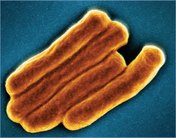

![Image 157.2 Scanning electron micrograph of Mycobacterium tuberculosis bacteria, which cause tuberculosis (circular foreground Image; virus is colorized pink) and a PET/CT scan showing tuberculosis infection (pink) in a patient’s lungs (background Image). Courtesy of Clifton Barry III, PhD, Chief, Tuberculosis Research Section, National Institute of Allergy and Infectious Diseases Laboratory of Clinical Immunology & Microbiology. Inlay of scanning electron micrograph of M tuberculosis bacteria, with an overview of the lungs shown in the background.](../../figures/ch157_p1036_02.jpg)

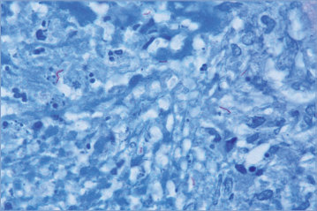

## PDF page 1037 | printed page 1023

Image 157.5 Tuberculosis, miliary, in a 29-year-old woman 4 months after delivery. Tuberculosis may become exacerbated during pregnancy.

Image 157.7 Young woman with Mycobacterium tuberculosis cervical lymphadenitis. Copyright Martin G. Myers, MD.

Image 157.6 Young man with Mycobacterium tuberculosis cervical lymphadenitis. Copyright Martin G. Myers, MD.

Image 157.8 Mycobacterium tuberculosis infection with paratracheal lymph nodes. Copyright Martha Lepow, MD.

Image 157.9 A 1-year-old with endobronchial tuberculosis with pulmonary consolidation.

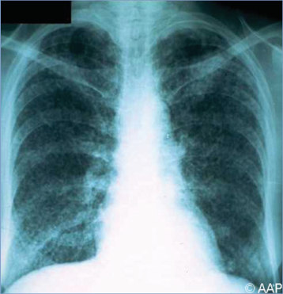

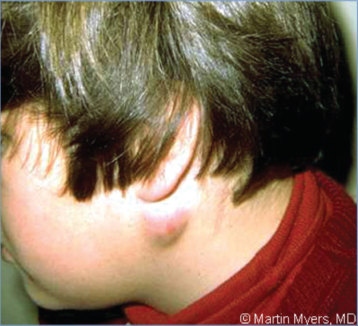

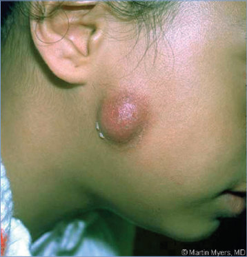

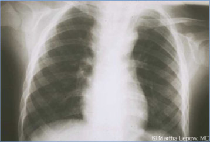

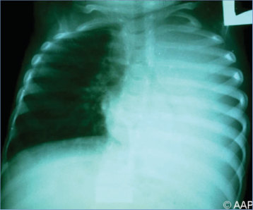

## PDF page 1038 | printed page 1024

Image 157.10 A 13-year-old boy with tuberculosis. The patient had a 1-week history of shortness of breath and sharp pain on his right side while riding his bicycle. A purified protein derivative revealed 20 × 25 mm of induration at 72 hours. The chest computed tomographic scan revealed right hilar adenopathy and a primary complex in the right peripheral lung field. Copyright Barbara Jantausch, MD, FAAP.

Image 157.12 Pulmonary tuberculosis with right pleural effusion.

Image 157.11 Tuberculosis. Caseation and Langhans giant cells in a lymph node. Courtesy of Dimitris P. Agamanolis, MD.

Image 157.13 A 10-month-old with radiographic changes of miliary tuberculosis.

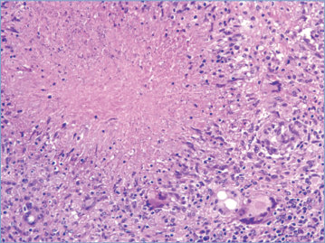

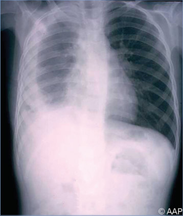

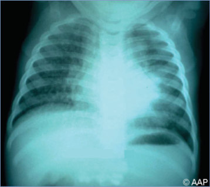

## PDF page 1039 | printed page 1025

Image 157.14 Miliary tuberculosis with pulmonary cavitation (right lung).

Image 157.16 A 15-year-old boy with tuberculous epididymitis. Copyright Martin G. Myers, MD.

Image 157.15 Tuberculosis of the spine with paravertebral abscess (Pott disease).

Image 157.17 Tuberculous spondylitis in a 14-year-old boy demonstrated by magnetic resonance imaging. Courtesy of Benjamin Estrada, MD.

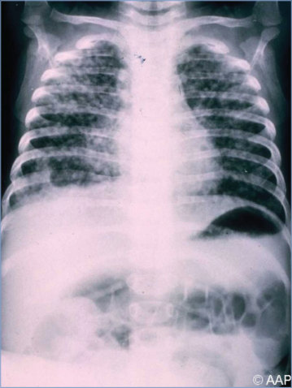

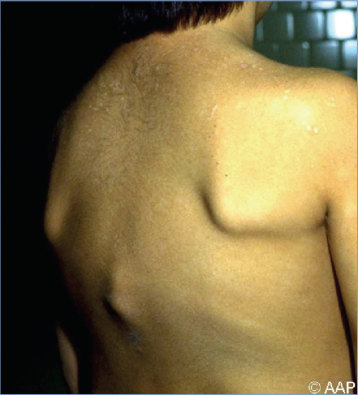

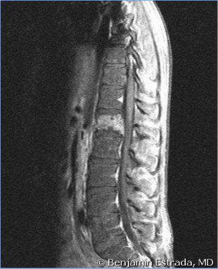

## PDF page 1040 | printed page 1026

Image 157.18 Cavitary tuberculosis in a 15-year-old boy delineated by computed tomography. Courtesy of Benjamin Estrada, MD.

Image 157.20 Progress toward tuberculosis (TB) elimination, United States, 1982–2020. Courtesy of Centers for Disease Control and Prevention.

Image 157.19 This photomicrograph reveals Mycobacterium tuberculosis bacteria by use of acid-fast Ziehl-Neelsen stain (magnification ×1,000). The acid-fast stains depend on the ability of mycobacteria to retain dye when treated with mineral acid or an acid-alcohol solution, such as the Ziehl-Neelsen or Kinyoun stains that are carbolfuchsin methods specific for M tuberculosis. Courtesy of Centers for Disease Control and Prevention.

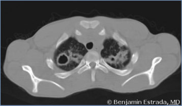

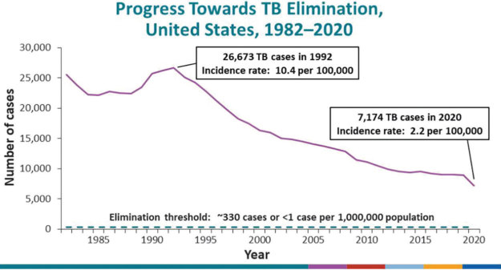

## PDF page 1041 | printed page 1027

Image 157.21 Tuberculosis (TB) cases and incidence rates, United States, 1993–2022. Courtesy of Centers for Disease Control and Prevention.

Image 157.22 Tuberculosis (TB) cases and incidence rates by origin of birth, United States, 1993–2022. Courtesy of Centers for Disease Control and Prevention.

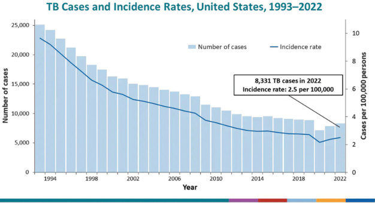

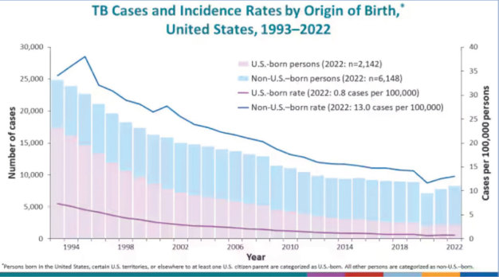

## PDF page 1042 | printed page 1028

Image 157.23 Estimated tuberculosis incidence rates of 2022. Courtesy of World Health Organization.

Image 157.24 Estimated incidence of multidrug-resistant/rifampicin-resistant tuberculosis in 2022. Courtesy of World Health Organization.

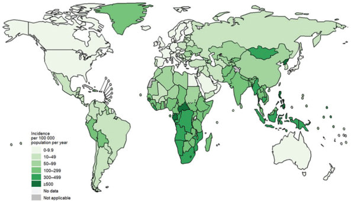

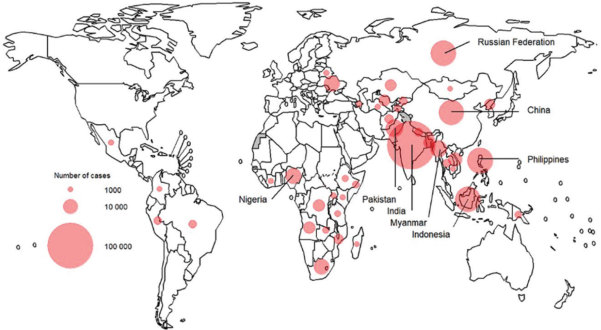
