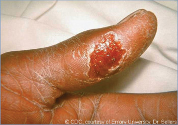
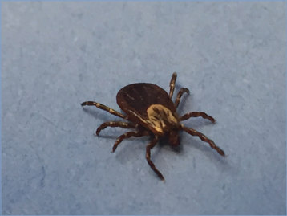

# 159. Tularemia
> Reference: [source credits](../../SOURCE_CREDITS.md). Printed pp. 1040-1047; PDF pp. 1054-1061.
> Editorial study pathway: Bacterial infections (not a part division in the source).
[Flashcards](../flashcards/159_flashcards.md) · [Quiz](../mcqs/159_mcqs.md) · [Full extraction](../../raw/chapters/159.md)

## Five study pillars

### Etiology and transmission
Francisella tularensis is a small, weakly staining, gram-negative pleomorphic coccobacillus. Two subspecies cause human infection in North America: F tularensis subspecies tularensis (type A), and F tularensis subspecies holarctica (type B).
*Printed p. 1040 / PDF p. 1054*

### Clinical recognition
There are several common presentations of tularemia in children, with ulceroglandular disease being the most frequently identified. Characterized by a maculopapular lesion at the entry site with subsequent ulceration and slow healing, the ulceroglandular variant is associated with tender regional lymphadenopathy that can drain spontaneously.
*Printed p. 1040 / PDF p. 1054*

### Diagnostic workup
Because of its propensity for causing laboratoryacquired infections, laboratory personnel should be alerted immediately when F tularensis infection is suspected. Isolation of F tularensis confirms infection and is most successful from specimens of ulcers, lymph node aspirates or biopsies, pleural fluid and/or other respiratory tract specimens, pharyngeal swabs, or blood depending on the form of illness, and is best achieved by inoculation of cysteine-enriched media.
*Printed p. 1040 / PDF p. 1054*

### Treatment in the atlas
Gentamicin (2.5 mg/kg/dose, administered 3 times daily, intravenously or intramuscularly, with the dose adjusted to maintain the desired peak serum concentrations of at least 5 μg/mL) is the drug of choice for the treatment of tularemia in children because of the limited availability of streptomycin and the fewer adverse effects of gentamicin. Gentamicin administered as a once daily dose, rather than divided, may be considered in consultation with an expert in infectious diseases.
*Printed p. 1041 / PDF p. 1055*

### Prevention and infection control
Standard precautions are recommended.
*Printed p. 1041 / PDF p. 1055*

## Clinical search tags
Fever, Vesicles, Maculopapular rash, Ulcers / eschar, Lymphadenopathy, Conjunctivitis, Pharyngitis, Cough, Hepatosplenomegaly, Meningitis, Sepsis / shock, Tick / arthropod exposure, Animal exposure, Water exposure

## Full text, original tables, and images

# 159. Tularemia
> Private study reference ([source credits](../../SOURCE_CREDITS.md)). PDF pages 1054-1061; printed pages 1040-1047.

## PDF page 1054 | printed page 1040

### CLINICAL MANIFESTATIONS

There are several common presentations of tularemia in children, with ulceroglandular disease being the most frequently identified. Characterized by a maculopapular lesion at the entry site with subsequent ulceration and slow healing, the ulceroglandular variant is associated with tender regional lymphadenopathy that can drain spontaneously. The glandular variant (regional lymphadenopathy with no ulcer) also is common. Less common disease variants include oculoglandular (severe conjunctivitis with preauricular lymphadenopathy), oropharyngeal (exudative stomatitis, painful pharyngitis, or tonsillitis with cervical lymphadenopathy), typhoidal (high fever, septicemia, possible splenomegaly or hepatomegaly), and meningitis. Secondary skin eruptions, which can include vesicular skin lesions, can be mistaken for herpes simplex virus or varicella-zoster virus cutaneous infections. Pneumonic tularemia presents with fever, dry or productive cough, chest pain, and hilar adenopathy with or without chest abnormalities. Pneumonic tularemia is normally caused by inhalation of contaminated dust or aerosols often associated with farming or lawn maintenance activities; it can also occur when other forms of tularemia remain untreated and spread through the bloodstream to the lungs. Pneumonic tularemia would be the anticipated variant after intentional release of aerosolized organisms.

### ETIOLOGY

Francisella tularensis is a small, weakly staining, gram-negative pleomorphic coccobacillus. Two subspecies cause human infection in North America: F tularensis subspecies tularensis (type A), and F tularensis subspecies holarctica (type B). Type A is generally considered more virulent, especially if inhaled. In the absence of effective chemotherapy, inhalation of small numbers of type A bacteria has a mortality rate of >30%. Therefore, in this situation, rapid diagnosis and chemotherapy are critical.

### EPIDEMIOLOGY

F tularensis can infect more than 100 animal species; the vertebrate species considered most

important in enzootic cycles are lagomorphs (rabbits and hares) and rodents (especially muskrats, voles, beavers, and prairie dogs). Domestic cats and dogs are an additional but uncommon source of infection. In the United States, most human cases are attributed to tick bites but may also result from bites of other arthropod vectors, such as deer flies, or direct contact with any of the aforementioned animal species. Infections attributable to tick and deer fly bites usually take the form of ulceroglandular or glandular tularemia. F tularensis bacteria can be transmitted to humans via the skin when handling infected animal tissue, as can occur when hunting or skinning infected rabbits, muskrats, prairie dogs, and other rodents. Infection has been reported in commercially traded hamsters and prairie dogs. Infection also can be acquired following ingestion of contaminated water (including contaminated well water) or inadequately cooked meat, or by inhalation of contaminated aerosols generated during lawn mowing, brush cutting, or certain farming activities (eg, baling contaminated hay). At-risk people have occupational or recreational exposure to infected animals or their habitats; this includes rabbit hunters and trappers, people exposed to certain ticks or biting insects, and laboratory technicians working with F tularensis, which is highly infectious and may be aerosolized when grown in culture. In the United States, most cases occur from May through September. Approximately two-thirds of cases occur in male individuals, and one-quarter of cases occur in children younger than 15 years of age.

Tularemia has been reported in all U.S. states except Hawaii. It is most common in central and western states and parts of Massachusetts (particularly Martha’s Vineyard). In 2019, a total of 274 cases in the United States were reported.

Organisms can be present in blood during the first 2 weeks of disease and in cutaneous lesions for as long as 1 month if untreated. Person-to-person transmission has not been reported.

The incubation period usually is 3 to 5 days, with a range of 1 to 21 days.

### DIAGNOSTIC TESTS

Because of its propensity for causing laboratoryacquired infections, laboratory personnel should

## PDF page 1055 | printed page 1041

be alerted immediately when F tularensis infection is suspected. Isolation of F tularensis confirms infection and is most successful from specimens of ulcers, lymph node aspirates or biopsies, pleural fluid and/or other respiratory tract specimens, pharyngeal swabs, or blood depending on the form of illness, and is best achieved by inoculation of cysteine-enriched media. Blood cultures are often negative. Biosafety level (BSL)-2 practices are recommended for initial activities involving clinical specimens. If tularemia is suspected on the basis of clinical and epidemiological history or Gram stain identification of tiny gram-negative coccobacilli, BSL-3 practices, containment equipment, and facilities are recommended for all manipulations of suspect cultures. All isolates suspected to be F tularensis should be discussed with the state public health agency and forwarded for confirmation to local reference laboratories (usually the state laboratory) that are part of the Laboratory Response Network.

F tularensis in clinical samples can be identified by a laboratory-developed and validated nucleic acid amplification test. Immunohistochemical staining is specific for detection of F tularensis in fixed tissues; however, this method is not available in most clinical laboratories.

Diagnosis is established most often by serologic testing. Patients do not develop antibodies until the second week of illness. Serologic assays include microagglutination, tube agglutination, enzyme-linked immunosorbent assay, and indirect immunofluorescence assay. Confirmatory serologic laboratory evidence includes a fourfold or greater change in serum antibody titer to F tularensis antigen between acute and convalescent specimens. Seroconversion from negative to positive immunoglobulin (Ig) M and/or IgG antibodies in paired sera is also indicative of infection. A single elevated serum antibody titer to F tularensis antigen, collected at least 14 days after illness onset, is supportive of the diagnosis, but can also occur with past infection. Additional information on confirmatory and supportive laboratory diagnosis is available at www.cdc.gov/tularemia/ clinicians/index.html.

### TREATMENT

Gentamicin (2.5 mg/kg/dose, administered 3 times daily, intravenously or intramuscularly, with the

dose adjusted to maintain the desired peak serum concentrations of at least 5 μg/mL) is the drug of choice for the treatment of tularemia in children because of the limited availability of streptomycin and the fewer adverse effects of gentamicin. Gentamicin administered as a once daily dose, rather than divided, may be considered in consultation with an expert in infectious diseases. The usual duration of therapy is 10 to 14 days. A 7-day course may be sufficient in mild disease, but a longer course is required for more severe illness (eg, meningitis). Because of the difficulty in achieving adequate cerebrospinal fluid concentrations of gentamicin, combination therapy of gentamicin plus ciprofloxacin or gentamicin plus doxycycline may be considered for patients with tularemia meningitis (see www.cdc.gov/ tularemia/clinicians/index.html). Suppuration of lymph nodes can occur despite antimicrobial therapy.

Oral ciprofloxacin is an alternative for mild to moderate disease, but it is not approved by the U.S. Food and Drug Administration for the treatment of tularemia. Doxycycline is associated with a higher rate of relapse compared with other therapies and is not recommended for definitive treatment; if doxycycline is used, some experts recommend extending treatment to 21 days. F tularensis is not susceptible to β-lactam drugs, including carbapenems.

Because treatment delay is associated with therapeutic failure, treatment should be initiated as soon as tularemia is suspected. Clinically relevant resistance to antimicrobials recommended for treatment of tularemia has not been identified in the United States; when treatment failures occur, they are likely related to delays in treatment or inadequate antimicrobial penetration of infected tissue.

### INFECTION PREVENTION AND CONTROL MEASURES IN HEALTH CARE SETTINGS

Standard precautions are recommended.

### CONTROL MEASURES

• People should protect themselves against arthropod bites by wearing protective clothing, by frequent inspection for and removal of ticks from the skin and scalp, and by using insect repellents.

## PDF page 1056 | printed page 1042

• Drinking untreated surface water should be avoided.

• Gloves should be worn by those handling the carcasses of wild rabbits, muskrats, prairie dogs, and other potentially infected animals. Children should not handle sick or dead animals, including pets.

• People should avoid mowing over live or dead animals because this may aerosolize infective material.

• Game meats should be cooked thoroughly.

• Primary clinical specimens may be handled in the laboratory using BSL-2 precautions. BSL-3 precautions are recommended for all manipulations of suspect cultures. Note that F tularensis is a tier 1 select agent and must be handled as such after it has been identified.

Image 159.1 A tularemic lesion on the dorsal skin of the right hand. Tularemia is caused by the bacterium Francisella tularensis. Symptoms vary depending on how the person was exposed to the disease; as shown, they can include skin ulcers. Courtesy of Centers for Disease Control and Prevention.

Additional information on laboratory safety can be found in the Centers for Disease Control and Prevention Biosafety in Microbiological and Biomedical Laboratories manual (www.cdc. gov/biosafety/publications/bmbl5/).

• Standard precautions should be used for handling clinical materials.

• Oral doxycycline or ciprofloxacin for 10 to 14 days is recommended for children and adults after exposure to an intentional release of tularemia (eg, a bioterrorism attack) and for laboratory workers with inadvertent exposure to F tularensis.

Public Health Reporting

Tularemia is a nationally notifiable condition; a suspected case should be reported immediately to the state or local health department.

Image 159.2 An 8-year-old boy with 7 days of fever unresponsive to ceftriaxone was examined because of occipital and posterior cervical lymphadenitis. The cervical lymph node had spontaneously drained purulent material. A culture of the node aspirate was positive for Francisella tularensis. Courtesy of Richard Jacobs, MD.

## PDF page 1057 | printed page 1043

Image 159.3 Tularemic ulcer on the thumb. Irregular ulceration occurred at the site of entry of Francisella tularensis. Courtesy of Centers for Disease Control and Prevention/Emory University, Dr Sellers.

A

C

Image 159.4 A, A 6-week-old patient with vesicular tularemia initially diagnosed with herpes simplex. Findings from complete herpes evaluation were negative. B and C, A 10-year-old with vesicular lesions on the arms and legs thought to be varicella. Arrow (B) shows a vesicle near the primary eschar. Evaluation was negative for varicella and herpes. Culture results of the eschar and vesicles confirmed tularemia. D, Varicella lesions shown for comparison. Courtesy of Centers for Disease Control and Prevention/Heinz F. Eichenwald, MD.

B

D

![Image 159.4 A, A 6-week-old patient with vesicular tularemia initially diagnosed with herpes simplex. Findings from complete herpes evaluation were negative. B and C, A 10-year-old with vesicular lesions on the arms and legs thought to be varicella. Arrow (B) shows a vesicle near the primary eschar. Evaluation was negative for varicella and herpes. Culture results of the eschar and vesicles confirmed tularemia. D, Varicella lesions shown for comparison. Courtesy of Centers for Disease Control and Prevention/Heinz F. Eichenwald, MD.](../../figures/ch159_p1057_01.jpg)

## PDF page 1058 | printed page 1044

Image 159.5 Tularemia pneumonia. Posteroanterior chest radiograph showing pneumonia and pleural effusion in the lower lobe of the right lung; the pneumonia was unresponsive to ceftriaxone, azithromycin, and nafcillin. The patient had a history of tick bite and a high fever for 8 days, and his tularemia agglutinin titer was 1:2,048. An outbreak of pneumonic tularemia should prompt consideration of bioterrorism.

Image 159.6 Tularemia is a relatively rare infection that can manifest with painful cervical adenitis. This boy had a tick bite on his scalp that developed an ulcer followed by a large postauricular node. His tularemia titers were positive, and he responded to treatment with gentamicin.

Image 159.7 This is a photomicrograph of Francisella tularensis bacteria with a methylene-blue stain. F tularensis is considered a potential biological weapon because of its extreme infectivity, ease of dissemination, and substantial capacity to cause illness and death. Courtesy of Centers for Disease Control and Prevention.

## PDF page 1059 | printed page 1045

Image 159.8 Map of reported tularemia cases in the United States, 2022. Tularemia has been reported from all states except Hawaii but is most common in the south-central United States; the Pacific Northwest; and parts of Massachusetts, including Martha’s Vineyard. Courtesy of Centers for Disease Control and Prevention.

Image 159.9 Spatial distribution of 125 Francisella tularensis isolates for which information on originating county was available. Locations (colored circles) correspond to county centroids; >1 subspecies were isolated from some counties in California (Alameda, Contra Costa, Los Angeles, San Luis Obispo, and Santa Cruz) and Wyoming (Natrona). In some cases, a single circle may represent instances in which >1 sample of a given subspecies or genotypic group were isolated from a single county. Two isolates with county information, 1 from northern British Columbia and 1 from Alaska, are not shown. Courtesy of Emerging Infectious Diseases.

![Image 159.9 Spatial distribution of 125 Francisella tularensis isolates for which information on originating county was available. Locations (colored circles) correspond to county centroids; >1 subspecies were isolated from some counties in California (Alameda, Contra Costa, Los Angeles, San Luis Obispo, and Santa Cruz) and Wyoming (Natrona). In some cases, a single circle may represent instances in which >1 sample of a given subspecies or genotypic group were isolated from a single county. Two isolates with county information, 1 from northern British Columbia and 1 from Alaska, are not shown. Courtesy of Emerging Infectious Diseases.](../../figures/ch159_p1059_02.jpg)

## PDF page 1060 | printed page 1046

A

B

Image 159.10 Spatial distributions of isolates from the A1 and A2 subpopulations of Francisella tularensis subspecies tularensis relative to (A) distribution of tularemia vectors Dermacentor variabilis, Dermacentor andersoni, Amblyomma americanum, and Chrysops discalis and (B) distribution of tularemia hosts Sylvilagus nuttallii and Sylvilagus floridanus species of rabbits. Courtesy of Emerging Infectious Diseases.

Image 159.11 This is a typical muskrat “house” camouflaged by reeds in Little Otter Creek, VT. The muskrat is a carrier of the bacterium Francisella tularensis, which is considered a dangerous potential biological weapon because of its extreme infectivity, ease of dissemination, and substantial capacity to cause illness and death. Courtesy of Centers for Disease Control and Prevention.

## PDF page 1061 | printed page 1047

Image 159.12 A female adult dog tick, or Dermacentor variabilis. Dog ticks can transmit pathogens that cause tick-borne diseases such as Rocky Mountain spotted fever and tularemia. Courtesy of National Institute of Allergy and Infectious Diseases.

Image 159.14 Fluorescent microscopic Image shows mouse macrophages (red) 12 hours after infection with a virulent strain of Francisella tularensis (stained green). The cells on the left are untreated, while the cells on the right were treated 3 days in advance with CLDC+MPF. The untreated cells fail to control replication of F tularensis. In contrast, cells activated with the CLDC+MPF therapeutic have nearly eliminated all of the bacteria. Courtesy of National Institute of Allergy and Infectious Diseases.

Image 159.13 A male adult dog tick, or Dermacentor variabilis, crawls over a penny. Dog ticks can transmit the pathogen that causes tick-borne diseases such as Rocky Mountain spotted fever and tularemia. Courtesy of National Institute of Allergy and Infectious Diseases.

Image 159.15 This Image depicts a male brown dog tick, Rhipicephalus sanguineus, from a superior, or dorsal, view looking down on this hard tick’s scutum, or keratinized shield, which entirely covers its back, identifying it as a male. In the female, the dorsal abdomen is only partially covered, thereby offering room for abdominal expansion when she becomes engorged with blood while ingesting her blood meal obtained from her host. Courtesy of Centers for Disease Control and Prevention/James Gathany/William Nicholson.

![Image 159.15 This Image depicts a male brown dog tick, Rhipicephalus sanguineus, from a superior, or dorsal, view looking down on this hard tick’s scutum, or keratinized shield, which entirely covers its back, identifying it as a male. In the female, the dorsal abdomen is only partially covered, thereby offering room for abdominal expansion when she becomes engorged with blood while ingesting her blood meal obtained from her host. Courtesy of Centers for Disease Control and Prevention/James Gathany/William Nicholson.](../../figures/ch159_p1061_03.jpg)

![Image 159.14 Fluorescent microscopic Image shows mouse macrophages (red) 12 hours after infection with a virulent strain of Francisella tularensis (stained green). The cells on the left are untreated, while the cells on the right were treated 3 days in advance with CLDC+MPF. The untreated cells fail to control replication of F tularensis. In contrast, cells activated with the CLDC+MPF therapeutic have nearly eliminated all of the bacteria. Courtesy of National Institute of Allergy and Infectious Diseases.](../../figures/ch159_p1061_04.jpg)
