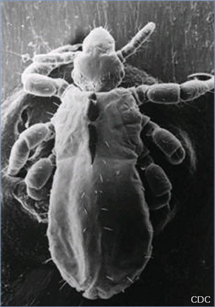
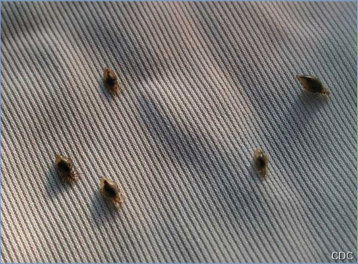
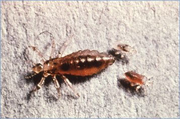

# 160. Louse-borne Typhus (Epidemic or Sylvatic Typhus)
> Reference: [source credits](../../SOURCE_CREDITS.md). Printed pp. 1048-1051; PDF pp. 1062-1065.
> Editorial study pathway: Bacterial infections (not a part division in the source).
[Flashcards](../flashcards/160_flashcards.md) · [Quiz](../mcqs/160_mcqs.md) · [Full extraction](../../raw/chapters/160.md)

## Five study pillars

### Etiology and transmission
Epidemic typhus is caused by Rickettsia prowazekii, which are gram-negative obligate intracellular bacteria.
*Printed p. 1048 / PDF p. 1062*

### Clinical recognition
Louse-borne or epidemic typhus is an uncommon disease that is spread through contact with infected human body lice. Patients develop abrupt onset of high fever, chills, and myalgia accompanied by severe headache and malaise.
*Printed p. 1048 / PDF p. 1062*

### Diagnostic workup
Louse-borne typhus may be diagnosed via indirect immunofluorescence antibody (IFA) assay; immunohistochemistry; a nucleic acid amplification test (NAAT) of blood, plasma, or tissue samples; or isolation by culture. Serologic tests are the most common means of confirmation and can be used to detect either immunoglobulin (Ig) G or IgM antibodies.
*Printed p. 1049 / PDF p. 1063*

### Treatment in the atlas
Because of the rapid progression of louse-borne typhus, treatment should not be delayed pending diagnostic results in patients who present with clinically and epidemiologically compatible disease. Doxycycline is the drug of choice to treat louse-borne typhus, regardless of patient age.
*Printed p. 1049 / PDF p. 1063*

### Prevention and infection control
Standard precautions are recommended after delousing has been completed. Precautions should be taken when delousing hospitalized patients infected with R prowazekii using pediculicide, because aerosolized louse feces associated with these patients pose an exposure risk.
*Printed p. 1049 / PDF p. 1063*

## Clinical search tags
Fever, Petechiae / purpura, Maculopapular rash, Ulcers / eschar, Cough, Encephalitis / seizures, Cytopenia

## Full text, original tables, and images

# 160. Louse-borne Typhus (Epidemic or Sylvatic Typhus)
> Private study reference ([source credits](../../SOURCE_CREDITS.md)). PDF pages 1062-1065; printed pages 1048-1051.

## PDF page 1062 | printed page 1048

(Epidemic or Sylvatic Typhus)

### CLINICAL MANIFESTATIONS

Louse-borne or epidemic typhus is an uncommon disease that is spread through contact with infected human body lice. Patients develop abrupt onset of high fever, chills, and myalgia accompanied by severe headache and malaise. A rash often develops by day 4 to 7 after the start of illness but may not always be present and should not be relied on for diagnosis. When present, the rash usually begins on the trunk and axilla, spreads centrifugally to the limbs, and generally spares the face, palms, and soles. The rash typically is macular to maculopapular but in advanced stages can become petechial or hemorrhagic. The rash can be difficult to observe on patients with darkly pigmented skin and is absent in up to 40% of patients. There is no eschar, as might be present in many other rickettsial diseases. Abdominal complaints (stomach pain, nausea) and changes in mental status are common, including delirium, drowsiness, seizures, and coma. Cough and tachypnea may be present. Myocardial and renal failure can occur when disease is severe. The fatality rate in untreated people can exceed 30%, particularly among persons who are malnourished and those without access to supportive care. Mortality is less common in children and increases with advancing age. Untreated patients who recover typically have an illness lasting 2 weeks.

Brill-Zinsser disease is a recrudescent form of epidemic typhus that is unrelated to louse infestation. It can occur years after the initial episode, and generally occurs when the body’s immune system is weakened from illness, medications, advanced age, or stress. The symptoms of Brill-Zinsser disease generally are milder in nature and shorter in duration than the initial infection.

Laboratory abnormalities in epidemic typhus may include thrombocytopenia, increased hepatic enzymes, hyperbilirubinemia, and elevated blood urea nitrogen.

### ETIOLOGY

Epidemic typhus is caused by Rickettsia prowazekii, which are gram-negative obligate intracellular bacteria.

### EPIDEMIOLOGY

Epidemic typhus is transmitted by the human body louse (Pediculus humanus corporis), which is infected through feeding on patients with acute typhus fever. Humans are the primary reservoir of the organism. Infected lice generally defecate during feeding and excrete the bacteria in their feces. Disease transmission can occur when infected louse feces are rubbed into broken skin or mucous membranes or are inhaled. All ages can be affected. Poverty, crowding, and poor sanitary conditions such as those found in war, famine, drought, and other natural disasters contribute to the spread of body lice and, hence, the disease. Cases have occurred throughout the world, including the colder, mountainous areas of Asia, Africa, some parts of Europe, and Central and South America, particularly in refugee camps and jails in resource-limited countries. Epidemic typhus is most common during winter months, when conditions favor person-to-person transmission of the vector. The last known epidemic of louse-borne typhus in the United States occurred in 1921. Sporadic human cases associated with close contact with infected flying squirrels (Glaucomys volans), their nests, or their ectoparasites occasionally are reported in the eastern United States. Cases have been reported in people who reside or work in flying squirrel-infested dwellings, even when direct contact is not reported. Flying squirrel-associated disease, called sylvatic typhus, typically presents with a similar but generally milder illness to that observed with body louse-transmitted infection. Untreated illness can be severe, although no fatal cases of sylvatic typhus have been reported; the later development of Brill-Zinsser disease has been confirmed in at least 1 case of untreated sylvatic typhus.

People with Brill-Zinsser disease harbor active R prowazekii and, therefore, may pose a risk for reintroduction of the organism and new

## PDF page 1063 | printed page 1049

outbreaks. Rickettsiae are present in the blood and tissues of patients during the early febrile phase but are not found in secretions. Direct person-to-person spread of the disease does not occur in the absence of the louse vector.

The incubation period is 1 to 2 weeks.

### DIAGNOSTIC TESTS

Louse-borne typhus may be diagnosed via indirect immunofluorescence antibody (IFA) assay; immunohistochemistry; a nucleic acid amplification test (NAAT) of blood, plasma, or tissue samples; or isolation by culture. Serologic tests are the most common means of confirmation and can be used to detect either immunoglobulin (Ig) G or IgM antibodies. The specimen preferably should be obtained within the first week of symptoms and before (or within 24 hours of) doxycycline administration. Detectable levels of IgG and IgM antibodies generally do not appear until around 7 to 10 days after onset of symptoms, so a negative test result early in the disease does not rule out infection. The gold standard for serologic diagnosis of louse-borne typhus is a fourfold increase in IgG antibody titer by the IFA test between acute sera obtained in the first week of illness and convalescent sera obtained 2 to 4 weeks later. Lowlevel antibody titers may persist in persons for years; therefore, only a change in titer in paired samples is diagnostic of recent infection. People with Brill-Zinsser disease generally show an elevation in their IgG but not IgM antibody concentrations to R prowazekii. Cross-reactivity may be observed to antibodies to Rickettsia typhi (the agent of endemic typhus) and, to a lesser degree, Rickettsia rickettsii (the etiologic agent of Rocky Mountain spotted fever) and other spotted fever group rickettsiae. R prowazekii also may be cultured and identified through submission to specific reference laboratories that are equipped to culture and identify epidemic typhus. Cell culture cultivation of the organism must be confirmed by molecular methods. NAATs can detect R prowazekii in acute whole blood, serum, or tissue specimens, but sensitivity is lower during the first few days of the illness or following 48 hours of doxycycline therapy. Treatment should never be withheld pending results of diagnostic tests.

Because epidemic typhus is not common in the United States, testing generally is not available at commercial laboratories but can be performed at the Centers for Disease Control and Prevention through submission by state health departments.

### TREATMENT

Because of the rapid progression of louse-borne typhus, treatment should not be delayed pending diagnostic results in patients who present with clinically and epidemiologically compatible disease. Doxycycline is the drug of choice to treat louse-borne typhus, regardless of patient age. The recommended dosage of doxycycline for adults is 100 mg, twice per day, intravenously or orally, and for children weighing less than 45 kg (100 lb) is 2.2 mg/kg per dose, administered twice a day (maximum 100 mg/ dose). Treatment should be continued for at least 3 days after clinical defervescence and evidence of clinical improvement is documented; the total treatment course usually is 7 to 10 days. Some patients may relapse if not treated for the full 7 to 10 days. Patients treated early may experience less severe illness and shorter recovery time. Chloramphenicol, where available, may be used in cases of absolute contraindication of doxycycline (life-threatening allergy) but also carries significant risks (ie, aplastic anemia). In epidemic situations in which antimicrobial agents have limited availability (eg, refugee camps), a single 200-mg dose of doxycycline in adults (or 4.4 mg/kg, maximum dose 200 mg, as a single dose for children) may provide effective treatment and facilitate outbreak control when combined with delousing efforts.

### INFECTION PREVENTION AND CONTROL MEASURES IN HEALTH CARE SETTINGS

Standard precautions are recommended after delousing has been completed. Precautions should be taken when delousing hospitalized patients infected with R prowazekii using pediculicide, because aerosolized louse feces associated with these patients pose an exposure risk. Therefore, health care providers initially caring for these patients and handling

## PDF page 1064 | printed page 1050

potentially contaminated clothing should consider wearing an N95 or higher respirator (or similar respiratory protection) and eye protection.

### CONTROL MEASURES

Thorough delousing in epidemic situations, particularly among exposed contacts of cases, is recommended. Several applications of pediculicides may be needed, because lice eggs are resistant to most insecticides. Washing clothes in hot water kills lice and eggs. During epidemics, insecticides dusted onto clothes of louseinfested populations are effective. In situations involving outbreaks of epidemic typhus in prisons and refugee settings, active surveillance for fever is important to assess effectiveness of control measures and to ensure rapid and effective treatment. To halt the spread of disease to

other people, louse-infested patients should be treated with cream or gel pediculicides containing pyrethrins or permethrin; malathion is prescribed most often when pyrethroids fail. Prevention and control of flying squirrelassociated typhus requires application of insecticides and precautions to prevent contact with these animals and their ectoparasites and to exclude them from nesting in, or entering into, human dwellings. No prophylaxis is recommended for people exposed to flying squirrels.

Public Health Reporting

R prowazekii is considered a select agent and a category B potential biological terrorism agent requiring additional regulation and oversight for its storage, use, and transfer. Cases should be reported to local, state, regional, or national public health departments.

## PDF page 1065 | printed page 1051

Image 160.1 Pediculus humanus humanus, the human body louse, viewed with an electron microscope (magnification 3120). Courtesy of Centers for Disease Control and Prevention/Emerging Infectious Diseases and Cédric Foucault.

Image 160.3 This image depicts an adult female body louse, Pediculus humanus, and 2 larval young, which serve as the vector of epidemic typhus. Courtesy of Centers for Disease Control and Prevention.

Image 160.2 Human body lice in clothes. Courtesy of Centers for Disease Control and Prevention/Emerging Infectious Diseases and Cédric Foucault.

