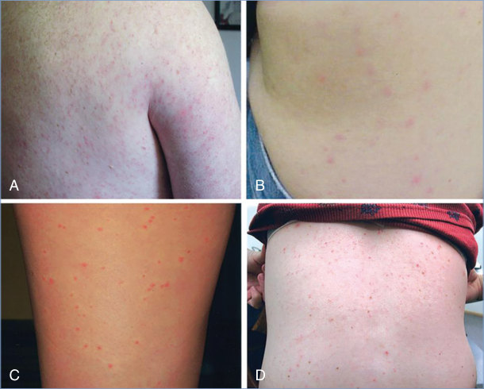
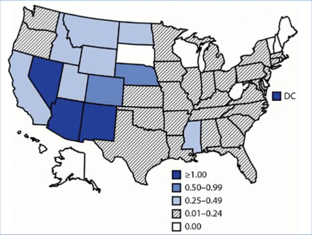
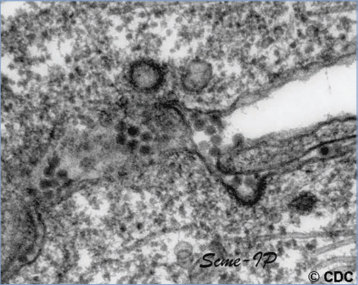
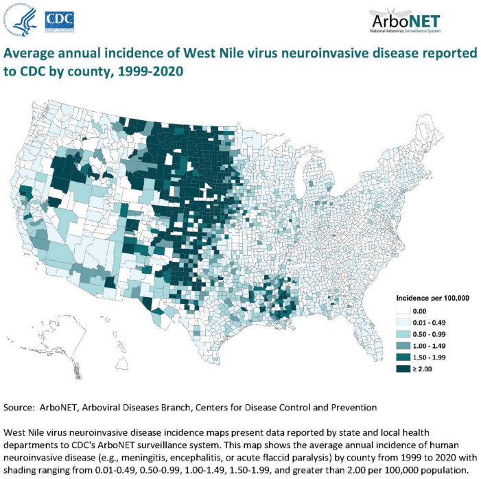

# 166. West Nile Virus
> Reference: [source credits](../../SOURCE_CREDITS.md). Printed pp. 1083-1090; PDF pp. 1097-1104.
> Editorial study pathway: Viral infections (not a part division in the source).
[Flashcards](../flashcards/166_flashcards.md) · [Quiz](../mcqs/166_mcqs.md) · [Full extraction](../../raw/chapters/166.md)

## Five study pillars

### Etiology and transmission
WNV is an RNA virus of the Flaviviridae family (genus Flavivirus) that is related antigenically to St. Louis encephalitis and Japanese encephalitis viruses.
*Printed p. 1083 / PDF p. 1097*

### Clinical recognition
West Nile virus (WNV) is the leading cause of mosquito-borne illness in the United States. An estimated 80% of people infected with WNV are asymptomatic.
*Printed p. 1083 / PDF p. 1097*

### Diagnostic workup
Detection of anti-WNV immunoglobulin (Ig) M antibodies in serum or CSF is the most common method for diagnosis of WNV infection. Presence of anti-WNV IgM usually is good evidence of recent WNV infection but may indicate infection with another closely related flavivirus.
*Printed p. 1084 / PDF p. 1098*

### Treatment in the atlas
No specific therapy is available; management of WNV disease is supportive. Although various therapies have been evaluated or used empirically for WNV disease, none has shown specific benefit thus far.
*Printed p. 1085 / PDF p. 1099*

### Prevention and infection control
Standard precautions are recommended.
*Printed p. 1085 / PDF p. 1099*

## Clinical search tags
Fever, Maculopapular rash, Diarrhea, Vomiting, Hepatitis / jaundice, Meningitis, Encephalitis / seizures, Weakness / paralysis, Arthritis / bone pain, Congenital / neonatal, Immunocompromised host, Tick / arthropod exposure, Travel / endemic setting

## Full text, original tables, and images

# 166. West Nile Virus
> Private study reference ([source credits](../../SOURCE_CREDITS.md)). PDF pages 1097-1104; printed pages 1083-1090.

## PDF page 1097 | printed page 1083

### CLINICAL MANIFESTATIONS

West Nile virus (WNV) is the leading cause of mosquito-borne illness in the United States. An estimated 80% of people infected with WNV are asymptomatic. Most of the 20% of people who are symptomatic experience an acute systemic febrile illness that often includes headache, myalgia, arthralgia, vomiting, diarrhea, or a transient maculopapular rash. Less than 1% of infected people (1 in 150) develop neuroinvasive disease, which typically manifests as meningitis, encephalitis, or acute flaccid myelitis. WNV meningitis is indistinguishable clinically from aseptic meningitis caused by other viruses. Patients with WNV encephalitis usually present with fever, headache, seizures, mental status changes (including disorientation, stupor, or coma), focal neurologic deficits, or movement disorders (including tremor). WNV acute flaccid myelitis often is clinically and pathologically identical to poliovirus-associated poliomyelitis, with damage of anterior horn cells and resulting weakness and paralysis of one or more limbs; this may progress to respiratory paralysis requiring mechanical ventilation. WNVassociated Guillain-Barré syndrome also has been reported and can be distinguished from WNV acute flaccid myelitis by clinical manifestations, findings on cerebrospinal fluid (CSF) analysis, and electrophysiologic testing. Cardiac dysrhythmias, myocarditis, rhabdomyolysis, optic neuritis, uveitis, chorioretinitis, orchitis, pancreatitis, and hepatitis have been described rarely after WNV infection.

Routine clinical laboratory results are nonspecific in WNV infections. In patients with neuroinvasive disease, CSF examination generally shows lymphocytic pleocytosis, but neutrophils may predominate early in the illness. Brain magnetic resonance imaging frequently is normal, but signal abnormalities may be seen in the basal ganglia, thalamus, and brainstem with WNV encephalitis and in the spinal cord with WNV acute flaccid myelitis.

Most patients with WNV nonneuroinvasive disease or meningitis recover completely, but fatigue, malaise, and weakness can linger for weeks or

months. Recovery from WNV encephalitis or acute flaccid myelitis often takes weeks to months, and patients commonly have residual neurologic deficits. Among patients with neuroinvasive disease, the overall case fatality rate is approximately 10% but is significantly higher in WNV encephalitis and acute flaccid myelitis than in WNV meningitis.

Most people known to have been infected with WNV during pregnancy have delivered infants without evidence of infection or clinical abnormalities. Rare cases of congenital infection and probable transmission via human milk have been reported. If WNV disease is diagnosed during pregnancy, a detailed examination of the fetus and of the newborn infant should be performed.1

### ETIOLOGY

WNV is an RNA virus of the Flaviviridae family (genus Flavivirus) that is related antigenically to St. Louis encephalitis and Japanese encephalitis viruses.

### EPIDEMIOLOGY

WNV is an arthropod-borne virus (arbovirus) that is transmitted in an enzootic cycle between mosquitoes and amplified in vertebrate hosts, primarily birds. WNV is transmitted to humans primarily through bites of infected Culex mosquitoes. Humans usually do not develop a level or duration of viremia sufficient to infect mosquitoes and, therefore, are dead-end hosts. Person-to-person WNV transmission can occur rarely through blood transfusion and solid organ transplantation. Congenital and perinatal transmission during pregnancy, delivery, or via breastfeeding has been described. Transmission through percutaneous and mucosal exposure has occurred in laboratory workers and occupational settings.

WNV transmission has been documented on every continent except Antarctica. Since the 1990s, the largest outbreaks of WNV neuroinvasive disease have occurred in the Middle East, Europe, and North America. WNV first was detected in the Western Hemisphere in New York City in 1999 and subsequently spread across the continental United States and Canada. From 1999 through 2020, 52,532 cases of WNV infection were reported in the United States, of which 26,683 were nonneuroinvasive disease and 25,849

## PDF page 1098 | printed page 1084

were neuroinvasive disease, with peaks in national incidence in 2002, 2003, and 2012. WNV is the leading cause of neuroinvasive arboviral disease in the United States. In 2020 (latest finalized data available from the Centers for Disease Control and Prevention [CDC]), there were 559 cases of WNV neuroinvasive disease reported. Although the lower number of cases reported in 2020 likely was associated with the COVID-19 pandemic, WNV caused 4 times more neuroinvasive disease cases than the number reported for all other domestic arboviruses combined (eg, La Crosse [88], Powassan [20], St. Louis encephalitis viruses [14], eastern equine encephalitis [13], and Jamestown Canyon [10]). WNV human cases have been reported from all U.S. states; the states with the highest average annual incidence (>1.0 case per 100,000) of human WNV disease over the period 1999–2020 were Colorado, Louisiana, Mississippi, Nebraska, North Dakota, South Dakota, and Wyoming. Preliminary data from 2021 have shown Arizona to have nearly 10 times the number of cases reported in other states. A map of the distribution of WNV neuroinvasive disease across the United States can be found on the CDC website (www.cdc.gov/westnile/statsmaps/ final.html). Climate change likely is one factor associated with the expanded range of mosquito vectors and, therefore, WNV disease.

Most human WNV infections occur in summer or early fall in temperate and subtropical regions. All age groups are susceptible to WNV infection, but incidence of severe disease (eg, neuroinvasive disease and death) is highest among older adults. Overall incidence is 0.05/100,000 in those <20 years of age compared with 1.2/100,000 in those ≥70 years of age. Chronic renal failure, history of cancer, alcohol use disorder, diabetes mellitus, and hypertension have been associated with developing severe WNV disease.

The incubation period usually is 2 to 6 days but ranges from 2 to 14 days and can be up to 21 days in immunocompromised people and up to 37 days in solid organ transplant recipients.

### DIAGNOSTIC TESTS

Detection of anti-WNV immunoglobulin (Ig) M antibodies in serum or CSF is the most common method for diagnosis of WNV infection. Presence of anti-WNV IgM usually is good evidence of

recent WNV infection but may indicate infection with another closely related flavivirus. WNV IgM antibodies are detectable in most WNV-infected patients within 3 to 8 days of symptom onset and typically remain detectible for months and, in some individuals, years after the acute illness. For patients from whom serum collected within 8 days of illness lacks detectable IgM, testing should be repeated on a convalescent-phase sample. Because anti-WNV IgM can persist in the serum of some patients for longer than 1 year, a positive test result may reflect past infection. Detection of WNV IgM in CSF generally is indicative of recent neuroinvasive infection. IgG antibody generally is detectable shortly after IgM and usually persists for years. Plaque-reduction neutralization tests can be performed to measure virus-specific neutralizing antibodies and to discriminate between cross-reacting antibodies from closely related flaviviruses. A fourfold or greater increase in virus-specific neutralizing antibodies between acute- and convalescent-phase serum specimens collected 2 to 3 weeks apart may be used to confirm recent WNV infection. State and local health departments can assist with diagnostic testing and with determination of whether additional testing is indicated via the CDC Arbovirus Diagnostic Laboratory (www.cdc. gov/ncezid/dvbd/specimensub/arboviralshipping.html).

Viral culture and WNV nucleic acid amplification tests (including reverse transcriptase-polymerase chain reaction) can be performed on acute-phase serum, CSF, or tissue specimens. By the time most immunocompetent patients present with clinical symptoms, WNV RNA usually no longer is detectable; therefore, polymerase chain reaction assay is not recommended for diagnosis in immunocompetent hosts. Sensitivity of these tests is likely higher in immunocompromised patients. Immunohistochemical staining can detect WNV antigens in fixed tissue, but negative results are not definitive.

WNV disease should be considered in the differential diagnosis of febrile or acute neurologic illnesses associated with recent exposure to mosquitoes, blood transfusion, or solid organ transplantation and of illnesses in neonates whose birthing parent was infected with WNV during pregnancy or while breastfeeding.

## PDF page 1099 | printed page 1085

WNV and other arboviruses should be considered in the differential diagnosis of aseptic meningitis and encephalitis along with other causes such as herpes simplex virus and enteroviruses.

### TREATMENT

No specific therapy is available; management of WNV disease is supportive. Although various therapies have been evaluated or used empirically for WNV disease, none has shown specific benefit thus far. A review summarizing potential treatments (including immunoglobulin intravenous with or without a high titer of WNV antibody, WNV recombinant humanized monoclonal antibody, interferon, corticosteroids, and ribavirin) is available online at www.cdc.gov/westnile/ healthcareproviders/healthCareProviders- TreatmentPrevention.html.

### INFECTION PREVENTION AND CONTROL MEASURES IN HEALTH CARE SETTINGS

Standard precautions are recommended.

### CONTROL MEASURES

Candidate WNV vaccines are being evaluated, but none are licensed for use in humans. Prevention of WNV disease depends on community-level mosquito control programs to reduce vector densities, personal protective measures to decrease exposure to infected mosquitoes, and screening of blood and organ donors. Successful community-level integrated pest-management strategies combine removing mosquito habitats by eliminating standing water, using structural barriers, and controlling both larval stage and adult mosquitos (www.epa. gov/mosquitocontrol/success-mosquitocontrol-integrated-approach and www. epa.gov/insect-repellents/using-repellentproducts-protect-against-mosquito-borneillnesses). Personal protective measures include

use of mosquito repellents, wearing long-sleeved shirts and long pants, and limiting outdoor exposure from dusk to dawn. Using airconditioning, installing window and door screens, and reducing peridomestic mosquito breeding sites can decrease the risk of WNV exposure further. Blood donations in the United States are screened for WNV infection, but physicians should remain vigilant for the possible transmission of WNV through blood transfusion or organ transplantation. Any suspected WNV infections temporally associated with blood transfusion or organ transplantation should be reported promptly to the appropriate state health department and to the United Network for Organ Sharing in the case of suspected organ transmission.

Pregnant people should take precautions to avoid mosquito bites. Products containing N,N-diethyl-meta-toluamide (DEET) can be used in pregnancy without adverse effects. Pregnant people who develop meningitis, encephalitis, acute flaccid myelitis, or unexplained fever in areas of ongoing WNV transmission should be tested for WNV infection. Confirmed WNV infections should be reported to local or state health departments, and infected pregnant people should be followed to determine the outcomes of their pregnancies. Although WNV probably has been transmitted through human milk, such transmission appears rare, and no adverse effects on infants have been described. Because the benefits of breastfeeding outweigh the risk of WNV disease in breastfeeding infants, people should be encouraged to breastfeed even in areas with ongoing WNV transmission.

1 Centers for Disease Control and Prevention. Interim guidelines for the evaluation of infants born to mothers infected with West Nile virus during pregnancy. MMWR Morb Mortal Wkly Rep. 2004;53(7):154–157

## PDF page 1100 | printed page 1086

Image 166.1 Transmission electron micrograph of West Nile virus particles (orange) replicating within the cytoplasm of an infected Vero E6 cell (green). Image captured at the National Institute of Allergy and Infectious Diseases Integrated Research Facility in Fort Detrick in Frederick, Maryland. Courtesy of National Institute of Allergy and Infectious Diseases.

A

Image 166.3 West Nile virus–associated flaccid paralysis. Sagittal (A) and axial (B) T2-weighted magnetic resonance images of the cervical spinal cord in a patient with acute asymmetrical upper extremity weakness and subjective dyspnea. A, Diffuse cervical cord signal abnormality. B, Abnormal signal in the anterior horn region. Courtesy of Emerging Infectious Diseases.

Image 166.2 Female Culex quinquefasciatus mosquitoes, which transmit West Nile virus (images courtesy of Centers for Disease Control and Prevention [CDC]); Culex mosquito larvae (image courtesy of CDC); a cryo–electron microscopy reconstruction of West Nile virus (courtesy of NIH 3D Print Exchange); and a transmission electron micrograph of West Nile virus particles (orange) replicating within the cytoplasm of an infected Vero E6 cell (green), captured at the National Institute of Allergy and Infectious Diseases Integrated Research Facility in Fort Detrick in Frederick, Maryland. Courtesy of National Institute of Allergy and Infectious Diseases.

B

![Image 166.2 Female Culex quinquefasciatus mosquitoes, which transmit West Nile virus (images courtesy of Centers for Disease Control and Prevention (CDC)); Culex mosquito larvae (image courtesy of CDC); a cryo–electron microscopy reconstruction of West Nile virus (courtesy of NIH 3D Print Exchange); and a transmission electron micrograph of West Nile virus particles (orange) replicating within the cytoplasm of an infected Vero E6 cell (green), captured at the National Institute of Allergy and Infectious Diseases Integrated Research Facility in Fort Detrick in Frederick, Maryland. Courtesy of National Institute of Allergy and Infectious Diseases.](../../figures/ch166_p1100_02.jpg)

## PDF page 1101 | printed page 1087

Image 166.4 Three Mollaret-like cells are present (center), with a neutrophil (upper left) and a lymphocyte (upper right) in cerebrospinal fluid from a patient with West Nile virus encephalitis, confirmed by reverse transcriptase– polymerase chain reaction and serological testing (Papanicolaou stain, magnification 3500). Courtesy of Centers for Disease Control and Prevention.

A

C

Image 166.6 Four patients with West Nile virus fever and erythematous, maculopapular rashes on the back (A), flank (B), posterior thigh (C), and back (D). Copyright Clinical Infectious Diseases.

Image 166.5 Histopathologic features of West Nile virus (WNV) in human tissues. A and B, Inflammation, microglial nodules, and variable necrosis that occur during WNV encephalitis. C, WNV antigen (red) in neurons and neuronal processes with an immunohistochemical stain. D, Electron micrograph of WNV in the endoplasmic reticulum of a nerve cell (arrow) (bar 5 100 nm). These 4 images are from a fatal case of WNV infection in a 39-year-old woman. Courtesy of Emerging Infectious Diseases.

B

D

## PDF page 1102 | printed page 1088

Image 166.7 Transmission electron micrograph of West Nile virus. This virus is transmitted between culicine mosquitoes and birds. Humans, horses, and other mammals are infected incidentally. Courtesy of Centers for Disease Control and Prevention.

Image 166.8 Incidence of reported cases per 100,000 population of West Nile virus neuroinvasive disease—United States, 2019. No cases were reported from Alaska or Hawaii. Courtesy of Centers for Disease Control and Prevention.

## PDF page 1103 | printed page 1089

Image 166.9 West Nile virus (WNV) neuroinvasive disease incidence by state—United States, 2021 (as of January 11, 2022). This map shows the incidence of human WNV neuroinvasive disease (eg, meningitis, encephalitis, or acute flaccid paralysis) by state for 2021 with shading ranging from 0.01 to 0.24, 0.25 to 0.49, 0.50 to 0.99, and >1.00 per 100,000 population. Courtesy of Centers for Disease Control and Prevention.

## PDF page 1104 | printed page 1090

Image 166.10 Average annual incidence of West Nile virus neuroinvasive disease reported to the Centers for Disease Control and Prevention (CDC) by county, 1999–2020. Courtesy of Centers for Disease Control and Prevention.

Image 166.11 Female Culex restuans mosquito, collected in Maryland. This type of mosquito is a proven vector associated with the transmission of West Nile virus and eastern equine encephalitis. Courtesy of National Institute of Allergy and Infectious Diseases.

