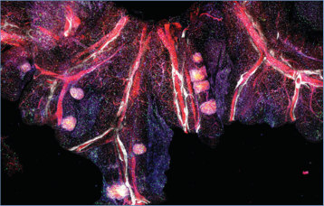
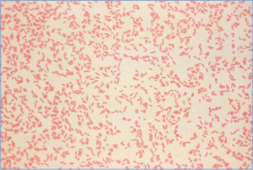
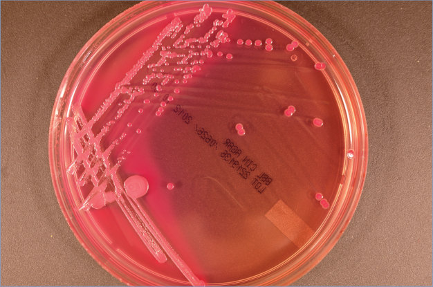

# 167. Yersinia enterocolitica and Yersinia pseudotuberculosis Infections (Enteritis and Other Illnesses)
> Reference: [source credits](../../SOURCE_CREDITS.md). Printed pp. 1091-1095; PDF pp. 1105-1109.
> Editorial study pathway: Bacterial infections (not a part division in the source).
[Flashcards](../flashcards/167_flashcards.md) · [Quiz](../mcqs/167_mcqs.md) · [Full extraction](../../raw/chapters/167.md)

## Five study pillars

### Etiology and transmission
The genus Yersinia consists of 17 species of gram-negative bacilli belonging to the family Yersiniaceae. Y enterocolitica, Y pseudotuberculosis, and Yersinia pestis are the 3 most recognized human pathogens; however, other Yersinia species also have been isolated from clinical specimens.
*Printed p. 1091 / PDF p. 1105*

### Clinical recognition
Yersinia enterocolitica causes several age-specific syndromes and a variety of other less commonly reported clinical illnesses. Infection with Y enterocolitica typically manifests as fever, diarrhea, and abdominal pain in children younger than 5 years; stool often contains leukocytes, blood, and mucus.
*Printed p. 1091 / PDF p. 1105*

### Diagnostic workup
Y enterocolitica and Y pseudotuberculosis can be recovered from stool, mesenteric lymph nodes, and blood. Stool cultures generally yield bacteria during the first 2 weeks of illness, regardless of the nature of gastrointestinal tract manifestations.
*Printed p. 1092 / PDF p. 1106*

### Treatment in the atlas
In immunocompetent hosts, yersiniosis is typically self-limited and does not require antibiotic treatment. Although a clinical benefit of antimicrobial therapy for immunocompetent patients with enterocolitis, pseudoappendicitis syndrome, or mesenteric adenitis has not been established, some clinicians consider treatment because it can decrease the duration of shedding of Yersinia organisms.
*Printed p. 1092 / PDF p. 1106*

### Prevention and infection control
In addition to standard precautions, contact precautions are indicated for diapered or incontinent children for the duration of diarrheal illness.
*Printed p. 1093 / PDF p. 1107*

## Clinical search tags
Fever, Lymphadenopathy, Conjunctivitis, Pharyngitis, Pneumonia, Diarrhea, Meningitis, Arthritis / bone pain, Abscess / soft tissue, Sepsis / shock, Immunocompromised host, Animal exposure

## Full text, original tables, and images

# 167. Yersinia enterocolitica and Yersinia pseudotuberculosis Infections (Enteritis and Other Illnesses)
> Private study reference ([source credits](../../SOURCE_CREDITS.md)). PDF pages 1105-1109; printed pages 1091-1095.

## PDF page 1105 | printed page 1091

(Enteritis and Other Illnesses)

### CLINICAL MANIFESTATIONS

Yersinia enterocolitica causes several age-specific syndromes and a variety of other less commonly reported clinical illnesses. Infection with Y enterocolitica typically manifests as fever, diarrhea, and abdominal pain in children younger than 5 years; stool often contains leukocytes, blood, and mucus. Symptoms of Y enterocolitica generally resolve within 7 days but diarrhea may persist for more than 2 weeks. Relapsing disease and, rarely, necrotizing enterocolitis and protein-losing enteropathy also have been described. In older children and adults, a pseudoappendicitis syndrome attributable to mesenteric lymphadenitis (fever, abdominal pain, tenderness in the right lower quadrant of the abdomen, and leukocytosis) is common. Bacteremia is the major complication of Y enterocolitica infection occurring mostly in children younger than 1 year and in older children with predisposing conditions, such as excessive iron storage (eg, deferoxamine use, sickle cell disease, and b-thalassemia) and immunosuppressive states. Extraintestinal manifestations of Y enterocolitica are uncommon but include pharyngitis, meningitis, osteomyelitis, pyomyositis, conjunctivitis, pneumonia, empyema, endocarditis, acute peritonitis, abscesses of the liver and spleen, urinary tract infection, and primary cutaneous infection. Postinfectious sequelae with Y enterocolitica infection include erythema nodosum, reactive arthritis, uveitis, and glomerulonephritis. These sequelae occur most often in older children and adults, particularly people with HLA-B27 antigen.

Major manifestations of Y pseudotuberculosis infection include fever, scarlatiniform rash, acute gastroenteritis, and abdominal symptoms. Acute pseudoappendiceal abdominal pain is common, resulting from ileocecal mesenteric adenitis or terminal ileitis. Other uncommon findings reported have been intestinal intussusception; erythema nodosum; septicemia, mainly among individuals with underlying conditions; acute renal failure with nephritis; and sterile pleural and joint

effusions. Y pseudotuberculosis infection may cause a severe systemic inflammatory disease called Far East scarlet-like fever, which has been reported sporadically and in outbreaks in Russia and Japan.

Although not common, recent case reports suggest that infection with Y enterocolitica and Y pseudotuberculosis may mimic or contribute to the pathogenesis of Kawasaki disease. In Japan, nearly 10% of children with a diagnosis of Kawasaki disease have serologic or culture evidence of Y pseudotuberculosis infection. These patients often require more than 1 dose of intravenous immunoglobulin and are more likely to develop cardiac sequelae than Kawasaki disease patients without Y pseudotuberculosis infection.

### ETIOLOGY

The genus Yersinia consists of 17 species of gram-negative bacilli belonging to the family Yersiniaceae. Y enterocolitica, Y pseudotuberculosis, and Yersinia pestis are the 3 most recognized human pathogens; however, other Yersinia species also have been isolated from clinical specimens. Isolates of Y enterocolitica involved in human infections belong to several serotypes (O:3, O:8, O:9, and O:5.27) and are divided into 3 groups according to their pathogenic potential: nonpathogenic biotype 1A, weakly pathogenic biotypes 2 through 5, and highly pathogenic biotype 1B. Strains from biotype 1A can induce infections only in immunocompromised individuals. Serotype O:8, from biotype 1B, is the most virulent and has been responsible for several food poisoning outbreaks in the United States. At present, carriage of pathogenic Y enterocolitica serotype O:3, found primarily in pigs, is the most frequent cause of yersiniosis in Europe and North America. The 3 Yersinia species have in common a tropism for lymphoid tissue and share factors that promote serum resistance, coordinate gene expression, and facilitate iron acquisition. Differences in virulence gene distribution exist among Yersinia species.

### EPIDEMIOLOGY

Y enterocolitica and Y pseudotuberculosis are isolated most often during the cool months of temperate climates because of favorable growth conditions at cooler temperatures (4°C to 43°C). The Foodborne Disease Active Surveillance

## PDF page 1106 | printed page 1092

Network (FoodNet) conducts active surveillance for infections caused by Yersinia. During 2019, FoodNet identified 681 Yersinia cases of infection (21% were hospitalized and 0.6% died), with an average incidence of 1.4 per 100,000 population, which represents a 153% increase in comparison to 2016–2018.1 This increased incidence likely resulted from increased use of culture-independent diagnostic tests that detect bacterial antigens and genes for Y enterocolitica. Yersinia incidence is highest in children younger than 5 years and in Black people; however, in recent years, a significant declining incidence among Black children has been observed. FoodNet data from 1996–2007 indicate that compared with Y enterocolitica infection, the average annual incidence of Y pseudotuberculosis infection is much lower (0.04 cases per 1 million population), occurs in older people (median age was 47 years), and is more severe and invasive (72% were hospitalized, 11% died, and two-thirds of isolates were recovered from blood).

The principal reservoir of Y enterocolitica is swine, although it can be isolated from a variety of domestic and wildlife animals; Y pseudotuberculosis has been isolated from ungulates (deer, elk, goats, sheep, cattle), rodents (rats, squirrels, beavers), rabbits, and many bird species. Infection with Y enterocolitica is reported to be transmitted by ingestion of contaminated food (raw or incompletely cooked pork products, tofu, and unpasteurized or inadequately pasteurized milk2), by contaminated surface or well water, by direct or indirect contact with animals, and rarely by transfusion with contaminated packed red blood cells and by person-to-person transmission. Cross-contamination has been documented to lead to infection in infants if their caregivers handle raw pork intestines (ie, chitterlings) and do not clean their hands or food preparation surfaces adequately before handling the infant or the infant’s toys, bottles, or pacifiers. Y pseudotuberculosis can follow exposure to well and mountain waters contaminated with animal feces. Household pets can be a source of infection for children.

The incubation period typically is 4 to 6 days, with a range of 1 to 14 days. Organisms typically are excreted for 2 to 3 weeks and up to 2 to 3 months in untreated cases. Prolonged asymptomatic carriage is possible.

### DIAGNOSTIC TESTS

Y enterocolitica and Y pseudotuberculosis can be recovered from stool, mesenteric lymph nodes, and blood. Stool cultures generally yield bacteria during the first 2 weeks of illness, regardless of the nature of gastrointestinal tract manifestations. Laboratory personnel should be notified when Yersinia infection is suspected so that stool can be appropriately stored (eg, Cary-Blair transport media) and cultured on suitable media (eg, blood, chocolate, and MacConkey agars incubated at 25°C to 35°C for 24 to 48 hours in ambient air). Because of relatively slow growth conditions of Yersinia, isolation from nonsterile sources (eg, stool) is recommended using selective media.

DNA-based gastrointestinal syndrome panels are commercially available but typically target only Y enterocolitica and may cross-react with other Yersinia species. In 2018, 68% of yersiniosis cases reported to FoodNet were diagnosed using such culture-independent panels. Reliable species identification using matrix-assisted laser desorption/ ionization–time-of-flight mass spectrometry, DNA-based methods, biotyping, and serotyping of pathogenic strains isolated from clinical, food, and environmental samples are available through public health reference laboratories.

Infection also can be confirmed by demonstrating increases in serum antibody titer after infection, but these tests generally are available only in reference or research laboratories. Cross-reactions of these antibodies with Brucella, Vibrio, Salmonella, and Rickettsia organisms and Escherichia coli can lead to false-positive Y enterocolitica and Y pseudotuberculosis titers. In patients with thyroid disease, persistently increased Y enterocolitica antibody titers can result from antigenic similarity of the organism with antigens of the thyroid epithelial cell membrane. Characteristic ultrasonographic features demonstrating edema of the wall of the terminal ileum and cecum with normal appendix help to distinguish pseudoappendicitis from appendicitis and can help avoid exploratory surgery.

### TREATMENT

In immunocompetent hosts, yersiniosis is typically self-limited and does not require antibiotic treatment. Although a clinical benefit of antimicrobial therapy for immunocompetent patients with enterocolitis,

## PDF page 1107 | printed page 1093

pseudoappendicitis syndrome, or mesenteric adenitis has not been established, some clinicians consider treatment because it can decrease the duration of shedding of Yersinia organisms. Antibiotic treatment is recommended for neonates, immunocompromised hosts, and all patients with severe manifestations like septicemia or extraintestinal disease. Parenteral therapy with a third-generation cephalosporin is appropriate in these situations, and evaluation of cerebrospinal fluid should be performed for infected neonates. In addition to third-generation cephalosporins, trimethoprim-sulfamethoxazole, aminoglycosides, fluoroquinolones, chloramphenicol, tetracycline, and doxycycline may be used. Y enterocolitica isolates are usually resistant to first-generation cephalosporins and most penicillins. Antibiotic therapy has no beneficial effect on postinfectious syndromes.

### INFECTION PREVENTION AND CONTROL MEASURES IN HEALTH CARE SETTINGS

In addition to standard precautions, contact precautions are indicated for diapered or incontinent children for the duration of diarrheal illness.

### CONTROL MEASURES

Ingestion of uncooked or undercooked meat (especially pork), unpasteurized milk,3 or contaminated water should be avoided. People who

Image 167.1 Mesenteric adipose tissue after Yersinia pseudotuberculosis infection. Courtesy of National Institute of Allergy and Infectious Diseases.

handle raw meat products should minimize contact with young children and their possessions while handling raw products. Meticulous hand hygiene and proper sanitization of food preparation surfaces should be practiced before and after handling and preparation of uncooked products. No vaccines against Y enterocolitica and Y pseudotuberculosis are available, although several candidates are under evaluation.

Public Health Reporting

Yersinia infections are not nationally notifiable but are reportable in many states (a directory of state and territorial, city and county, and tribal health departments can be found at www.cdc.gov/ publichealthgateway/healthdirectories/ index.html).

1 Tack DM, Ray L, Griffin PM, et al. Preliminary incidence and trends of infections with pathogens transmitted commonly through food - Foodborne Diseases Active Surveillance Network, 10 U.S. sites, 2016-2019. MMWR Morb Mortal Wkly Rep. 2020;69(17):509–514 2 American Academy of Pediatrics, Committee on Infectious Diseases, Committee on Nutrition. Consumption of raw or unpasteurized milk and milk products by pregnant women and children. Pediatrics. 2014;133(1):175–179 (Reaffirmed November 2019) 3 American Academy of Pediatrics, Committee on Infectious Diseases and Committee on Nutrition. Consumption of raw or unpasteurized milk and milk products by pregnant women and children. Pediatrics. 2014;133(1):175–179 (Reaffirmed November 2019)

Image 167.2 Fat associated with lymphoid clusters in mesenteric adipose tissue 4 days after Yersinia pseudotuberculosis infection. Courtesy of National Institute of Allergy and Infectious Diseases.

## PDF page 1108 | printed page 1094

Image 167.3 Multiple erythema nodosum lesions over both lower extremities of a 10-year-old girl following a Yersinia enterocolitica infection. This immunoreactive complication may also occur in association with Campylobacter jejuni infections, tuberculosis, leprosy, coccidioidomycosis, histoplasmosis, and other infectious diseases. Courtesy of George Nankervis, MD.

Image 167.4 A photomicrograph of Yersinia enterocolitica by use of Gram stain technique. Courtesy of Centers for Disease Control and Prevention.

## PDF page 1109 | printed page 1095

Image 167.5 A photomicrograph of Yersinia enterocolitica by use of flagella-staining technique. Symptoms of yersiniosis are fever, abdominal pain, and diarrhea (often bloody), and Y enterocolitica is the cause of most Yersinia-related illnesses in the United States (mostly in children). Courtesy of Centers for Disease Control and Prevention.

Image 167.6 Yersinia kristensenii on cefsulodin-irgasan-novobiocin agar. Colonies appear light rose in color with a darker, reddish center. Courtesy of Julia Rosebush, DO; Robert Jerris, PhD; and Theresa Stanley, M(ASCP).

